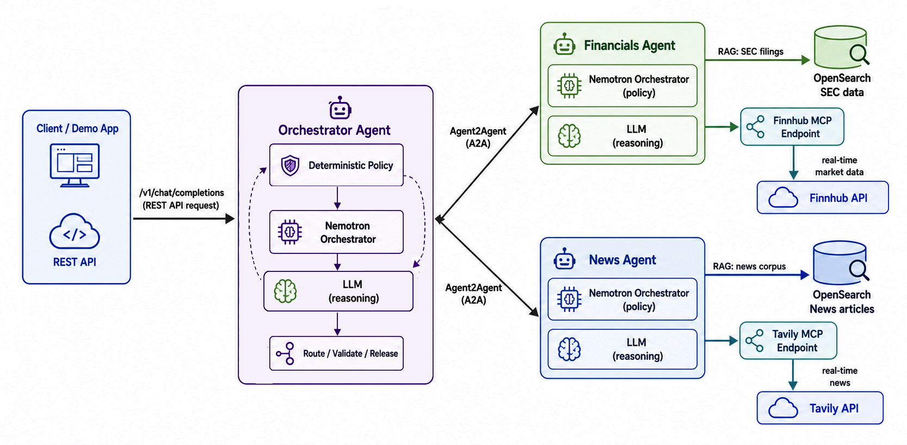

# 1. Introduction to the Solution and Prerequisites

This workshop builds a technology-company research assistant with three responsibilities: a **News Expert** finds company developments, a **Financial Expert** examines filings and market information, and an **Orchestrator Expert** delegates work and checks whether the answer is complete. A combined question can connect a company's technology activity with its reported financial results.

This is a **Mixture of Experts at the application level**: independently governed agents own different kinds of questions. The Orchestrator's **reinforcement loop** is a bounded feedback loop-plan, delegate, evaluate, and correct or stop.

In this task, you prepare the environment that supports those experts. You will start only the Python development/jump container. The news and SEC-filing corpora, including their document embeddings, are already populated on an OpenSearch instance hosted by Instaclustr. You will configure external inference and verify the workspace before running the experts. No local OpenSearch or Dashboards service is required.



The diagram shows the complete solution. Its Nemotron Orchestrator and LLM Reasoning boxes represent separate **roles**. With this task's default OpenAI configuration, both roles use `gpt-5.4`. The optional Nebius configuration uses different models for planning and generation.

## What each component does

| Component | Function in the lab | What crosses its boundary |
|---|---|---|
| Python workspace (`lab`) | Provides Python 3.12, the supplied dependencies, Git, Make, and the lab code and configuration. Later, you will start each application process in a separate terminal inside this container. | Source files, locally computed query embeddings, API requests, retrieved evidence, and responses. |
| OpenSearch hosted by Instaclustr | Stores the pre-populated news and SEC-filing chunks and their document embeddings. Later tasks inspect and retrieve this evidence without repeating ingestion. | Document chunks, metadata, stored embedding vectors, and retrieval queries/results. |
| External model provider | Runs the planning/verification and answer-generation models. No local text-generation model server is started. | Prompts, selected evidence, and model responses over HTTPS. |

Later, **MCP** connects each specialist to bounded tools and data. **A2A** connects the Orchestrator to those specialists. The Orchestrator only manages the coordination between the News Expert and Financials Expert and enforces the AI governance rules and policy within this solution. 

## Choose your lab environment

**Default: Podman and Compose.** Follow the instructions below on Linux, Windows, or macOS, including Apple Silicon. These are Linux containers; Podman uses a Linux virtual machine on Windows and macOS. See the [Podman machine documentation](https://docs.podman.io/en/latest/markdown/podman-machine-init.1.html).

**Alternative: host Python environment.** Follow [Native Python Setup](../references/NATIVE_SETUP.md) to install the workspace dependencies on your machine instead of running the `lab` container. That guide retains the native OpenSearch and Dashboards setup and requires `make ingest` for each agent. Its local-database workflow is separate from the hosted-corpus path below.

### Before you begin

Install [Podman Desktop](https://podman-desktop.io/docs/installation). Enable a Compose provider using the [Podman Desktop Compose setup](https://podman-desktop.io/docs/compose/setting-up-compose). `podman compose` delegates to an external provider such as Docker Compose or `podman-compose`; installing Podman alone does not always install that provider. [Reference](https://docs.podman.io/en/latest/markdown/podman-compose.1.html)

You also need an [OpenAI API key](https://platform.openai.com/) (or an OpenAI-compatible service, such as [Nebius TokenFactory](https://tokenfactory.nebius.com/)), a [FinnHub API key](https://finnhub.io/), and a [Tavily API key](https://www.tavily.com/), for the optional configuration, with access to the chosen models and available API quota. Model validation sends small paid requests. Internet access is needed for the development image, the hosted OpenSearch instance, model API calls, and the first embedding-model download. Tavily and Finnhub keys are **RERQUIRED** for the setup of your `.env` configuration file.

For planning purposes, reserve roughly **4 CPU cores, 8 GiB of memory, and 30 GiB of free disk space** for the container environment. These are suggested workshop allocations, not measured minimum requirements. A machine with 16 GiB of total RAM should be sufficient for the operating system and all processes within this lab.

Check the tools in a **host terminal**:

```bash
podman --version
podman compose version
podman info
```

**Expected:** Podman reports its version, a Compose provider responds, and `podman info` reaches the container engine. A provider warning naming the external Compose executable is not itself a failure. A "provider not found" error means Compose setup is incomplete.

### Windows and macOS: start the Podman machine

First inspect existing machines:

```bash
podman machine list
```

When no machine exists, initialize one and start it:

```bash
podman machine init --cpus 4 --memory 8192 --disk-size 64
podman machine start
```

When a machine already exists, start that machine rather than initializing another. Review its memory allocation in Podman Desktop. If it is already running, continue. The commands above also work in PowerShell.

## Step 1: open the task directory

Open the repository or extracted workshop distribution on your **host**. From its root, run:

```bash
cd scripts/introduction
```

Keep this host terminal in that directory for all `podman compose` commands. It contains the supplied [Compose definition](../scripts/introduction/docker-compose.yaml) and environment templates; the development image supplies the Python workspace and its runtime tooling. You do not need to write a Dockerfile or install Python on the host for the default path.

The supplied development image provides the workshop code and configuration in `/workspace/agentic-rag`. This is a **separate checkout from the host directory**. Editing a host source file does not automatically change the container's copy. The supplied Compose definition does not mount persistent workspace storage; preserve local changes and audit files before removing or replacing the container.

## Step 2: choose your external inference provider

Choose **one** of the following configurations. The `.env` file stays on the host. Compose reads its values and explicitly passes the supported variables to the `lab` container when creating it. Every later `exec` session inherits those variables; API keys are not baked into the image.

Shell environment variables take precedence over values in `.env`. Use a fresh host terminal or unset old provider exports when switching profiles. Do not paste the output of `podman compose config`, `env`, or `podman inspect` into a public issue: those commands can reveal credentials. [Compose environment precedence](https://docs.docker.com/compose/how-tos/environment-variables/variable-interpolation/)

### Option A: OpenAI - Default

**Bash or zsh:**

```bash
cp .env.openai.example .env
```

Open `.env` in your editor and replace `<YOUR_OPENAI_API_KEY>`, `<YOUR_TAVILY_API_KEY>`, and `<YOUR_FUNNHUB_API_KEY>` values. The essential configuration is:

```dotenv
USE_EXTERNAL_AI=true
USE_EXTERNAL_OPENAI=true
OPENAI_API_KEY=<YOUR_OPENAI_API_KEY>
OPENAI_MODEL=gpt-5.4

TAVILY_API_KEY=<YOUR_TAVILY_API_KEY>
FINNHUB_API_KEY=<YOUR_FUNNHUB_API_KEY>
```

Both the planning/verification role and the generation role will use OpenAI's API at `https://api.openai.com/v1`. GPT-5.4 exposes Chat Completions, the interface used by the supplied application. [Model reference](https://developers.openai.com/api/docs/models/gpt-5.4)

The template also sets these **output ceilings**:

```dotenv
EXTERNAL_ORCH_MAX_TOKENS=127000
EXTERNAL_LLM_MAX_TOKENS=127000
```

These are workshop limits, not context-window sizes. A larger model context window does not mean the same number of output tokens can be requested. [Model limits](https://developers.openai.com/api/docs/models/gpt-5.4)

The equivalent Bash/zsh exports may be used instead of editing `.env`:

```bash
export USE_EXTERNAL_AI=true
export USE_EXTERNAL_OPENAI=true
export OPENAI_API_KEY="<YOUR OPENAI API KEY>"
export OPENAI_MODEL="gpt-5.4"
export EXTERNAL_ORCH_MAX_TOKENS="127000"
export EXTERNAL_LLM_MAX_TOKENS="127000"

export TAVILY_API_KEY=<YOUR_TAVILY_API_KEY>
export FINNHUB_API_KEY=<YOUR_FUNNHUB_API_KEY>
```

Use these only in your private terminal and avoid exposing keys through screen sharing or saved shell history. The `.env` workflow works without translating `export` commands into PowerShell.

### Option B: Nebius Token Factory

Copy `.env.nebius.example` to `.env` instead and replace **both** key placeholders. You may use the same Nebius key for both roles.

```dotenv
USE_EXTERNAL_AI=true
export USE_EXTERNAL_OPENAI=false

EXTERNAL_ORCH_URL=https://api.tokenfactory.nebius.com/v1/
EXTERNAL_ORCH_API_KEY=<YOUR_NEBIUS_API_KEY>
EXTERNAL_ORCH_MODEL=nvidia/NVIDIA-Nemotron-3-Nano-30B-A3B
EXTERNAL_ORCH_MAX_TOKENS=127000

EXTERNAL_LLM_URL=https://api.tokenfactory.nebius.com/v1/
EXTERNAL_LLM_API_KEY=<YOUR_NEBIUS_API_KEY>
EXTERNAL_LLM_MODEL=Qwen/Qwen3-30B-A3B-Instruct-2507
EXTERNAL_LLM_MAX_TOKENS=127000
```

The example preserves the requested Nebius model names and ceilings; confirm current account access and endpoint limits during validation. `127000` is not a promise that either endpoint accepts that output budget for every input.

The equivalent Bash/zsh configuration is:

```bash
export USE_EXTERNAL_AI=true
export USE_EXTERNAL_OPENAI=false

export EXTERNAL_ORCH_URL="https://api.tokenfactory.nebius.com/v1/"
export EXTERNAL_ORCH_API_KEY="<YOUR NEBIUS API KEY>"
export EXTERNAL_ORCH_MODEL="nvidia/NVIDIA-Nemotron-3-Nano-30B-A3B"
export EXTERNAL_ORCH_MAX_TOKENS="127000"
export EXTERNAL_LLM_URL="https://api.tokenfactory.nebius.com/v1/"
export EXTERNAL_LLM_API_KEY="<YOUR NEBIUS API KEY>"
export EXTERNAL_LLM_MODEL="Qwen/Qwen3-30B-A3B-Instruct-2507"
export EXTERNAL_LLM_MAX_TOKENS="127000"

export TAVILY_API_KEY=<YOUR_TAVILY_API_KEY>
export FINNHUB_API_KEY=<YOUR_FUNNHUB_API_KEY>
```

Nebius documents using the OpenAI client with this API base URL. The API key and exact model identifier belong to the provider, not to the OpenAI SDK. [Nebius quickstart](https://docs.tokenfactory.nebius.com/quickstart)

### Other OpenAI-compatible APIs

The two configurations above are the workshop author's reported tested providers. The following services also document OpenAI-compatible interfaces; they are **alternatives to evaluate, not additional verified lab configurations**.

| Provider | API base URL | Provider documentation |
|---|---|---|
| Groq | `https://api.groq.com/openai/v1` | [OpenAI compatibility](https://console.groq.com/docs/openai) |
| Together AI | `https://api.together.ai/v1` | [OpenAI compatibility](https://docs.together.ai/docs/inference/openai-compatibility) |
| Fireworks AI | `https://api.fireworks.ai/inference/v1` | [OpenAI compatibility](https://docs.fireworks.ai/tools-sdks/openai-compatibility) |
| OpenRouter | `https://openrouter.ai/api/v1` | [Quickstart](https://openrouter.ai/docs/quickstart) |

For a third-party service, use `USE_EXTERNAL_AI=true` and set the URL, key, model, and output ceiling for **both** `EXTERNAL_ORCH_*` and `EXTERNAL_LLM_*`. Supply a base URL, not a URL ending in `/chat/completions`.

Compatibility is not identical behavior. Models differ in sampling parameters, token limits, structured output, reasoning behavior, and access controls. The archived clients send `max_tokens`, `temperature`, and-in several calls-`top_p`. OpenAI documents `max_tokens` as deprecated in favor of `max_completion_tokens`. The validator intentionally tests the parameters that the source actually sends; it does not hide a mismatch by using a different request shape. [API parameter reference](https://developers.openai.com/api/reference/resources/chat/subresources/completions/methods/create)

## Step 3: start the development container

From the **host task directory**, start the `lab` service defined in the supplied [Compose file](../scripts/introduction/docker-compose.yaml):

```bash
podman compose up -d lab
podman compose ps
```

**Expected:** the `lab` service is running with container name `agentic-lab`. This Compose definition contains only the development container. Do not expect local `opensearch` or `dashboards` services.

The first run downloads the supplied development image when it is not already available. The image contains the lab code, configuration, Python environment, and dependencies. Starting the container does not prove that its external dependencies are reachable; validate the workspace in Step 5 and inspect the hosted corpora in Tasks 2 and 3.

Inspect a failing workspace without printing environment variables:

```bash
podman compose logs --tail 80 lab
```

**Expected:** recent workspace logs, or no lines if the container has not emitted any. Use any reported startup error to identify the failed component before continuing.

### Understand the network

| Destination | From your host | From inside `lab` |
|---|---|---|
| OpenSearch hosted by Instaclustr | Remote service; no local OpenSearch port is published. | The hosted endpoint configured in the supplied workspace. |
| Runtime readiness | Not published to the host | `http://lab:8088/healthz` |
| Future Orchestrator API | Not published to the host | `http://127.0.0.1:10000` |
| External inference | Not used by the host in this path | Your configured HTTPS API base URL |

Inside a container, `localhost` refers to that container, not the hosted OpenSearch instance. Later, the specialists, their MCP servers, the Orchestrator, and the client all run inside the **same** `lab` container, so their existing loopback addresses remain valid. Run their probes inside that workspace. No Orchestrator listens on port `10000` until its task starts the process.

## Step 4: enter the Python workspace

From the **host task directory**:

```bash
podman compose exec lab bash
```

Now run these commands **inside the container**:

```bash
pwd
python --version
python -m pip check
ls 2-news-agent 3-financials-agent 4-orchestrator-agent
```

**Expected:** the working directory is `/workspace/agentic-rag`, Python reports `3.12.x`, pip reports no broken requirements, and all three application directories exist.

To open another session, use a **new host terminal**, return to this task directory, and repeat:

```bash
podman compose exec lab bash
```

Each command opens a shell in the **same container and repository**, not a new container. This is how later tasks keep a server running in one terminal while a client runs in another. Shell-local exports do not propagate to sibling shells, so configure provider values through Compose before opening those sessions. Leaving a shell with `exit` does not stop the workspace container. Do not close a future service's foreground terminal while that service is still needed.

## Step 5: validate the environment

Run **inside the container**:

```bash
python /opt/lab/validate_setup.py
```

**Expected:** exit `0` and `READY FOR TASK 2` after the required checks pass. Review warnings and resolve failures before continuing. The exact check list and output come from the validator supplied in the development image, not from a validation script in this source archive.

The validator checks Python and the requested package versions, imports the ML dependencies, checks the three agent configurations in separate Python processes, and verifies governance remains enabled. For the default workshop path, the environment is one local workspace plus hosted OpenSearch, not a local database/Dashboards stack. The Step 2 corpus-inspection probes in Tasks 2 and 3 use each agent's configured OpenSearch client to inspect counts, mappings, and coverage without creating or changing indices. Complete those checks before initializing retrieval against the prepared corpus.

If a validator still requires local OpenSearch or Dashboards, treat that as a workspace-image/runtime mismatch and follow the [setup troubleshooting](../troubleshooting/introduction.md). Do not start extra database containers or modify the hosted corpus to satisfy an outdated check.

For inference, it captures the real model-call parameters from the repository's clients without sending their original prompts. It then submits a short readiness prompt using each distinct request profile. Both ORCH and LLM roles are covered, including different parameters used by the specialists and Orchestrator. **These are paid model calls.** By default, each probe has an output/reasoning ceiling of 512 tokens and no automatic network retries. Identical request profiles are tested once.

An illustrative successful run ends with:

```text
[PASS] Python: 3.12.x on Linux/...
[PASS] Dependencies: ...
[PASS] User container: ...
[PASS] Model: ...
[WARN] Full output ceilings: ...
[SKIP] Embedding model download: Optional. ...
[SKIP] Later-task services: ...

READY FOR TASK 2
```

This is example output, not a promise that an unconfigured provider account will pass. A warning about full output ceilings means the small probes did not certify a provider's larger configured token budget. Optional embedding checks and later-task service checks are skipped intentionally.

| Exit code | Meaning | Next action |
|---|---|---|
| `0` | Required Task 1 checks passed. | Continue, after reviewing warnings. |
| `1` | At least one required check failed. | Resolve the reported failure and rerun. |
| `2` | Infrastructure checks completed, but model checks were deliberately skipped. | Run without `--skip-models` before continuing. |

For an infrastructure-only check without model API charges:

```bash
python /opt/lab/validate_setup.py --skip-models
```

**Expected:** the infrastructure checks run without model API probes. Exit `2` indicates that model checks were deliberately skipped; it is not readiness to continue to the agent tasks.

To also download/cache the embedding model and validate a finite, normalized vector using the repository's own embedding wrapper:

```bash
python /opt/lab/validate_setup.py --check-embeddings
```

**Expected:** the embedding check loads the configured query model and verifies a finite, normalized vector, in addition to the regular checks. This does not ingest documents or rebuild the hosted corpus.

The first embedding check can take several minutes and requires disk space for the weights. Later checks reuse the cache. This option is useful before Task 2; a normal successful run verifies package imports but does not claim that model weights have already been downloaded.


[Troubleshoot the failed check, not a different layer](../troubleshooting/introduction.md)

## Pause or stop the lab

Exit container shells, then run these commands from the **host task directory**. These commands affect the local development container, not the corpora hosted by Instaclustr.

To stop the workspace while keeping the container's writable layer:

```bash
podman compose stop lab
```

**Expected:** `lab` stops. Any foreground application processes stop with it.

To resume:

```bash
podman compose start lab
```

**Expected:** the existing workspace container starts. Re-enter it and restart the agent/MCP processes needed for the later tasks.

To remove the local container and Compose network, preserve any local changes and audit files first:

```bash
podman compose down
```

**Expected:** the local workspace container is removed; the hosted corpora are unaffected. The supplied Compose definition does not mount persistent workspace or audit storage.

Return to Step 3 to create the development container again.

## What you learned and what comes next

You now have a Python workspace configured to access the hosted corpora, plus separate configuration for planning and generation. The next tasks verify each pre-populated corpus before retrieval; neither requires local database startup or ingestion.

A successful Task 1 run means the infrastructure and model requests passed.

Continue to [Task 2: News Expert](news-agent.md), or return to the [workshop task index](../README.md#tasks). 
