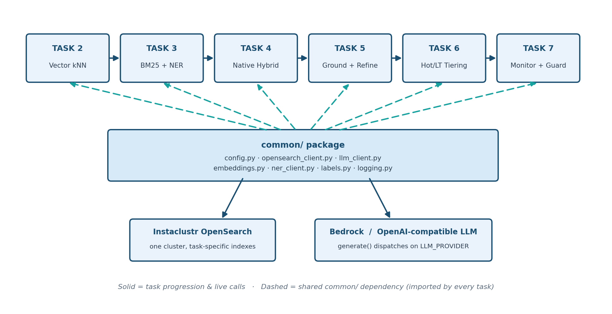

# RAG Developer Journey — Recipe & Dietary Safety Assistant

A hands-on, seven-task walkthrough of RAG (retrieval-augmented generation)
architectures: a workspace setup, five retrieval architectures that each fix a
concrete, verified failure of the one before it, and a production-hardening pass. Every task is runnable end-to-end against a real Instaclustr
OpenSearch cluster and an LLM (Amazon Bedrock, or any OpenAI-compatible
endpoint if you don't have AWS access), on a real (if small and curated)
dataset — not a slide deck.

The running theme is a **"Recipe & Dietary Safety Assistant"**: a system
that answers questions about recipes and their allergen/dietary
information. That theme is deliberately chosen because retrieval mistakes
in it are easy to make *concrete and checkable* — "does this recipe
contain sulfites?" has a factual answer, so every task's failure mode and
fix can be demonstrated with a real, verified example rather than an
abstract claim. See [`SAFETY_AND_SCOPE.md`](references/SAFETY_AND_SCOPE.md) for what
that does and does not mean about this being production dietary-safety
advice (it is not).

## Why this journey, and why should you care
If you've shipped a RAG system to production, you've probably run into one
of these without realizing it had a name:
- **Wrong, but confident.** You ask "does this recipe have peanuts?" and
  the system finds a *different* recipe that sounds almost the same, and
  answers as if it were the right one — because it matched on wording, not
  on facts.
- **The fix needs its own babysitter.** You add exact keyword matching (so
  "peanuts" only matches recipes that actually say "peanuts") — but now
  you're running a second, separate service just to spot which words
  matter, and it has to stay running alongside everything else.
- **Combining two guesses isn't a guarantee.** You blend keyword matching
  and similarity search into one score, hoping to get the best of both —
  but averaging two guesses still isn't a promise. A recipe that says
  "contains peanuts" can still outscore one that doesn't, and slip through.
- **You didn't know some data was safety-critical.** You label older or
  rarely-used data as low priority, so it is searched only as a fallback,
  to save cost or time — without checking whether any of it was allergen or
  safety information, which can then arrive late or get missed.
- **"Why did it say that?" — and you have nothing.** The system gives a
  wrong or risky answer, someone asks what it looked at and why, and
  there's no record of what was searched, what was found, or why it picked
  that answer.
Tasks 2 to 6 reproduce these in order, on a real dataset,
against a real OpenSearch cluster and a real LLM — not as a slide claim,
but as something you run and watch break, then run again and watch get
fixed. By the end, you have a working mental model *and* working code for
the difference between "a RAG demo" and "a RAG system you can actually
trust and defend."

**Who this is for:** developers and engineers building, reviewing, or
inheriting a RAG system who want to recognize these failure modes by name
before they show up in production, not after.

## Ways to Experience This Lab

| This Lab | Local Laptop | CLI | Notebook | Videos |
| --- | --- | --- | --- | --- |
| **RAG Developer Journey** | [Getting Started](#getting-started) | _Coming soon:_ Codex Claude Cursor | _Coming soon_ | _Coming soon_ |

## Tasks

These tasks are cumulative in setup and independent in content: Task 1 prepares the shared workspace, and Tasks 2–6 each isolate and fix a single retrieval failure of the task before it (Task 2 is the baseline that shows the failure), and Task 7 hardens the result for production. Tasks 2–7 run on the same "Recipe & Dietary Safety Assistant" dataset. Each task page has a specific **teaching goal**, numbered steps with expected results, and a completion checkpoint.

| Task | Description | Hands-on Lab |
| --- | --- | --- |
| **1. Prepare the workspace** | Create the Python environment, install the shared dependencies, and configure OpenSearch and your LLM provider in one `.env`, then run the setup check. | [Start](tasks/setup-environment.md) |
| **2. Baseline Vector RAG** | Plain kNN vector search. Shows vector search retrieving similar-sounding recipes instead of the right one. | [Start](tasks/baseline-vector-rag.md) |
| **3. Baseline BM25 RAG** | BM25 keyword matching, plus a small boost from a local NER (entity-tagging) service. Fixes vector search confusing semantically-similar-but-factually-different questions: keyword matching on the recipe name retrieves both same-named recipes, and the NER boost only adds a nudge. | [Start](tasks/baseline-bm25-rag.md) |
| **4. Hybrid RAG (Native)** | Server-side BM25+kNN fusion via a native OpenSearch search pipeline, one index. Retrieves both same-named recipes with no separate NER microservice. | [Start](tasks/hybrid-rag-native.md) |
| **5. Hybrid RAG (NER + Rerank)** | Two-phase ground (BM25, hard filters) → refine (vector rerank), using an external NER service. Fixes similarity *scores* being unable to guarantee a hard exclusion like "no sulfites". | [Start](tasks/hybrid-rag-ner-rerank.md) |
| **6. Governance Tiering** | Safety-driven hot/long-term (LT) tiering, escalation, audit log, citation-tagging. Fixes treating all data as equally reachable regardless of safety criticality, and having no record of *why* a query reached what it reached. | [Start](tasks/governance-tiering.md) |
| **7. Operationalize Production** | Governance-signal monitoring, audit-log retention, policy change control. Fixes nobody watching the audit trail Governance Tiering introduced, unbounded audit growth, and undocumented threshold drift. | [Start](tasks/operationalize-production.md) |

**Which approach do I need?** The tasks are a teaching sequence, not a ranking. To see what each retrieval approach adds, what it costs and what it cannot do, read [`CHOOSING_RETRIEVAL.md`](concepts/CHOOSING_RETRIEVAL.md).

**What the retriever owns, and what the model does.** The retrieval steps in this lab decide which recipes, and which caution fields, reach the model. With the filters in Task 5, what is excluded stays excluded. The model then writes an answer from that text, and nothing in the retriever makes the wording correct. Task 6 checks that the answer's citations match what was retrieved and records the result; it does not block an answer.

**A demonstration, not a benchmark.** The tasks use 260 recipes, one embedding model and a few questions, so they show *how* each approach fails and what fixes it, not *how often*. Scores and answer wording vary between runs.

**Concepts.** These pages explain the choices behind the tasks, with live probes on this lab's data: [BM25 versus kNN](concepts/BM25_VS_KNN.md), [embedding models](concepts/EMBEDDING_MODELS.md), [chunking](concepts/CHUNKING.md), [named-entity recognition](concepts/NER_IN_RETRIEVAL.md) and [choosing a retrieval approach](concepts/CHOOSING_RETRIEVAL.md). Why each piece of infrastructure was chosen is in [`INFRASTRUCTURE_CHOICES.md`](concepts/INFRASTRUCTURE_CHOICES.md).

The system contract, interfaces, repository layout, shared `support/common/` design, configuration, index naming,
per-task limits, evidence and audit, and verification notes:
[`architecture.md`](architecture.md). Production hardening checklist
(automated + manual): [`OPERATIONAL_CHECKLIST.md`](references/OPERATIONAL_CHECKLIST.md).
Setup problems: [`troubleshooting/setup-environment.md`](troubleshooting/setup-environment.md); each task also has its own page under `troubleshooting/`.

## Getting Started

This lab is the `rag-retrieval/` folder of the [instaclustr/labs](https://github.com/instaclustr/labs) repository; Task 1 shows how to clone it. You need Python 3.10 or newer; Python 3.12 is the default recommended version. The only accounts you need are an [Instaclustr](https://www.instaclustr.com/) OpenSearch cluster and one LLM provider, either AWS Bedrock with model access enabled or an OpenAI-compatible API key. Task 1 walks through the environment, the dependencies, and the one `.env` file every task shares, and ends with a configuration check.

Every task runs from its own directory under `scripts/`, with `python -m src.<module>` or the matching `make` target. Some tasks need the local NER service from Baseline BM25 RAG running in a second terminal. Each task page says when.

[Start Task 1: Prepare the workspace](tasks/setup-environment.md)

## Learn with Codex, Claude Code, or Cursor

Coming Soon

## Jupyter Notebook

Coming Soon

## Videos

Coming Soon
