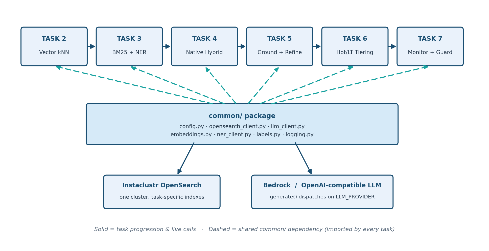

# Architecture: Recipe & Dietary Safety Assistant

## 1. Purpose and how to use this reference

This describes the pieces every task shares (`support/common/`), how they connect
to the two pieces of real infrastructure (Instaclustr OpenSearch, AWS
Bedrock), the index-naming scheme that lets every task share one
cluster without colliding, and the contracts and known limits of each task's
retrieval design. For what each *task* does step by step, see the
[top-level README](README.md)'s task table and the matching
page in `tasks/`; this page does not repeat those walkthroughs.

Use this page as a source-navigation reference: read the system contract first, then use the task-to-source map to open only the files relevant to the task you are changing. Why each piece of infrastructure was chosen is explained separately in [Infrastructure choices, and why](concepts/INFRASTRUCTURE_CHOICES.md).

**Source-of-truth order:** executable code under `scripts/` and `support/common/`, then the per-task Makefiles and `support/requirements.txt`, then this document and the task pages. When a comment or page disagrees with a function body, follow the function body.

**What this lab is not.** "Tier" (`hot` / `lt`) is a governance label stored in a `tier` field; it is not OpenSearch hot/warm storage and nothing moves between storage classes. The recipe answers are not dietary or allergen advice ([Safety & Scope](references/SAFETY_AND_SCOPE.md)). Nothing is trained or tuned: the embedding model, the spaCy model and the LLM are used as downloaded or hosted, and the only "tuning" is the retrieval thresholds in [Configuration](#6-configuration-and-deployment-boundaries).

Paths are relative to the lab root, the directory containing `README.md`, `scripts/`, and `support/`. Each `scripts/<task-id>/src/common` entry is a symbolic link to the single shared `support/common/` package, so a change there applies to every task.

### Repository layout

```
tasks/                                Task pages: setup-environment.md, then one per task
concepts/                             Concept pages: BM25 vs kNN, embeddings, chunking, NER, choosing, infrastructure
references/                           Per-task source maps, safety & scope, operational checklist
troubleshooting/                      One page per task
images/                               Overview + per-task architecture diagrams
architecture.md                       This page: contracts, interfaces, per-task limits, verification
scripts/                              One directory per task (see below)
support/
  common/                             Shared config, LLM (Bedrock/OpenAI)/OpenSearch/NER clients, embeddings, logging
  requirements.txt                    Single shared dependency set for every task
  .env.example                        Every task's configuration, in one place
  recipes/recipes_sample.json         The curated 260-recipe sample every ingest script reads
  recipes/recipes_synthetic.json      Synthetic introduction, method and notes for each recipe (chunked with the sample)
  generate_synthetic_recipes.py       Regenerates that synthetic text with Bedrock (optional; not needed to run a task)
  validate_setup.py                   Workspace check run in Task 1
```

Each task directory under `scripts/` follows the same shape: a `Makefile` and a `src/` package.

```
scripts/baseline-vector-rag/       Baseline Vector RAG
scripts/baseline-bm25-rag/         Baseline BM25 RAG (also holds ner_service.py)
scripts/hybrid-rag-native/         Hybrid RAG (Native)
scripts/hybrid-rag-ner-rerank/     Hybrid RAG (NER + Rerank)
scripts/governance-tiering/        Governance Tiering
scripts/operationalize-production/ Operationalize Production
```

Inside each `src/` are `ingest.py`, `query.py` (plus `ner_service.py` for Baseline BM25 RAG), `validate.py`, an `__init__.py`, and a `common` link to `support/common/`. Modules use relative imports, so they run as `python -m src.<module>` from the task directory. The recipe data is not under `src/`; every `ingest.py` reads the one shared `support/recipes/recipes_sample.json`. Operationalize Production has no `ingest.py` or `query.py`; it has `monitor.py`, `policy_registry.py`, `policy_history.json`, and `hardening/` instead, and its task page explains why.

## 2. System contract

| Concern | Architectural rule |
|---|---|
| Shared plumbing | Every task imports connection, configuration, model, and logging code from `support/common/` through its `src/common` link. Tasks define retrieval logic only. |
| Configuration | One `.env`, created from `support/.env.example`, is loaded by `load_settings()`. `require_configured()` stops a task before it connects if required values are missing. Details and precedence: [section 6](#6-configuration-and-deployment-boundaries). |
| Isolation between tasks | Tasks share one OpenSearch cluster but write to separate indexes (see [Index naming](#7-index-naming-one-cluster-many-indexes)). Hybrid RAG (NER + Rerank) and Governance Tiering deliberately share `recipes-bm25` / `recipes-vector`. |
| LLM access | Tasks call only `generate()`. The provider (`bedrock` or `openai`) is selected by `LLM_PROVIDER`; no task depends on either provider's wire format. |
| NER | Baseline BM25 RAG, Hybrid RAG (NER + Rerank) and Governance Tiering call the local `ner_service.py` through `NERClient`. |
| Hard constraints | From Hybrid RAG (NER + Rerank), `--exclude` / `--require` become OpenSearch `must_not` / `filter` clauses, which are boolean and not scored. |
| Governance record | From Governance Tiering, every query writes one document to `recipes-audit-log` through `log_audit_event()`. |
| Operations | Operationalize Production adds no retrieval mechanism. It reads the audit trail, checks tiering thresholds against `policy_history.json`, and supplies illustrative hardening policies. |
| Failure | See the table below. Most failures degrade quietly instead of stopping the task; the LLM call is the exception. |
| Bounded execution | One LLM call per question in every task, with no retry loop and no agentic step. Governance Tiering runs at most one escalation: hot-tier BM25, then (if needed) one full-corpus BM25, then one vector refine, plus one extra vector query per named source that the refine left out (the pin). |
| Authority | Application code, not the model, owns filters, tiers, escalation and the audit record. The model only writes the answer; in Governance Tiering its `[R#]` citation tags are checked against the retrieved evidence afterwards. |
| Scope | The lab teaches retrieval and governance architecture. It is not dietary-safety advice; see [Safety & Scope](references/SAFETY_AND_SCOPE.md). |

**How each boundary fails** (all verified in the code named):

| Failing component | What happens | Where |
|---|---|---|
| NER service (ingest or query) | `extract_entities()` logs a warning and returns `[]`. Ingest still succeeds but stores `entities` without NER tags; query loses only the entity score boost, and filters still apply. | `ner_client.py` |
| OpenSearch search (BM25, kNN) | `TransportError` is logged and an empty hit list is returned, so the model is asked with no context and (per its prompt) should say it doesn't know. | `bm25_search()`, `recipe_knn_search()`; Task 4's `hybrid_search()` does not catch the error, so a failed hybrid search raises |
| Audit write | `log_audit_event()` logs the failure and returns; the user still gets the answer (fail-open). | `opensearch_client.py` |
| LLM call | The exception propagates and the task stops. In Governance Tiering the audit record is written after generation, so a failed LLM call leaves no audit record. | `llm_client.py`, `governance-tiering/src/query.py` |
| Missing configuration | `require_configured()` raises one `RuntimeError` listing every missing value. | `config.py` |

The components this lab was run with (Bedrock Claude Haiku 4.5, which you choose through `BEDROCK_MODEL_ID`, plus `all-MiniLM-L6-v2`, spaCy `en_core_web_sm` and OpenSearch 3.6.0) are what was tested, not proof that other choices behave the same way. The thresholds and score examples were measured on this 260-recipe sample and are not validated on other data. Everything in this table is an application-level control inside one process; none of it is a security boundary (for access control, see the illustrative policies under Operationalize Production's `hardening/`).

### Runtime topology

```text
scripts/<task-id>/  (python -m src.ingest | src.query | src.validate)
  -> src/common -> support/common/
       -> Instaclustr OpenSearch (HTTPS, basic auth from .env)
            recipes-vector-baseline | recipes-bm25-baseline | recipes-hybrid
            recipes-bm25 + recipes-vector | recipes-audit-log
       -> LLM: Amazon Bedrock (boto3) or OpenAI-compatible /chat/completions
       -> local embeddings: sentence-transformers/all-MiniLM-L6-v2
       -> NER: scripts/baseline-bm25-rag/src/ner_service.py
            POST /ner on 127.0.0.1:8000 (Baseline BM25 RAG, Hybrid RAG (NER + Rerank) and Governance Tiering; probed by Operationalize Production)
```

**Source:** [`config.py`](support/common/config.py), [`opensearch_client.py`](support/common/opensearch_client.py), [`llm_client.py`](support/common/llm_client.py), [`ner_service.py`](scripts/baseline-bm25-rag/src/ner_service.py).

## 3. Task-to-source map

Open the listed files before changing the corresponding task. Each task's full file list is in its source map under `references/`.

| Task | Start here | Key symbols |
|---|---|---|
| Prepare the workspace ([Task 1](tasks/setup-environment.md)) | [`.env.example`](support/.env.example), [`requirements.txt`](support/requirements.txt), [`config.py`](support/common/config.py), [`validate_setup.py`](support/validate_setup.py) | `Settings`, `load_settings`, `require_configured`; the setup check |
| Baseline Vector RAG ([Task 2](tasks/baseline-vector-rag.md)) | [`ingest.py`](scripts/baseline-vector-rag/src/ingest.py), [`query.py`](scripts/baseline-vector-rag/src/query.py) | `chunk_recipe`, `group_by_recipe`, `ask`, `ensure_recipe_vector_index`, `recipe_knn_search`, `EmbeddingModel` |
| Baseline BM25 RAG ([Task 3](tasks/baseline-bm25-rag.md)) | [`ner_service.py`](scripts/baseline-bm25-rag/src/ner_service.py), [`ingest.py`](scripts/baseline-bm25-rag/src/ingest.py), [`query.py`](scripts/baseline-bm25-rag/src/query.py) | `ner`, `load_spacy`, `NERClient`, `ensure_recipe_bm25_index`, `bm25_search` |
| Hybrid RAG (Native) ([Task 4](tasks/hybrid-rag-native.md)) | [`ingest.py`](scripts/hybrid-rag-native/src/ingest.py), [`query.py`](scripts/hybrid-rag-native/src/query.py) | `ensure_hybrid_index`, `ensure_hybrid_pipeline`, `hybrid_search`, `HYBRID_PIPELINE_NAME` |
| Hybrid RAG (NER + Rerank) ([Task 5](tasks/hybrid-rag-ner-rerank.md)) | [`ingest.py`](scripts/hybrid-rag-ner-rerank/src/ingest.py), [`query.py`](scripts/hybrid-rag-ner-rerank/src/query.py) | `DEFAULT_TIER`, `ask`, `parse_field_value_pairs`, `FILTERABLE_FIELDS`, `bm25_search`, `recipe_knn_search` |
| Governance Tiering ([Task 6](tasks/governance-tiering.md)) | [`ingest.py`](scripts/governance-tiering/src/ingest.py), [`query.py`](scripts/governance-tiering/src/query.py) | `assign_tier`, `ask`, `ann_pool_for_filtered_search`, `_extract_domain_tokens`, `_build_system_prompt`, `_extract_cited_handles`, `log_audit_event` |
| Operationalize Production ([Task 7](tasks/operationalize-production.md)) | [`monitor.py`](scripts/operationalize-production/src/monitor.py), [`policy_registry.py`](scripts/operationalize-production/src/policy_registry.py), [`validate.py`](scripts/operationalize-production/src/validate.py) | `evaluate_alerts`, `check_ner_service_health`, `check_drift`, `HISTORY_PATH`, `audit_log_governance_stats`, `ensure_audit_retention_policy` |

If you are changing behavior rather than a whole task, start from the intent:

| Change intent | Start here | Key symbols |
|---|---|---|
| Change the LLM provider or model call | [`llm_client.py`](support/common/llm_client.py) | `generate`, `_generate_bedrock`, `_generate_openai` |
| Change index mappings or query builders | [`opensearch_client.py`](support/common/opensearch_client.py) | `create_client`, `ensure_recipe_*_index`, `build_recipe_bm25_query`, `build_recipe_vector_query`, `normalize_hits` |
| Change what is ingested or embedded, or how recipes are chunked | [`chunking.py`](support/common/chunking.py) and `main()` in each task's `ingest.py`; [`embeddings.py`](support/common/embeddings.py) | `chunk_recipe`, `load_recipes`, `STEPS_PER_CHUNK`, `EmbeddingModel`, `RECIPES_SAMPLE_PATH`, `RECIPES_SYNTHETIC_PATH` |
| Add or change `--exclude` / `--require` fields | [`opensearch_client.py`](support/common/opensearch_client.py) | `FILTERABLE_FIELDS`, `parse_field_value_pairs`, `normalize_values` in [`labels.py`](support/common/labels.py) |
| Change the tiering policy or escalation rule | [`scripts/governance-tiering/src/ingest.py`](scripts/governance-tiering/src/ingest.py), [`scripts/governance-tiering/src/query.py`](scripts/governance-tiering/src/query.py), then [`policy_history.json`](scripts/operationalize-production/src/policy_history.json) | `assign_tier`, `ask`, `tier_min_hot_score`, `tier_min_hot_candidates` |
| Change audit fields or monitoring | [`opensearch_client.py`](support/common/opensearch_client.py), [`monitor.py`](scripts/operationalize-production/src/monitor.py) | `ensure_audit_index`, `log_audit_event`, `audit_log_governance_stats`, `evaluate_alerts` |
| Change entity extraction | [`ner_service.py`](scripts/baseline-bm25-rag/src/ner_service.py), [`ner_client.py`](support/common/ner_client.py) | `DEFAULT_INTERESTING_ENTITY_TYPES`, `NERClient.extract_entities`, `NERClient.is_available` |
| Change the setup check | [`validate_setup.py`](support/validate_setup.py) | `check_layout`, the `--check-opensearch`, `--check-embeddings` and `--check-ner` flags |

## 4. Interfaces across each boundary

These are the contracts at each point where one component hands data to another. If you replace a component, preserve its contract.

**Command line to task.** Each task is run from its own directory, so the lab's `.venv` must be active and the working directory is the task directory.

| Task | Entry points | Options |
|---|---|---|
| Baseline Vector RAG | `src.ingest`, `src.query` | ingest: `--data-file`, `--index-name`, `--batch-size`, `--recreate`. query: `--question`/`-q`; without it, runs two built-in questions. |
| Baseline BM25 RAG | `src.ner_service`, `src.ingest`, `src.query` | ingest: `--data-file`, `--index-name`, `--recreate`. query: `--question`/`-q`, `--top-k` (default 10). |
| Hybrid RAG (Native) | `src.ingest`, `src.query` | ingest takes `--data-file`, `--index-name`, `--batch-size`, `--recreate` and `--bm25-weight` / `--vector-weight`. query: `--top-k` (default `RAG_TOP_K`, 5). |
| Hybrid RAG (NER + Rerank) | `src.ingest`, `src.query` | ingest: `--data-file`, `--bm25-index-name`, `--vector-index-name`, `--batch-size`, `--recreate`. query: `--top-k` (5), `--candidate-k` (25), repeatable `--exclude field=value` and `--require field=value`. |
| Governance Tiering | `src.ingest`, `src.query` | As above, plus `--audit-index-name` on ingest. |
| Operationalize Production | `src.monitor`, `src.policy_registry` | monitor: `--audit-index-name`, `--lookback-hours`, `--max-escalation-rate`; exits `1` on any alert. policy: `--history-file`; exits `1` on drift. |

Every task's `src.validate` takes no arguments and exits non-zero if a check fails. A task's `Makefile` wraps these (`install`, `ingest`, `query QUESTION=... ARGS=...`, `validate`, `clean`; Task 3 adds `ner`; Task 7 has `monitor` and `policy` instead of `ingest`/`query`).

**Task to OpenSearch.** Created once through `create_client()`: HTTPS, basic auth, with the host and credentials from `.env`. Documents are keyed by `chunk_id` (the recipe ID plus the chunk position), so re-ingesting overwrites each chunk rather than duplicating it. BM25 and kNN searches use a 30-second request timeout. Tasks 2, 3, 5 and 6 turn a response into a list of plain dicts with `normalize_hits()`: a `score` key, an `id`, and the stored fields at the top level. Task 4 does not; `hybrid_search()` returns the raw response, and its `query.py` and `validate.py` read `hits.hits[]` with `_score` and the fields under `_source`.

**Task to LLM.** `generate(prompt, system=..., max_tokens=..., temperature=...)` returns one string. Bedrock sends an Anthropic Messages body, so the Bedrock path works for Anthropic Claude model IDs; the OpenAI path calls `{OPENAI_BASE_URL}/chat/completions` through the official `openai` SDK with a 60-second timeout and no automatic retries. Defaults are `BEDROCK_MAX_TOKENS=1024` and `BEDROCK_TEMPERATURE=0.2`. No explicit timeout is set for the Bedrock call. Tasks 2, 4, 5 and 6 send a `Question:` block followed by a `Context:` block built from the retrieved hits, with at most 1,800 characters of each recipe's evidence (its best-matching chunks); Task 3 sends `Context:` first, then the question, caps each recipe at the same 1,800 characters, and uses its own shorter system prompt ("Answer using ONLY the provided context…"). Only Task 6 wraps each hit in an `[R#]` handle.

**Task to NER service.** `POST http://127.0.0.1:8000/ner` with `{"text": "...", "labels": [...]}` (labels optional). The reply is `{"entities": [...], "entity_pairs": [...]}`; a malformed request gets HTTP 400. The service keeps entities of type PERSON, ORG, PRODUCT, GPE, EVENT, WORK_OF_ART, NORP, LOC and FAC of at least three characters, lowercased and de-duplicated. `NERClient` has a 5-second timeout (`NER_TIMEOUT_SECS`). `extract_entities()` hides failures by returning `[]`; `is_available()` is the check that does not, and is what the smoke tests and setup check use. What the entities do to ranking, and where they silently do nothing, is on [Named-entity recognition in retrieval](concepts/NER_IN_RETRIEVAL.md).

## 5. The shared `support/common/` package

Every task's `ingest.py`/`query.py` imports from `support/common/` rather than
reimplementing connection/config/model logic per task. This is the single
biggest reason a new task is typically <200 lines: it only has to define
its *retrieval logic*, never its plumbing.

What changes from task to task is which index(es) a task reads or writes and how it builds its
query, not the underlying plumbing. That is intentional: the point of this lab is to isolate
*one architectural change at a time* so its effect is easy to see and verify.

| Module | Responsibility |
|---|---|
| `support/common/config.py` | Loads every setting from one `.env` into a single `Settings` dataclass. `require_configured()` fails fast with one actionable message instead of a raw connection traceback if `.env` is missing real values. Also defines `RECIPES_SAMPLE_PATH`. |
| `support/common/opensearch_client.py` | `create_client()` (the one OpenSearch client factory every task uses) + every index-mapping/query-builder function, organized by task in comment-delimited sections. This is the largest shared module and the one most tasks extend. It still holds four older helpers (`ensure_vector_index`, `knn_search`, `ensure_bm25_index`, `bm25_entity_query`) that no task calls; they are kept as legacy code. |
| `support/common/llm_client.py` | `generate()` — the one function every task calls to get a completion. Dispatches to Amazon Bedrock or an OpenAI-compatible endpoint based on `LLM_PROVIDER` in `.env`. |
| `support/common/chunking.py` | `chunk_recipe()` splits a recipe into section chunks (each starting with the recipe name and source), `load_recipes()` merges in the synthetic text, `group_by_recipe()` folds ranked chunk hits back into recipes, and `chunk_fetch()` sizes a chunk search. See [Chunking](concepts/CHUNKING.md). |
| `support/common/embeddings.py` | `EmbeddingModel` — wraps `sentence-transformers`, cached per process. `encode()` returns L2-normalized vectors; `dimension` is read from the loaded model. See [Embedding models](concepts/EMBEDDING_MODELS.md). |
| `support/common/ner_client.py` | `NERClient` — calls the local `ner_service.py` Flask service and normalizes results; network/service failures degrade to an empty entity list rather than raising, so a flaky NER call never takes down ingest or query. See [Named-entity recognition in retrieval](concepts/NER_IN_RETRIEVAL.md#failure-and-monitoring). |
| `support/common/labels.py` | `normalize_values()` — lowercases, collapses whitespace and de-duplicates, so `"Sulfites"`, `"sulfites"`, `" Sulfites "` all resolve to the same filter term. |
| `support/common/logging.py` | One `get_logger()` used everywhere, with third-party HTTP libraries quieted below `DEBUG`. |
| `support/common/__init__.py` | Runs on import, before anything else: on macOS only, merges the System keychain's trusted roots into a local CA bundle. This exists because Python installed via the official python.org `.pkg` and corporate TLS-inspecting proxies (Zscaler, Netskope, ...) both cause `CERTIFICATE_VERIFY_FAILED` even on an unrestricted network — see [setup troubleshooting](troubleshooting/setup-environment.md). On other platforms it adds nothing, and that case was not tested. |



## 6. Configuration and deployment boundaries

There is exactly one `.env` (copied from `support/.env.example`), loaded once per process by `support/common/config.py`'s `load_settings()`. Every task reads
from the same `Settings` dataclass; what differs per task is *which*
fields it actually uses (e.g. only Governance Tiering and Operationalize Production read
`TIER_MIN_HOT_SCORE`/`TIER_MIN_HOT_CANDIDATES`). This is why adding a new
env var for a new task (e.g. Operationalize Production's `AUDIT_RETENTION_DAYS`) is a
two-line change to `Settings` + `load_settings()`, not a new config
system.

**Precedence, from highest to lowest:**

1. Real environment variables already set in the shell. `.env` never overrides them (`load_dotenv` runs with its default `override=False`).
2. The first `.env` found, looking in the current directory and then the lab root. Only one file is read, so a `.env` inside a task directory hides the root one.
3. The defaults in `Settings`.

**Selected defaults and what they control:**

| Setting | Default | Notes |
|---|---|---|
| `EMBEDDING_MODEL` / `EMBEDDING_DIMENSION` | `sentence-transformers/all-MiniLM-L6-v2` / `384` | The dimension is a fallback only. `EmbeddingModel.dimension` asks the loaded model, and indexes are created with that value. To change the model safely, see [Switching the embedding model safely](concepts/EMBEDDING_MODELS.md#switching-the-embedding-model-safely). |
| `RAG_TOP_K` / `RAG_NUM_CANDIDATES` | `5` / `25` | Used by Baseline Vector RAG; `RAG_TOP_K` is also Task 4's default. Tasks 3, 5 and 6 use their own `--top-k` / `--candidate-k`. |
| `TIER_MIN_HOT_SCORE` / `TIER_MIN_HOT_CANDIDATES` | `15.0` / `3` | Governance Tiering's escalation thresholds, tuned on this sample. |
| `AUDIT_RETENTION_DAYS`, `GOVERNANCE_ALERT_LOOKBACK_HOURS`, `GOVERNANCE_MAX_ESCALATION_RATE` | `180`, `24`, `0.5` | Operationalize Production. |
| `NER_SERVICE_URL`, `NER_TIMEOUT_SECS` | `http://127.0.0.1:8000/ner`, `5` | The NER service is local only. |
| `LLM_PROVIDER` | `bedrock` | `openai` selects an OpenAI-compatible endpoint. Only the Bedrock path was exercised in the live runs; the OpenAI path is untested. |

**Deployment boundaries.** The OpenSearch cluster and the LLM are remote and need credentials; embeddings and the NER service run on the local machine. The NER service is a development server started by hand (`make ner`, or `python -m src.ner_service`) and listens on `127.0.0.1` only; nothing in the lab starts or supervises it. The cluster is typically shared, so a task that writes indexes can be pointed at disposable names by setting the `OPENSEARCH_*_INDEX` variables in the shell. Tasks 4 and 7 also create cluster-wide objects with fixed names: the search pipeline `hybrid-search-pipeline` and the ISM policy `recipes-audit-log-retention`. Running the lab on a shared cluster therefore changes those objects for everyone using it. Credentials belong in `.env`, which must not be committed or shared.

## 7. Index naming: one cluster, many indexes

Every task shares the *same* Instaclustr cluster but writes to its own
index (or pair of indexes), so tasks never collide and can be run/re-run
independently:

| Index (default name) | Used by | Shape |
|---|---|---|
| `recipes-vector-baseline` | Baseline Vector RAG | One document per **chunk**: the recipe's fields plus `chunk_id`, `chunk_index`, `chunk_count`, `section`, `text` and an `embedding` `knn_vector` (Lucene HNSW, cosine). Built by `ensure_recipe_vector_index()`; the `tier` field exists but is not filled. |
| `recipes-bm25-baseline` | Baseline BM25 RAG | One document per chunk: the recipe's fields, the chunk fields above, and `entities`: NER entities, plus the recipe's source and name added by ingest, the same on every chunk of a recipe. Built by `ensure_recipe_bm25_index()`, the same function Tasks 5 and 6 use; `tier` exists but is not filled, and queries apply no filters. |
| `recipes-hybrid` | Hybrid RAG (Native) | Its own smaller mapping, one document per chunk (`text`, the chunk fields, `allergens`, `diet_labels`, `cuisine_type`, `embedding` with `l2`), queried through a native `hybrid` search pipeline |
| `recipes-bm25` / `recipes-vector` | Hybrid RAG (NER + Rerank) and Governance Tiering | The same two mapping functions as the baselines, with the structured fields (`cautions`, `diet_labels`, `cuisine_type`, `meal_type`, `dish_type`) all populated for filtering. Task 5 writes `tier="hot"` for every recipe; Task 6 overwrites it with the real tier. Both hold the same chunks. |
| `recipes-audit-log` | Governance Tiering and Operationalize Production | One document per query: tiering decision, escalation, citation validity, latency — see [Governance Tiering's task page](tasks/governance-tiering.md) for the full field list |

All index-mapping and query-builder functions live in
`support/common/opensearch_client.py`, grouped under comment headers by which
task introduced them (e.g. `# Hybrid RAG (NER + Rerank) and Governance Tiering: BM25-grounding + vector-refine
recipe indexes ...`) — that file is effectively a running architectural
history of the whole project.

## 8. The retrieval progression, task by task

Each task is one architectural change, isolated so its effect is independently verifiable. The limits below were observed in the live runs of this lab (OpenSearch 3.6.0, Bedrock Claude Haiku 4.5, 260 recipes as 1,823 chunks) unless marked as read from the code. The task pages hold the commands and sample output. To pick between the approaches rather than follow them in order, see [Choosing a retrieval approach](concepts/CHOOSING_RETRIEVAL.md).

### Baseline pair: Vector RAG and BM25 RAG

- **Baseline Vector RAG** — one mechanism: the question is embedded and `recipe_knn_search()` returns the nearest recipes by cosine similarity. The embedded text is one recipe **chunk** (see [Chunking](concepts/CHUNKING.md)): a section of the recipe (ingredients, allergen cautions and labels, introduction, method steps, serving notes), each starting with the recipe's name and source. `group_by_recipe()` folds the ranked chunks back into recipes. The page text beyond the ingredients and cautions is synthetic.
  - *Limit:* similarity does not weigh a source domain heavily. The question naming `thegratefulgirlcooks.com` retrieves the `womensweeklyfood.com.au` Fish and Chips recipe and not its own (OpenSearch scores 0.813 against 0.747; its own recipe ranks 97th of 260). `validate.py` asserts this. [BM25 versus kNN](concepts/BM25_VS_KNN.md) and [Embedding models](concepts/EMBEDDING_MODELS.md) probe why on live data.
- **Baseline BM25 RAG** — keyword search run *instead of* vector search. `multi_match` (`best_fields`, operator `or`) over `recipe_name^4`, `entities^3`, `text^2` and `source`, plus a constant `+6.0` boost for a recipe whose `entities` match an entity found in the question.
  - *Limit:* BM25 does not "pick" the right same-name recipe. Both Fish and Chips recipes are retrieved for both questions (`validate.py` checks this), and the model tells them apart from the `source:` label in each snippet. NER adds only a small boost to the ranking. If the NER service is down, the boost silently disappears. See [Named-entity recognition in retrieval](concepts/NER_IN_RETRIEVAL.md) for what NER extracts and the alternatives.

### Hybrid pair: Native and NER + Rerank

- **Hybrid RAG (Native)** — both mechanisms fused **server-side** in one `hybrid` query: a `match` on `text` plus a kNN clause, combined by a search pipeline (`min_max` normalization, `arithmetic_mean`, weights 0.5 BM25 / 0.5 vector). The source domain is part of every chunk's `text` (the prefix), so that term counts toward the BM25 half. The lab used 0.3 / 0.7 while each recipe was one document; with chunks that let unrelated allergen chunks outrank the named recipe; 0.5 / 0.5 is a choice from a few questions, not a tuned value.
  - *Limits:* the fused score is relative to the result set (min-max), not an absolute relevance, and `hybrid_search()` accepts no filters, so it cannot express "never sulfites". The pipeline name is fixed and cluster-wide, and `query.py` re-applies the default 0.5 / 0.5 weights on every run, so weights passed to `ingest` do not persist past the next query (read from the code, not run). [BM25 versus kNN](concepts/BM25_VS_KNN.md#hybrid-fusion-and-the-weights) sweeps the weights on live data.
- **Hybrid RAG (NER + Rerank)** — two **separate phases**. `bm25_search()` grounds up to `--candidate-k` (25) recipes under hard filters: `--exclude` becomes `must_not`, `--require` becomes `filter`. `recipe_knn_search()` then reorders only those IDs by similarity and returns `--top-k` (5). A filter is boolean; a score is not.
  - *Limit, verified:* the vector filter on candidate IDs is a **post-filter** over the nearest `candidate_k` neighbors of the whole index (the `knn` clause sits in `bool.must`). With `candidate_k=25`, a Fish and Chips question with `--exclude allergen=Sulfites` kept 25 grounding candidates but returned only 4 refined recipes; with 300 it returned 10, and with 1,823 (every chunk) all 25. The exclusion is never violated (the filter still applies), but refine can silently drop good candidates. Tasks 5 and 6 avoid this by setting the pool to the index size (`ann_pool_for_filtered_search()`). See [BM25 versus kNN, Probe 3](concepts/BM25_VS_KNN.md#probe-3-a-post-filter-over-a-small-pool).
  - *Limit, from the code:* filters match normalized keyword values exactly, so `allergen=Sulfite` would not match `sulfites`. A filter name that is not one of the aliases (`allergen`, `caution`, `diet`, `health`, `cuisine`, `meal`, `dish`) is used as written as a field name; an unknown one matches no field and is not rejected, so `--exclude alergen=Sulfites` excludes nothing and raises no error (a `--require` on an unknown name returns no results). They are only as complete as the stored `cautions` metadata.

### Governance Tiering

The same two-phase pipeline, but which data is searched first is decided by a **governance policy**, not by relevance alone.

1. `assign_tier()` at ingest: any allergen caution makes a recipe `hot`; none makes it `lt`. On the sample that is 209 hot and 51 lt (201 recipes carry Sulfites).
2. At query time BM25 grounds in `tier=hot` first. It escalates to the whole corpus if the hot tier has no candidates (`no_hot_candidates`), the question names a source that is absent from the hot hits (`named_source_not_in_hot_tier`), or the hot results are weak (`low_confidence_hot_score`: fewer than `TIER_MIN_HOT_CANDIDATES` hits or a top score below `TIER_MIN_HOT_SCORE`). The reasons are checked in that order.
3. Vector refine runs over the resulting IDs with a neighbour pool as large as the index (`ann_pool_for_filtered_search()`, 1,823 chunks), so the post-filter limit above does not drop candidates.
4. **Named-source rule (pin).** If the question names a source and no refined recipe comes from it, the best grounded recipe from that source is added to the evidence with its own best chunks, and the pin is recorded (`pinned_named_sources`). Without it, a question such as "does the X.com recipe contain sulfites?" can be answered from the allergen chunks of unrelated recipes.
5. Each retrieved recipe gets a handle `[R1]`, `[R2]`, …; the prompt requires the model to cite them; the answer's tags are compared with the handles that were provided.
6. One audit record is written. See [section 10](#10-evidence-governance-and-audit).

*Limits.* The tier rule is about allergen presence, not about how recent or reliable a recipe is. The `lt` tier is reachable only by escalation. Source detection (`_extract_domain_tokens()`, a regular expression, not NER) recognizes only domain-like tokens (letters, then a dot and an alphabetic ending such as `.com` or `.com.au`), so numbers and abbreviations like "2.5" or "e.g" do not trigger an escalation. It can only detect a source written as a domain: 35 of the sample's 130 distinct sources are names without a dot (for example "Allrecipes" or "BBC Good Food"), and a question naming one of those is never flagged as naming a source. The scores 15.0 and 3 are tuned to this sample, where exact name or source matches scored about 22–29 and loose word overlap about 7–12.

### Operationalize Production

No new retrieval mechanism; it operates the audit trail that Governance Tiering writes. `monitor.py` reads `recipes-audit-log` for a lookback window and alerts on any hallucinated citation, on an escalation rate above `GOVERNANCE_MAX_ESCALATION_RATE`, and on a NER service that does not answer. `ensure_audit_retention_policy()` installs an ISM policy that deletes the whole audit index once the index itself is `AUDIT_RETENTION_DAYS` old (see the lifecycle note in [section 10](#10-evidence-governance-and-audit)). `policy_registry.py` compares the two tiering thresholds in `.env` with the latest entry in `policy_history.json`.

*Limits.* The drift check compares only `tier_min_hot_score` and `tier_min_hot_candidates`; it does not detect a change to `assign_tier()` itself, and the history file's `approved_by` is a placeholder to fill in. The NER alert means only that the entity boost is lost; `--exclude` / `--require` still apply. The task page explains the automated versus manual hardening items; the files under `hardening/` are illustrative; the lab does not apply them.

## 9. Retrieval and ingestion contracts

**Ingestion** is the same in every task: read `support/recipes/recipes_sample.json` and the synthetic page text (`recipes_synthetic.json`) with `load_recipes()`, split each recipe into chunks with `chunk_recipe()`, copy the recipe's fields onto every chunk, add task-specific fields, and `index` each chunk under `id=chunk_id` (the recipe ID plus the chunk position). The BM25 tasks run NER once per recipe on its facts text (`build_text()`) and store the same `entities` on every chunk.

| Task | Writes | Needs at ingest |
|---|---|---|
| Baseline Vector RAG | `recipes-vector-baseline`: recipe fields, `text`, `embedding`; batches of 32 | embedding model |
| Baseline BM25 RAG | `recipes-bm25-baseline`: recipe fields, `text`, `entities` | NER service (without it, `entities` holds only source and name) |
| Hybrid RAG (Native) | `recipes-hybrid`: `text`, `allergens`, `diet_labels`, `cuisine_type`, `embedding`; creates the pipeline | embedding model |
| Hybrid RAG (NER + Rerank) | `recipes-bm25` (with `entities`) and `recipes-vector`; `tier="hot"` for all | embedding model, NER service |
| Governance Tiering | the same two indexes with `tier=assign_tier()`; also creates `recipes-audit-log` | embedding model, NER service |

Ingest does not delete by default: if the data file shrinks or a recipe has fewer chunks than before, documents from an earlier run stay in the index until you delete them. There is one exception: an index with the older one-document-per-recipe layout (its mapping has no `chunk_id` field) is deleted and created again before ingest, with a `WARNING` log line, so old documents never mix with chunks. Only ingest deletes: the Baseline Vector RAG and Hybrid RAG (Native) query commands check the layout too, but against such an index they stop with an `OldLayoutIndexError` and leave it in place (the `ensure_*` functions take `replace_old_layout`, which only the ingest scripts set). `--recreate` drops and rebuilds the task's index even when it already holds chunks. Keyword metadata is stored twice, as a normalized lowercase value for matching (`cautions`) and as the original label for display (`cautions_display`).

**Retrieval** contracts, as run by each task's `ask()`:

| Task | Query | Returns | Filters |
|---|---|---|---|
| Baseline Vector RAG | kNN on `embedding`, `k=chunk_fetch(5)` = 30 chunks, `candidate_k=max(RAG_NUM_CANDIDATES, 30)` = 30, folded to recipes | up to 5 recipes | none |
| Baseline BM25 RAG | `multi_match` + entity boost, `k=chunk_fetch(10)` = 60 chunks, folded to recipes | up to 10 recipes | none |
| Hybrid RAG (Native) | `hybrid` (`match` + kNN) through `hybrid-search-pipeline`, `k=chunk_fetch(5)` = 30 chunks, folded to recipes | up to 5 recipes | none |
| Hybrid RAG (NER + Rerank) | BM25 for `chunk_fetch(25)` chunks folded to up to `candidate_k` (25) recipes, then kNN on those IDs (pool = index size), folded to 5 recipes | grounding list and refined list | `must_not` / `filter` on both phases |
| Governance Tiering | BM25 over `tier=hot` (and, if escalated, all tiers), then kNN (pool = index size), folded to 5 recipes, plus the named-source pin | grounding list, refined list, governance metadata | as above, plus `tier` |

In every task a hit is a recipe built by `group_by_recipe()`: the best chunk's `recipe_id`, `recipe_name`, `source`, `cautions_display` and the other fields listed in `RECIPE_SOURCE_FIELDS`, the best chunk's `score`, up to three matching `chunks` (in reading order), `matched_chunks` and a `text` made from those chunks. Scores are only comparable within one query on one index: BM25 scores are unbounded, the OpenSearch cosine score is (1 + cosine) / 2, and Task 4's fused score is min-max normalized.

## 10. Evidence, governance and audit

**Evidence.** In Governance Tiering the model sees each hit wrapped as `[R#] … [/R#]` with its name, source, tier and cautions. Its system prompt lists the allowed tags and requires one after every factual sentence. `_extract_cited_handles()` finds the `[R#]` tags in the answer; any tag not in the provided list is a *hallucinated citation*.

**What this does and does not establish.** The check is pattern-based. It can show that a cited tag was not provided. It cannot show that the cited recipe supports the sentence, that an uncited sentence is true, or that the answer is correct. A hallucinated citation is recorded (`hallucinated_citations`, `citations_valid=False`) and surfaced by the monitor; the answer is still returned. These controls detect and record; they do not enforce.

**Audit record.** One document per query in `recipes-audit-log`: `timestamp`, `question`, `entities`, `exclude_filters`, `require_filters`, `tiers_searched`, `escalated`, `escalation_reason`, `grounding_candidate_count`, `refined_hit_count`, `refined_recipe_ids`, `refined_sources`, `refined_cautions`, `evidence_chunk_ids`, `pinned_named_sources`, `evidence_handles`, `cited_handles`, `hallucinated_citations`, `citations_valid`, `answer` and `latency_ms`. Handle order matches `refined_recipe_ids`, so a handle can be mapped back to a recipe from the log alone. The record holds the full question and answer text, so apply the same care to the audit index as to the data it describes.

**Lifecycle.** The write is best-effort (see the failure table in [section 2](#2-system-contract)). `recipes-audit-log-retention` deletes the whole `recipes-audit-log` index when the index is `AUDIT_RETENTION_DAYS` old (180 by default), counted from when the index was created. It is an index-level deletion, not a per-record one: every record is removed together, including ones written the day before, and a fresh index starts a new window. A rolling per-record window would need rollover or time-based indexes, which the lab does not use. `monitor.py` summarizes the window and exits non-zero on an alert, so it can be scheduled by whatever runs your jobs; the lab does not schedule it.

## 11. Building similar components

Add a new task, or a variation of one, by keeping to the same shape:

1. Create `scripts/<task-id>/` with a `Makefile` and `src/` containing `__init__.py`, `ingest.py`, `query.py`, `validate.py`, and a relative symlink `src/common -> ../../../support/common`.
2. Import settings, clients and `RECIPES_SAMPLE_PATH` from `.common`; call `require_configured()` first.
3. Put a new index mapping or query builder in `opensearch_client.py` under a comment header naming the task. Give the index its own default name in `Settings` and `.env.example`, so it cannot collide with the existing ones.
4. Reuse `generate()` for the model and `NERClient` for entities. Decide which failures should be silent and which should stop the task, and write that down as the failure table above does.
5. Make `validate.py` fail on the property the task claims, not only on "returns something", and make any test that depends on a service (for example NER) fail with a message naming that service when it is missing.
6. Add a task page, reference page and troubleshooting page, and check that every relative link and anchor in the new pages resolves before publishing.

## 12. Verification and workflow

**Targets.** From a task directory with the `.venv` active: `make install`, `make ingest`, `make query QUESTION="..."`, `make validate`, `make clean` (Task 7: `make monitor`, `make policy`). From the lab root: `python support/validate_setup.py`, optionally with `--check-opensearch`, `--check-embeddings` and `--check-ner`. The setup check accepts Python 3.10+; Python 3.12 is the default recommended version. The dependency set uses spaCy 3.8.16 and permits NumPy 2.

**Acceptance scenarios.** These are the behaviors each task's `validate.py` asserts against live services:

| Task | The check proves |
|---|---|
| Baseline Vector RAG | Hits and an answer come back, and the named-source question retrieves the other source's recipe rather than its own. |
| Baseline BM25 RAG | The NER service is running; both same-name recipes are retrieved for both questions. |
| Hybrid RAG (Native) | An answer comes back and the question's own recipe is among the top two hits. |
| Hybrid RAG (NER + Rerank) | Both recipes are grounded without a filter, and with `--exclude allergen=Sulfites` the sulfite recipe is absent and the sulfite-free one remains. |
| Governance Tiering | Citation extraction and hallucination detection (offline); a hot-tier question resolves without escalation; a long-term-tier question escalates. |
| Operationalize Production | Alert and drift logic (offline); the retention policy can be ensured; live governance stats are well formed. |

**What was tested.** Python 3.10.0 on macOS with the dependency set in `support/requirements.txt` (spaCy 3.8.16, NumPy 2.2.6, `en_core_web_sm` 3.8.0); Instaclustr OpenSearch 3.6.0 (with the neural-search and index-management plugins; neural-search is the AI Search plugin in the Instaclustr console); Amazon Bedrock with Claude Haiku 4.5; `all-MiniLM-L6-v2`; spaCy `en_core_web_sm` via the local service. On this stack every task's ingest and `validate.py` were run against the live cluster, and the probes on the pages that depend on NER output (Tasks 3, 5 and 6, and the NER concept page) were re-run. Stored entities and a few NER-dependent scores differ from earlier runs on spaCy 3.5; the pages show the current values.

**Probes.** The `python - <<'PY'` probes on the task and concept pages were run against the same live services, and each page's **Expected** block is its real output. They read the indexes or the NER service and call no LLM; none writes to the cluster. They are teaching aids and are not part of any `validate.py`. Probes that print scores reproduce the ranking and counts, and the scores themselves drift with the index.

**Default compatibility target.** Python 3.12 is the default recommended interpreter. The setup check accepts Python 3.10 and newer without an upper-version gate; package metadata determines which newer interpreters can install the full dependency set.

**Verification boundaries.** Not tested: Python 3.12 or any interpreter other than 3.10, the `support/Dockerfile.dev` development container, live OpenAI calls (the OpenAI path imports the official SDK only when selected, and the live runs used Bedrock), non-macOS systems (the CA-bundle self-heal does nothing there), other OpenSearch versions, larger data than the 260-recipe sample, and concurrent users.

**Regression checks.** There is no unit-test suite in this folder. The task `validate.py` scripts are live-service smoke tests, and several require the NER service. No CI workflow is included. Treat a green task run as "the demonstrated behavior still holds on this data", not exhaustive retrieval-regression coverage.

**Suggested workflow for a change.** Read the task's source map under `references/`; change the shared module first if the change is shared; rerun `make validate` in every task that imports it (a change in `opensearch_client.py` can affect Tasks 2 to 7); update the task page if a command, output or number changed; check that links and anchors still resolve.

## 13. Data

- Recipe dataset (Baseline Vector RAG onward — the main path): a curated 260-recipe
  sample (`support/recipes/recipes_sample.json`, one shared copy read by every task's `ingest.py`)
  pulled from [`datahiveai/recipes-with-nutrition`](https://huggingface.co/datasets/datahiveai/recipes-with-nutrition)
  on HuggingFace. The sample is included directly, so no dataset download is
  needed, and this repo has no script that regenerates it.
- Chunking: every task indexes and searches chunks (see [Chunking](concepts/CHUNKING.md)). Each recipe is split by section into 6 to 8 chunks (1,823 in all), each starting with the recipe name and source and carrying the recipe's fields. The page text (introduction, method, serving notes) in `support/recipes/recipes_synthetic.json` is **synthetic**, generated by `support/generate_synthetic_recipes.py` from each recipe's ingredient list; the ingredients, cautions and labels come from the original dataset.
- Same-name recipes: the sample deliberately includes two "Fish and Chips" recipes from different sources, `thegratefulgirlcooks.com` (no cautions, `lt`) and `womensweeklyfood.com.au` (Sulfites, `hot`), which several tasks use to expose where retrieval confuses them.
