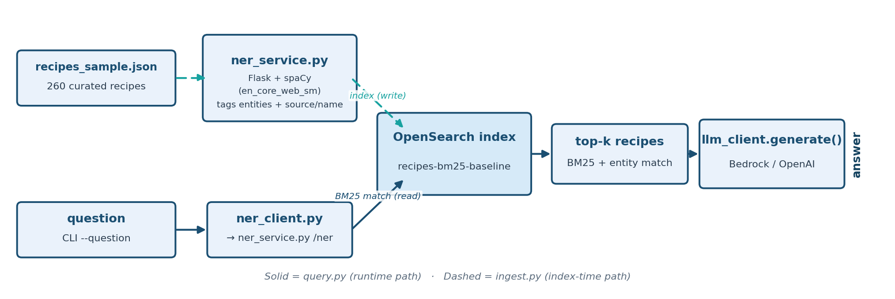

# Task 3: Baseline BM25 RAG

Builds on [Baseline Vector RAG](baseline-vector-rag.md), on the same
"Recipe & Dietary Safety Assistant" dataset.

**The fix, and what it costs.** BM25 matches the literal words in a recipe,
so the recipe that vector search dropped comes back, and the answers are
correct. Entity matching adds a boost on top, at the cost of a second service
to run. Here it is applied to the theme where a missed allergen actually
matters.

**Teaching goal:** BM25 + entity tagging is deterministic and auditable --
the same query keyword either matches a document's text or it doesn't. This
task's job is to retrieve both of the same-named recipes that Baseline Vector
RAG's vector search could confuse, so the model can answer about the one the
question names.

## What you will learn

By the end, you will have run a local NER service, indexed recipes with entity tags, and seen exact-term matching retrieve both Fish and Chips recipes for each question. You will also see the cost: a second service has to stay running. The entity extraction is [`ner()` in `ner_service.py`](../scripts/baseline-bm25-rag/src/ner_service.py); the query is `bm25_search()`, called from [`ask()`](../scripts/baseline-bm25-rag/src/query.py).

The practical sequence is:

| Step | Activity | Checkpoint |
| --- | --- | --- |
| [1](#step-1-enter-the-existing-workspace) | Re-enter the workspace and open the task directory. | `Makefile` and `src/` are listed. |
| [2](#step-2-start-the-ner-service) | Start the NER service in Terminal 1. | Flask reports it is serving on `127.0.0.1:8000`. |
| [3](#step-3-ingest-the-recipe-sample) | Tag and index the sample in Terminal 2. | The log reports `Ingested 260 recipes into 'recipes-bm25-baseline'`. |
| [4](#step-4-ask-both-fish-and-chips-questions) | Ask about each same-named recipe. | Each answer names the correct recipe's sulfite status. |
| [5](#step-5-validate) | Run the smoke test with NER still running. | It prints two `[PASS] Baseline BM25 RAG ...` lines. |

## Understand BM25 and entity matching

### Architecture



### Dataset

Same curated 260-recipe sample as Baseline Vector RAG, in `support/recipes/recipes_sample.json`
-- including the same real, verified ambiguous pair: two "Fish and Chips"
recipes (thegratefulgirlcooks.com, no cautions vs. womensweeklyfood.com.au,
Sulfites) where Baseline Vector RAG's vector search demonstrably drops the first
recipe from its top-5 results entirely.

Each recipe is tagged at ingest time with entities from the local NER
service, plus its own `source` and `recipe_name` folded directly into the
same `entities` field. This is a deliberate design choice, confirmed by
testing: spaCy's small NER model tags **no useful entity** for
"thegratefulgirlcooks.com" (it only spuriously tags the unrelated word
"chips" as `ORG`), so relying on NER alone would not have disambiguated
these two recipes. The source is already known, deterministic metadata --
there's no reason to leave a disambiguation signal you already have to
chance.

A note on what that does and does not do at query time, checked against the
live index. The entity boost only fires for entities NER extracts from the
*question*. For both Fish and Chips questions NER returns just `chips`, not
the source domain, so the folded-in source never matches. What retrieves both
recipes is plain BM25 on the recipe name ("Fish and Chips"), which both
recipes share. The two questions therefore get the *same* two top hits in the
same order; the model tells the recipes apart from the `source:` label printed
beside each snippet in its context. The `chips` entity adds a +6.0 boost
to thegratefulgirlcooks.com's recipe only because spaCy happened to tag
"chips" in that recipe's text. With the NER service stopped, both recipes still
come back, tied at 22.11.

## Before you begin

Complete [Task 1: Prepare the workspace](setup-environment.md), including the `en_core_web_sm` download. Baseline Vector RAG is not a prerequisite, but its results are what this task is compared against.

This task uses two terminals, both with the `.venv` active and both in `scripts/baseline-bm25-rag/`. The NER service listens only on `127.0.0.1`, on port 8000 unless `PORT` is set. Each `python -m src.<module>` command has a matching Make target, listed in the [Baseline BM25 RAG reference](../references/baseline-bm25-rag.md#commands).

## Step 1: enter the existing workspace

In each of two terminals, from the lab root:

```bash
source .venv/bin/activate
cd scripts/baseline-bm25-rag
ls
```

**Expected:** `Makefile` and `src` in both terminals.

## Step 2: start the NER service

Terminal 1 (NER service, stays running):

```bash
python -m src.ner_service
```

**Expected:** Flask's startup message, including `Running on http://127.0.0.1:8000`. Leave this terminal open; Hybrid RAG (NER + Rerank), Governance Tiering and Operationalize Production reuse the same service. If the port is taken, see [Baseline BM25 RAG troubleshooting](../troubleshooting/baseline-bm25-rag.md).

## Step 3: ingest the recipe sample

Terminal 2:

```bash
python -m src.ingest
```

**Expected:** a log line `Ingested 260 recipes into 'recipes-bm25-baseline'`. If NER warnings (`NER request failed ...`) appear, the service from Step 2 isn't reachable, and recipes are indexed without NER entities.

## Step 4: ask both Fish and Chips questions

Still in Terminal 2:

```bash
python -m src.query --question "Does the thegratefulgirlcooks.com Fish and Chips recipe contain sulfites?"
python -m src.query --question "Does the womensweeklyfood.com.au Fish and Chips recipe contain sulfites?"
```

**Expected:** each command prints the question, the model's answer, and a `RAG Hits:` list (10 hits by default). The wording varies from run to run; check these properties:

- **thegratefulgirlcooks.com question:** the answer is "no sulfites", and that recipe is among the hits. Baseline Vector RAG's vector search couldn't even retrieve it.
- **womensweeklyfood.com.au question:** the answer is "yes, sulfites".
- **Both questions:** the top two hits are the two Fish and Chips recipes, in the same order (thegratefulgirlcooks.com at about 28.1, womensweeklyfood.com.au at about 22.1), then unrelated recipes below 9.

The default here is 10 hits because `--top-k` defaults to 10 in this task; the later tasks default to 5. BM25 has no neighbour pool, so there is no `candidate_k` to set: the top `k` scored recipes are simply returned.

BM25 closes the gap Baseline Vector RAG exposed because it matches the literal words "Fish", "and" and "Chips" in the recipe name instead of relying on "similar meaning", so both same-named recipes are retrieved. The ranking does not tell the two apart (see the note under Dataset); the `source:` label on each snippet does, and the model answers about the source your question names.

### See the ranking without the model

This probe runs the retrieval step of `ask()` for the thegratefulgirlcooks.com question, once without the entity boost and once with the `chips` entity that NER extracts from the question. It passes the entity directly instead of calling the NER service, so the NER service does not need to be running. No LLM is called and nothing is written.

```bash
python - <<'PY'
from src.common.config import load_settings
from src.common.opensearch_client import bm25_search, create_client, normalize_hits

s = load_settings()
client = create_client(s)
question = "Does the thegratefulgirlcooks.com Fish and Chips recipe contain sulfites?"

for label, entities in [("BM25 only", []), ("BM25 + entity boost for 'chips'", ["chips"])]:
    resp = bm25_search(client, s.opensearch_bm25_recipes_baseline_index, question, k=5, entities=entities)
    print(label)
    for h in normalize_hits(resp):
        print(f"  {h['score']:7.4f}  {h['recipe_name']} | {h['source']}")
PY
```

**Expected:** two lists of five hits.

```text
BM25 only
  22.1129  Fish and Chips | thegratefulgirlcooks.com
  22.1129  Fish and chips | womensweeklyfood.com.au
   8.6906  Microwave Potato Chips | Food Network
   7.8901  Weight Watchers Potato Chips | food.com
   7.5032  Chorizo And Shrimp Rice Recipe | Food Republic
BM25 + entity boost for 'chips'
  28.1129  Fish and Chips | thegratefulgirlcooks.com
  22.1129  Fish and chips | womensweeklyfood.com.au
   8.6906  Microwave Potato Chips | Food Network
   7.8901  Weight Watchers Potato Chips | food.com
   7.5032  Chorizo And Shrimp Rice Recipe | Food Republic
```

The two Fish and Chips recipes tie at 22.1129 on words alone: both are named "Fish and Chips", and the name field carries a weight of 4. The `chips` boost adds exactly 6.0 to one of them, the one whose stored entities include `chips`, and changes nothing else. The ranking never separates the two recipes by the question's domain name, which is why the answers rely on the `source:` label. Every hit below the pair is a different dish that shares one word ("Chips") with the question. For when keyword matching wins or fails against vector search, see [BM25 versus kNN](../concepts/BM25_VS_KNN.md).

### See what the NER service extracts

The boost above only happens if the NER service returns an entity for the question and that entity equals a name stored on a recipe. This probe asks the running NER service about five questions and counts the recipes whose stored `entities` contain what came back. It needs the service from Step 2, reads the index, calls no LLM and writes nothing.

```bash
python - <<'PY'
import requests
from src.common.config import load_settings
from src.common.opensearch_client import create_client

s = load_settings()
client = create_client(s)
questions = [
    "Does the thegratefulgirlcooks.com Fish and Chips recipe contain sulfites?",
    "Which recipes from Food Network are free of sulfites?",
    "Which recipes from food network are free of sulfites?",
    "Does Food Network's Microwave Potato Chips recipe contain sulfites?",
    "Is the Chorizo And Shrimp Rice Recipe safe for a shellfish allergy?",
]
for q in questions:
    pairs = requests.post(s.ner_service_url, json={"text": q}, timeout=10).json()["entity_pairs"]
    names = [p["name"] for p in pairs]
    n = 0
    if names:
        n = client.count(index=s.opensearch_bm25_recipes_baseline_index, body={"query": {"terms": {"entities": names}}})["count"]
    print(q)
    print("  NER:", [(p["name"], p["label"]) for p in pairs])
    print("  recipes whose stored entities match:", n)
PY
```

**Expected:** each question, what NER returned, and how many recipes it can boost.

```text
Does the thegratefulgirlcooks.com Fish and Chips recipe contain sulfites?
  NER: [('chips', 'ORG')]
  recipes whose stored entities match: 1
Which recipes from Food Network are free of sulfites?
  NER: [('food network', 'ORG')]
  recipes whose stored entities match: 16
Which recipes from food network are free of sulfites?
  NER: []
  recipes whose stored entities match: 0
Does Food Network's Microwave Potato Chips recipe contain sulfites?
  NER: [("food network's", 'ORG')]
  recipes whose stored entities match: 0
Is the Chorizo And Shrimp Rice Recipe safe for a shellfish allergy?
  NER: [('chorizo', 'PERSON'), ('shrimp rice recipe', 'PERSON')]
  recipes whose stored entities match: 1
```

The first line is the Step 4 question: the service returns only `chips`, which is why one of the two Fish and Chips recipes gets the +6.0 and the question's source domain adds nothing. The other lines show what the service returns for other questions and how many stored recipes each result can boost. For what the entity boost does to a ranking, and the alternatives to this service, see [Named-entity recognition in retrieval](../concepts/NER_IN_RETRIEVAL.md).

## Step 5: validate

With `ner_service.py` still running:

```bash
python -m src.validate
```

**Expected:** two lines: `[PASS] Baseline BM25 RAG NER service is running`, then `[PASS] Baseline BM25 RAG retrieved both Fish and Chips recipes for both questions and answered each`. [`validate.py`](../scripts/baseline-bm25-rag/src/validate.py) fails at the first check if the NER service isn't answering (the clients otherwise hide that), and checks that both recipes are among the hits for both questions; Step 4 is where you confirm the answers are correct.

## Completion checkpoint

You have completed Baseline BM25 RAG when ingest reported 260 recipes, the two questions produced "no sulfites" and "yes, sulfites" respectively, and both smoke-test checks passed with the NER service running. The lesson to carry forward: matching literal words retrieves both candidates, but the ranking does not tell them apart, and the NER service you had to run was not what made retrieval work for this pair. It is an extra moving part that can fail silently.

For when keyword matching beats vector search and when it does not, see [BM25 versus kNN](../concepts/BM25_VS_KNN.md); for what the NER service contributes, see [Named-entity recognition in retrieval](../concepts/NER_IN_RETRIEVAL.md); to compare all the approaches in the lab, see [Choosing a retrieval approach](../concepts/CHOOSING_RETRIEVAL.md). The [Baseline BM25 RAG source map](../references/baseline-bm25-rag.md#source-map) lists every file used here. Setup or runtime issue? See [Baseline BM25 RAG troubleshooting](../troubleshooting/baseline-bm25-rag.md)
for common fixes -- including what to check if `ner_service.py` isn't
running (entity matching silently degrades to plain full-text matching
rather than erroring), missing `.env` values, certificate errors, and
Bedrock model access.

Continue to [Task 4: Hybrid RAG (Native)](hybrid-rag-native.md), or return to the [task index](../README.md#tasks).
