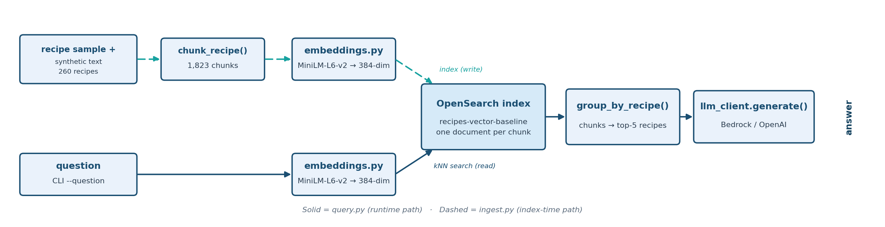

# Task 2: Baseline Vector RAG

The first task in the journey: plain vector (kNN) search over the "Recipe &
Dietary Safety Assistant" dataset, before any fix is applied.

Three ideas this task relies on have their own pages: [Embedding models](../concepts/EMBEDDING_MODELS.md) (how text becomes a vector), [BM25 versus kNN](../concepts/BM25_VS_KNN.md) (how vector search ranks, and where it fails) and [Chunking](../concepts/CHUNKING.md) (why each recipe is split into pieces). You can read them first or as the task points to them.

**Wrong, but confident — with real stakes.** This is the failure the whole
journey is built around, shown on actual allergen data: a wrong-but-confident
answer here isn't just an annoying demo bug, it's the exact mistake this
journey exists to prevent.

**Teaching goal:** vector search retrieves by *semantic similarity*, not by
*factual correctness*. Two similarly-worded questions can have completely
different correct answers, and pure vector retrieval has no way to know
that -- it just returns "similar-sounding" recipes.

## What you will learn

By the end, you will have split the recipe sample into chunks and indexed their embeddings, watched vector search miss the one recipe that answers a specific question, and explained why that miss is a retrieval failure even when the model declines to answer. The retrieval happens in [`ask()`](../scripts/baseline-vector-rag/src/query.py) through `recipe_knn_search()`, which returns chunks; `group_by_recipe()` then folds them back into recipes.

The practical sequence is:

| Step | Activity | Checkpoint |
| --- | --- | --- |
| [1](#step-1-enter-the-existing-workspace) | Re-enter the workspace and open the task directory. | `Makefile` and `src/` are listed. |
| [2](#step-2-ingest-the-recipe-sample) | Split the 260-recipe sample into chunks, then embed and index them. | The log reports `Ingested 260 recipes as 1823 chunks into index 'recipes-vector-baseline'`. |
| [3](#step-3-ask-both-fish-and-chips-questions) | Ask about each same-named recipe. | thegratefulgirlcooks.com's recipe is missing from the top-5 hits. |
| [4](#step-4-validate) | Run the smoke test. | It prints four `[PASS]` lines. |

## Understand baseline vector retrieval

### Architecture



### Dataset

A curated sample of 260 recipes (`support/recipes/recipes_sample.json`, shared by every task) pulled from
[`datahiveai/recipes-with-nutrition`](https://huggingface.co/datasets/datahiveai/recipes-with-nutrition)
on HuggingFace -- already included, no download step needed.

The sample deliberately includes a **real, naturally-occurring ambiguous pair**
found in the source dataset: two completely different recipes that both happen
to be named **"Fish and Chips"**:

| | Source | Cautions |
|---|---|---|
| Recipe A | thegratefulgirlcooks.com | *(none listed)* |
| Recipe B | womensweeklyfood.com.au | **Sulfites** |

Only Recipe B carries a sulfites caution in the dataset's labels. Both batters list beer (Recipe A's says "beer", Recipe B's says "beer or soda water"), so the difference comes from the source data, not from a visible difference in the ingredient list.
This pair was chosen after empirically verifying it actually breaks vector
retrieval, not just because the names match: with the `all-MiniLM-L6-v2`
embedding model, the question about Recipe A scores *higher* against
Recipe B's best chunk (OpenSearch score 0.81) than against any chunk of its
own (0.75) -- a genuine ranking flip, not just a close call. OpenSearch's
cosine score is (1 + cosine) / 2. A secondary, thinner-margin pair
("Chicken Cordon Bleu" -- Skinnytaste vs. sargento.com, soy vs. no-soy) is
also included in the sample for further exploration.

### Synthetic page text

The recipe records hold a name, a source, an ingredient list, allergen cautions and labels, but no method, and many of the original recipe URLs no longer work. So that every recipe has a page to chunk, `support/recipes/recipes_synthetic.json` adds an introduction, method steps and serving notes for each of the 260 recipes. **This text is synthetic.** An LLM wrote it from the ingredient list only, with instructions to add no ingredient and make no allergen claim, and a scan checks the result against each recipe's ingredients. It is not copied from the websites and is not a tested recipe, so do not cook from it. The ingredients, cautions and labels still come from the original dataset, and they alone decide the safety facts. [`support/generate_synthetic_recipes.py`](../support/generate_synthetic_recipes.py) regenerates the file; you do not need to run it.

### Why this lab chunks

Chunking splits a document into pieces before embedding, so each piece gets its own vector. With the page text added, a recipe is longer than the embedding model can read: all 260 recipes are over its 256-token input limit (median 482 tokens, longest 758), and the model silently ignores everything past the limit, which is most of the method and the notes. So each recipe is split by section into 6 to 8 chunks: the ingredients, the allergen cautions and labels, the introduction, the method in groups of three steps, and the serving notes.

Two rules keep chunks usable:

- **Every chunk starts with the recipe name and source**, as `Fish and chips (source: womensweeklyfood.com.au) - Method steps 4-6: ...`. A fragment such as "Method steps 4-6" says nothing about which of the two Fish and Chips recipes it came from, so without the prefix the pair cannot be told apart.
- **Every chunk carries its recipe's fields** (`recipe_id`, cautions, labels, source). Filters in later tasks work on chunks the way they would on whole recipes.

Search now returns chunks, and several chunks of one recipe often rank together. `group_by_recipe()` folds the ranked chunks back into recipes, keeps the best chunk score for each recipe, and passes the model each recipe's best-matching chunks as evidence. Step 2 measures the lengths, and [Chunking](../concepts/CHUNKING.md) explains the strategies and when each applies.

## Before you begin

Complete [Task 1: Prepare the workspace](setup-environment.md) and pass its completion checkpoint. This task needs OpenSearch and your LLM provider configured in `.env`; it does not need the NER service.

Every command below runs from `scripts/baseline-vector-rag/`. Each `python -m src.<module>` command has a matching Make target, listed in the [Baseline Vector RAG reference](../references/baseline-vector-rag.md#commands). Ingesting writes the `recipes-vector-baseline` index on your cluster; each query makes one LLM call.

## Step 1: enter the existing workspace

From the lab root, reactivate the environment from Task 1 and open the task directory:

```bash
source .venv/bin/activate
cd scripts/baseline-vector-rag
ls
```

**Expected:** `Makefile` and `src`. The [`src/common`](../references/baseline-vector-rag.md#source-map) entry inside `src/` is a link to the shared `support/common/` package.

## Step 2: ingest the recipe sample

[`main()` in `ingest.py`](../scripts/baseline-vector-rag/src/ingest.py) loads the recipes with their synthetic text (`load_recipes()`), splits each one with `chunk_recipe()`, embeds every chunk, and indexes it as its own document, with the recipe's fields copied onto it.

```bash
python -m src.ingest
```

**Expected:** an `Indexing` progress bar reaching 260 recipes, then a log line `Ingested 260 recipes as 1823 chunks into index 'recipes-vector-baseline'`. The first run also downloads the embedding model. If the index already exists with the older layout of this lab (one document per recipe), ingest logs a `WARNING`, deletes it and creates it again for chunks, so old documents never sit next to the chunks as duplicate hits. `query.py` never deletes an index: against an old-layout index it stops with an `OldLayoutIndexError` that tells you to run ingest. An index that already holds chunks is kept as it is; add `--recreate` to rebuild it from empty. A `RuntimeError: Missing configuration in .env` means Task 1's setup check hasn't passed yet.

### See the chunks

This is the measurement behind "why this lab chunks". It compares the length of each whole recipe (facts plus all the page text) with the length of its chunks, against the embedding model's input limit, and lists the chunks of one recipe. It reads only the sample files and the model; it makes no OpenSearch or LLM call.

```bash
python - <<'PY'
from statistics import median

from src.common.chunking import build_text, chunk_recipe, iter_chunks, load_recipes
from src.common.config import RECIPES_SAMPLE_PATH, load_settings
from src.common.embeddings import EmbeddingModel

recipes = load_recipes(RECIPES_SAMPLE_PATH)
model = EmbeddingModel(load_settings()).model
limit = model.max_seq_length
tokens = lambda text: len(model.tokenizer.encode(text))


def whole_recipe(r):  # what one document per recipe would embed: the facts plus all the page text
    page = r.get("synthetic", {})
    return "\n".join([build_text(r), page.get("intro", ""), *page.get("method", []), page.get("notes", "")])


whole = [tokens(whole_recipe(r)) for r in recipes]
chunks = [tokens(c["text"]) for _, c in iter_chunks(recipes)]
print(f"embedding model input limit = {limit} tokens")
print(f"whole recipes: {len(whole)}  median={int(median(whole))} tokens  longest={max(whole)}  over the limit={sum(n > limit for n in whole)}")
print(f"chunks:        {len(chunks)}  median={int(median(chunks))} tokens  longest={max(chunks)}  over the limit={sum(n > limit for n in chunks)}")

r = next(r for r in recipes if r["source"] == "womensweeklyfood.com.au" and r["recipe_name"].lower() == "fish and chips")
print(f"\n{r['recipe_name']} | {r['source']} -> {len(chunk_recipe(r))} chunks")
for c in chunk_recipe(r):
    print(f"  {c['chunk_id']}  {tokens(c['text']):>3} tokens  {c['section']}")
print("\n" + chunk_recipe(r)[1]["text"])
PY
```

**Expected:** a model-loading log line, a progress bar and a one-line `transformers` warning that a sequence is longer than the model's maximum, all on stderr, then this on stdout:

```text
embedding model input limit = 256 tokens
whole recipes: 260  median=482 tokens  longest=758  over the limit=260
chunks:        1823  median=92 tokens  longest=233  over the limit=0

Fish and chips | womensweeklyfood.com.au -> 7 chunks
  a9d7ddb702fa-00   79 tokens  Ingredients
  a9d7ddb702fa-01   65 tokens  Allergen cautions and labels
  a9d7ddb702fa-02   87 tokens  Introduction
  a9d7ddb702fa-03  114 tokens  Method steps 1-3
  a9d7ddb702fa-04   88 tokens  Method steps 4-6
  a9d7ddb702fa-05   62 tokens  Method steps 7-8
  a9d7ddb702fa-06  107 tokens  Serving and storage

Fish and chips (source: womensweeklyfood.com.au) - Allergen cautions and labels: Allergen cautions: Sulfites. Health labels: Dairy-Free, Peanut-Free, Tree-Nut-Free, Soy-Free, Shellfish-Free.
```

Every whole recipe is over the limit, and no chunk is. Four recipes with very long ingredient lists have their ingredients split into parts to get there. The allergen cautions and labels sit in a chunk of their own, so a question about an allergen has a short, focused chunk to match. [Embedding models](../concepts/EMBEDDING_MODELS.md#input-limit) explains the input limit and what the model ignores past it.

## Step 3: ask both Fish and Chips questions

```bash
python -m src.query --question "Does the thegratefulgirlcooks.com Fish and Chips recipe contain sulfites?"
python -m src.query --question "Does the womensweeklyfood.com.au Fish and Chips recipe contain sulfites?"
```

**Expected:** each command prints the question, the retrieved hits, and the model's answer. Each hit is a recipe, with its best chunk's score and, in brackets, the sections of its chunks that matched. The exact wording, and the scores, vary from run to run; check these properties:

- **thegratefulgirlcooks.com question** (the correct answer is "no sulfites"): vector search's top-5 recipes don't include that recipe at all. Only womensweeklyfood.com.au's same-named recipe shows up, followed by the allergen chunks of unrelated recipes. Because the system prompt tells the model to say "I don't know" when the context doesn't support an answer, you'll typically see the assistant decline rather than hallucinate. The *retrieval* still silently failed to find the one document that answers the question.
- **womensweeklyfood.com.au question:** that recipe is among the hits, since it legitimately ranks near the top of the corpus regardless.

This failure mode is directly tied to dietary safety here. With a looser system prompt, or a model that ignores it, a dropped retrieval produces a confidently wrong safety answer, which matters for someone with a sulfite sensitivity. Baseline BM25 RAG's BM25 retrieval closes this gap for this pair, because it matches the literal words in the recipe name, and it answers both questions correctly.

### See the miss without the model

The answer wording varies, but the retrieval does not. This probe runs only the retrieval step of `ask()` for the thegratefulgirlcooks.com question, so no LLM is called and nothing is written. It prints the top five recipes, then asks for every chunk and shows where the two same-named recipes rank.

```bash
python - <<'PY'
from src.common.chunking import chunk_fetch, group_by_recipe
from src.common.config import load_settings
from src.common.embeddings import EmbeddingModel, to_list
from src.common.opensearch_client import create_client, normalize_hits, recipe_knn_search

s = load_settings()
client, model = create_client(s), EmbeddingModel(s)
index = s.opensearch_vector_recipes_baseline_index
question = "Does the thegratefulgirlcooks.com Fish and Chips recipe contain sulfites?"
q_vec = to_list(model.encode([question])[0])

print("Top 5 recipes from the index (no LLM involved):")
chunks = normalize_hits(recipe_knn_search(client, index, q_vec, k=chunk_fetch(5), candidate_k=60))
for h in group_by_recipe(chunks, top_k=5):
    print(f"  {h['score']:.4f}  {h['recipe_name']} | {h['source']}  [{', '.join(c['section'] for c in h['chunks'])}]")

print("\nWhere the two Fish and Chips recipes rank among all 260 recipes:")
all_chunks = normalize_hits(recipe_knn_search(client, index, q_vec, k=2000, candidate_k=2000))
for rank, h in enumerate(group_by_recipe(all_chunks), start=1):
    if h["recipe_name"].lower() == "fish and chips":
        best = max((c for c in all_chunks if c["recipe_id"] == h["recipe_id"]), key=lambda c: c["score"])
        print(f"  #{rank:<3} score={h['score']:.4f}  {h['source']}  best chunk: {best['section']}")
PY
```

**Expected:** a model-loading log line and progress bar on stderr, then:

```text
Top 5 recipes from the index (no LLM involved):
  0.8134  Fish and chips | womensweeklyfood.com.au  [Ingredients, Allergen cautions and labels]
  0.8046  Breakfast Skillet recipes | momspantrykitchen.com  [Allergen cautions and labels]
  0.7968  Trout Amandine, Steamed Asparagus, and New Potatoes | Food Network  [Allergen cautions and labels]
  0.7903  New Orleans BBQ Shrimp | Epicurious  [Allergen cautions and labels]
  0.7857  Bloomin' Onion Bread | food.com  [Allergen cautions and labels]

Where the two Fish and Chips recipes rank among all 260 recipes:
  #1   score=0.8134  womensweeklyfood.com.au  best chunk: Allergen cautions and labels
  #97  score=0.7471  thegratefulgirlcooks.com  best chunk: Ingredients
```

The question names thegratefulgirlcooks.com, and that recipe ranks 97th of 260. The womensweeklyfood.com.au recipe ranks first, because the model sees the two as almost the same dish and the domain name barely moves a vector. The four recipes after it match for a different reason: the question is mostly "contain sulfites?", and the chunk that looks most like that question is the *allergen cautions and labels* chunk of almost any recipe, so those unrelated chunks fill the list. This is a side effect of chunking: a short, focused chunk makes a good match for an allergen question and a poor guide to *which recipe* is meant. The missed recipe is so deep that simply asking for more hits would not fix this cheaply; [BM25 versus kNN](../concepts/BM25_VS_KNN.md#probe-4-how-deep-the-missed-recipe-sits) shows that measurement and [Embedding models](../concepts/EMBEDDING_MODELS.md) explains why a domain name is a weak signal for an embedding.

The probe passes two numbers. `k=30` is how many chunks are returned: `chunk_fetch(5)` asks for six chunks per recipe wanted, because several chunks of one recipe often rank together. `candidate_k=60` is the size of the pool of nearest neighbours the search takes first; any filter is applied to that pool afterwards, and the top `k` of what survives is returned. This probe has no filter, so the pool size changes nothing here. It matters once a filter removes chunks from the pool: [BM25 versus kNN, Probe 3](../concepts/BM25_VS_KNN.md#probe-3-a-post-filter-over-a-small-pool) shows a filter over a small pool dropping the right recipe, and [Probe 4](../concepts/BM25_VS_KNN.md#probe-4-how-deep-the-missed-recipe-sits) shows how deep the missed recipe sits.

## Step 4: validate

```bash
python -m src.validate
```

**Expected:** four lines: `[PASS] 1823 chunks from 260 recipes all fit 256 tokens and name their recipe`, `[PASS] group_by_recipe folds chunk hits into recipes`, `[PASS] Baseline Vector RAG returned ... hits and a ...-char answer`, then `[PASS] Baseline Vector RAG reproduced the retrieval gap: ...`. [`validate.py`](../scripts/baseline-vector-rag/src/validate.py) first checks the chunks without any cluster call (every chunk fits the token limit and starts with its recipe's name and source, and grouping counts recipes, not chunks). It then checks that retrieval returned hits and the LLM returned an answer, and the lesson of Step 3: the thegratefulgirlcooks.com question retrieves womensweeklyfood.com.au's recipe and not its own, while the womensweeklyfood.com.au question retrieves its own. This is a test that the *failure* reproduces, so if you change the embedding model or the sample, it can fail with a message saying the gap did not reproduce.

## Completion checkpoint

You have completed Baseline Vector RAG when ingest reported 260 recipes as 1823 chunks, the thegratefulgirlcooks.com question's hits list shows only the womensweeklyfood.com.au recipe of the pair, and all four smoke-test checks passed. The lesson to carry forward: a plausible answer, or a polite "I don't know", doesn't show that retrieval found the right document.

For the reasoning behind this task, read [Embedding models](../concepts/EMBEDDING_MODELS.md), [Chunking](../concepts/CHUNKING.md) and [BM25 versus kNN](../concepts/BM25_VS_KNN.md). The [Baseline Vector RAG source map](../references/baseline-vector-rag.md#source-map) lists every file used here. Setup or runtime issue? See [Baseline Vector RAG troubleshooting](../troubleshooting/baseline-vector-rag.md)
for common fixes (missing `.env` values, certificate errors, Bedrock
model access, etc.).

Continue to [Task 3: Baseline BM25 RAG](baseline-bm25-rag.md), or return to the [task index](../README.md#tasks).
