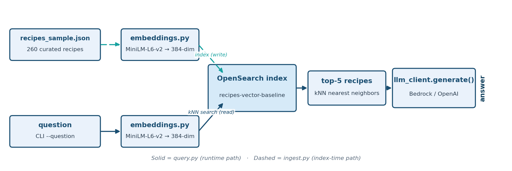

# Task 2: Baseline Vector RAG

The first task in the journey: plain vector (kNN) search over the "Recipe &
Dietary Safety Assistant" dataset, before any fix is applied.

**Wrong, but confident — with real stakes.** This is the failure the whole
journey is built around, shown on actual allergen data: a wrong-but-confident
answer here isn't just an annoying demo bug, it's the exact mistake this
journey exists to prevent.

**Teaching goal:** vector search retrieves by *semantic similarity*, not by
*factual correctness*. Two similarly-worded questions can have completely
different correct answers, and pure vector retrieval has no way to know
that -- it just returns "similar-sounding" recipes.

## What you will learn

By the end, you will have indexed the recipe sample as embeddings, watched vector search miss the one recipe that answers a specific question, and explained why that miss is a retrieval failure even when the model declines to answer. The retrieval happens in [`ask()`](../scripts/baseline-vector-rag/src/query.py) through `recipe_knn_search()`.

The practical sequence is:

| Step | Activity | Checkpoint |
| --- | --- | --- |
| [1](#step-1-enter-the-existing-workspace) | Re-enter the workspace and open the task directory. | `Makefile` and `src/` are listed. |
| [2](#step-2-ingest-the-recipe-sample) | Embed and index the 260-recipe sample. | The log reports `Ingested 260 recipes into index 'recipes-vector-baseline'`. |
| [3](#step-3-ask-both-fish-and-chips-questions) | Ask about each same-named recipe. | thegratefulgirlcooks.com's recipe is missing from the top-5 hits. |
| [4](#step-4-validate) | Run the smoke test. | It prints two `[PASS] Baseline Vector RAG ...` lines. |

## Understand baseline vector retrieval

### Architecture



### Dataset

A curated sample of 260 recipes (`support/recipes/recipes_sample.json`, shared by every task) pulled from
[`datahiveai/recipes-with-nutrition`](https://huggingface.co/datasets/datahiveai/recipes-with-nutrition)
on HuggingFace -- already included, no download step needed.

The sample deliberately includes a **real, naturally-occurring ambiguous pair**
found in the source dataset: two completely different recipes that both happen
to be named **"Fish and Chips"**:

| | Source | Cautions |
|---|---|---|
| Recipe A | thegratefulgirlcooks.com | *(none listed)* |
| Recipe B | womensweeklyfood.com.au | **Sulfites** |

Only Recipe B carries a sulfites caution in the dataset's labels. Both batters list beer (Recipe A's says "beer", Recipe B's says "beer or soda water"), so the difference comes from the source data, not from a visible difference in the ingredient list.
This pair was chosen after empirically verifying it actually breaks vector
retrieval, not just because the names match: with the `all-MiniLM-L6-v2`
embedding model, the question about Recipe A scores *higher* against
Recipe B's embedding (cosine similarity 0.65) than against its own (0.52) --
a genuine ranking flip, not just a close call. OpenSearch reports these as
0.83 and 0.76, because its cosine score is (1 + cosine) / 2. A secondary, thinner-margin pair
("Chicken Cordon Bleu" -- Skinnytaste vs. sargento.com, soy vs. no-soy) is
also included in the sample for further exploration.

### Why this lab does not chunk

Chunking splits a document into pieces before embedding, so each piece gets its own vector. This lab embeds each recipe whole, on purpose. A recipe is a short text about one dish (its name, ingredients, cautions and labels), so one vector represents it fairly, and one document means one vector, one retrieved hit and one citation. Splitting a recipe would not fix the failure in this task; it would leave fragments that no longer say which of the two Fish and Chips recipes they came from. Step 2 measures the recipe lengths, and [Chunking](../concepts/CHUNKING.md) explains the reasoning, the strategies you would use for longer documents, and when each applies.

Two concept pages go deeper on the choices behind this task: [Embedding models](../concepts/EMBEDDING_MODELS.md) covers what MiniLM captures and misses and why the lab uses it, and [BM25 versus kNN](../concepts/BM25_VS_KNN.md) covers when vector search is the wrong tool.

## Before you begin

Complete [Task 1: Prepare the workspace](setup-environment.md) and pass its completion checkpoint. This task needs OpenSearch and your LLM provider configured in `.env`; it does not need the NER service.

Every command below runs from `scripts/baseline-vector-rag/`. Each `python -m src.<module>` command has a matching Make target, listed in the [Baseline Vector RAG reference](../references/baseline-vector-rag.md#commands). Ingesting writes the `recipes-vector-baseline` index on your cluster; each query makes one LLM call.

## Step 1: enter the existing workspace

From the lab root, reactivate the environment from Task 1 and open the task directory:

```bash
source .venv/bin/activate
cd scripts/baseline-vector-rag
ls
```

**Expected:** `Makefile` and `src`. The [`src/common`](../references/baseline-vector-rag.md#source-map) entry inside `src/` is a link to the shared `support/common/` package.

## Step 2: ingest the recipe sample

[`main()` in `ingest.py`](../scripts/baseline-vector-rag/src/ingest.py) renders each recipe with `build_text()`, embeds it, and indexes it.

```bash
python -m src.ingest
```

**Expected:** an `Indexing` progress bar reaching 260 recipes, then a log line `Ingested 260 recipes into index 'recipes-vector-baseline'`. The first run also downloads the embedding model. A `RuntimeError: Missing configuration in .env` means Task 1's setup check hasn't passed yet.

### Check the recipe lengths

This is the measurement behind "why this lab does not chunk". It renders every recipe with the same `build_text()` that ingest used, and compares the result with the embedding model's input limit. It reads only the sample file and the model; it makes no OpenSearch or LLM call.

```bash
python - <<'PY'
import json
from statistics import median

from src.common.config import RECIPES_SAMPLE_PATH, load_settings
from src.common.embeddings import EmbeddingModel
from src.ingest import build_text

recipes = json.loads(RECIPES_SAMPLE_PATH.read_text(encoding="utf-8"))
texts = [build_text(r) for r in recipes]
chars = sorted(len(t) for t in texts)
print(f"recipes={len(texts)}  chars: min={chars[0]} median={int(median(chars))} "
      f"p90={chars[int(len(chars) * 0.9)]} max={chars[-1]}")

model = EmbeddingModel(load_settings())
limit = model.model.max_seq_length
tokens = [len(model.model.tokenizer.encode(t)) for t in texts]
print(f"embedding model input limit = {limit} tokens; "
      f"longest recipe = {max(tokens)} tokens; recipes over the limit = {sum(n > limit for n in tokens)}")
PY
```

**Expected:** a model-loading log line, a progress bar and a one-line `transformers` warning that a sequence is longer than the model's maximum, all on stderr, then two lines on stdout:

```text
recipes=260  chars: min=234 median=449 p90=659 max=1013
embedding model input limit = 256 tokens; longest recipe = 307 tokens; recipes over the limit = 5
```

Half of the recipes are under 449 characters and the longest is about 1,000, so one vector per recipe is reasonable. The five over the limit lose their last words to truncation. [Embedding models](../concepts/EMBEDDING_MODELS.md#input-limit) explains the input limit and what the model ignores past it.

## Step 3: ask both Fish and Chips questions

```bash
python -m src.query --question "Does the thegratefulgirlcooks.com Fish and Chips recipe contain sulfites?"
python -m src.query --question "Does the womensweeklyfood.com.au Fish and Chips recipe contain sulfites?"
```

**Expected:** each command prints the question, the retrieved hits, and the model's answer. The exact wording, and the scores, vary from run to run; check these properties:

- **thegratefulgirlcooks.com question** (the correct answer is "no sulfites"): vector search's top-5 hits don't include that recipe at all. Only womensweeklyfood.com.au's same-named recipe shows up. Because the system prompt tells the model to say "I don't know" when the context doesn't support an answer, you'll typically see the assistant decline rather than hallucinate. The *retrieval* still silently failed to find the one document that answers the question.
- **womensweeklyfood.com.au question:** that recipe is among the hits, since it legitimately ranks near the top of the corpus regardless.

This failure mode is directly tied to dietary safety here. With a looser system prompt, or a model that ignores it, a dropped retrieval produces a confidently wrong safety answer, which matters for someone with a sulfite sensitivity. Baseline BM25 RAG's BM25 retrieval closes this gap for this pair, because it matches the literal words in the recipe name, and it answers both questions correctly.

### See the miss without the model

The answer wording varies, but the retrieval does not. This probe runs only the retrieval step of `ask()` for the thegratefulgirlcooks.com question, so no LLM is called and nothing is written, then scores the question against each of the two same-named recipes.

```bash
python - <<'PY'
import json

from src.common.config import RECIPES_SAMPLE_PATH, load_settings
from src.common.embeddings import EmbeddingModel, to_list
from src.common.opensearch_client import create_client, normalize_hits, recipe_knn_search
from src.ingest import build_text

s = load_settings()
model = EmbeddingModel(s)
question = "Does the thegratefulgirlcooks.com Fish and Chips recipe contain sulfites?"
q_vec = model.encode([question])[0]

print("Top 5 from the index (no LLM involved):")
hits = normalize_hits(recipe_knn_search(
    create_client(s), s.opensearch_vector_recipes_baseline_index, to_list(q_vec), k=5, candidate_k=25))
for h in hits:
    print(f"  {h['score']:.4f}  {h['recipe_name']} | {h['source']}")

print("\nThe question against each Fish and Chips recipe:")
recipes = json.loads(RECIPES_SAMPLE_PATH.read_text(encoding="utf-8"))
for r in recipes:
    if r["recipe_name"].lower() == "fish and chips":
        cosine = float(q_vec @ model.encode([build_text(r)])[0])  # vectors are L2-normalized
        print(f"  cosine={cosine:.3f}  OpenSearch score={(1 + cosine) / 2:.4f}  {r['source']}")
PY
```

**Expected:** a model-loading log line and progress bar on stderr, then:

```text
Top 5 from the index (no LLM involved):
  0.8265  Fish and chips | womensweeklyfood.com.au
  0.8044  Trout Amandine, Steamed Asparagus, and New Potatoes | Food Network
  0.7987  New Orleans BBQ Shrimp | Epicurious
  0.7977  Cheesy Skillet Domino Potatoes | The Kitchn
  0.7940  Chocolate Stout Whoopie Pies | The Daily Meal

The question against each Fish and Chips recipe:
  cosine=0.519  OpenSearch score=0.7597  thegratefulgirlcooks.com
  cosine=0.653  OpenSearch score=0.8265  womensweeklyfood.com.au
```

The question names thegratefulgirlcooks.com, and that recipe scores 0.7597, below even the fifth hit (0.7940). The womensweeklyfood.com.au recipe scores higher (0.8265) because the model sees the two texts as almost the same dish and the domain name barely moves the vector. The next four hits are unrelated recipes that happen to sit nearby, which is what a nearest-neighbour search returns when nothing matches well: it always fills the list. The missed recipe is 41st of 260, so simply asking for more hits would not fix this cheaply; [BM25 versus kNN](../concepts/BM25_VS_KNN.md#probe-4-how-deep-the-missed-recipe-sits) shows that measurement and [Embedding models](../concepts/EMBEDDING_MODELS.md) explains why a domain name is a weak signal for an embedding.

The probe passes two numbers. `k=5` is how many hits are returned. `candidate_k=25` is the size of the pool of nearest neighbours the search takes first; any filter is applied to that pool afterwards, and the top `k` of what survives is returned. This probe has no filter, so the pool size changes nothing here. It matters once a filter removes recipes from the pool: [BM25 versus kNN, Probe 3](../concepts/BM25_VS_KNN.md#probe-3-a-post-filter-over-a-small-pool) shows a filter over a small pool dropping the right recipe, and [Probe 4](../concepts/BM25_VS_KNN.md#probe-4-how-deep-the-missed-recipe-sits) shows how deep the missed recipe sits.

## Step 4: validate

```bash
python -m src.validate
```

**Expected:** two lines: `[PASS] Baseline Vector RAG returned ... hits and a ...-char answer`, then `[PASS] Baseline Vector RAG reproduced the retrieval gap: ...`. [`validate.py`](../scripts/baseline-vector-rag/src/validate.py) checks that retrieval returned hits and the LLM returned an answer, and then checks the lesson of Step 3: the thegratefulgirlcooks.com question retrieves womensweeklyfood.com.au's recipe and not its own, while the womensweeklyfood.com.au question retrieves its own. This is a test that the *failure* reproduces, so if you change the embedding model or the sample, it can fail with a message saying the gap did not reproduce.

## Completion checkpoint

You have completed Baseline Vector RAG when ingest reported 260 recipes, the thegratefulgirlcooks.com question's hits list shows only the womensweeklyfood.com.au recipe of the pair, and both smoke-test checks passed. The lesson to carry forward: a plausible answer, or a polite "I don't know", doesn't show that retrieval found the right document.

For the reasoning behind this task, read [Embedding models](../concepts/EMBEDDING_MODELS.md), [Chunking](../concepts/CHUNKING.md) and [BM25 versus kNN](../concepts/BM25_VS_KNN.md). The [Baseline Vector RAG source map](../references/baseline-vector-rag.md#source-map) lists every file used here. Setup or runtime issue? See [Baseline Vector RAG troubleshooting](../troubleshooting/baseline-vector-rag.md)
for common fixes (missing `.env` values, certificate errors, Bedrock
model access, etc.).

Continue to [Task 3: Baseline BM25 RAG](baseline-bm25-rag.md), or return to the [task index](../README.md#tasks).
