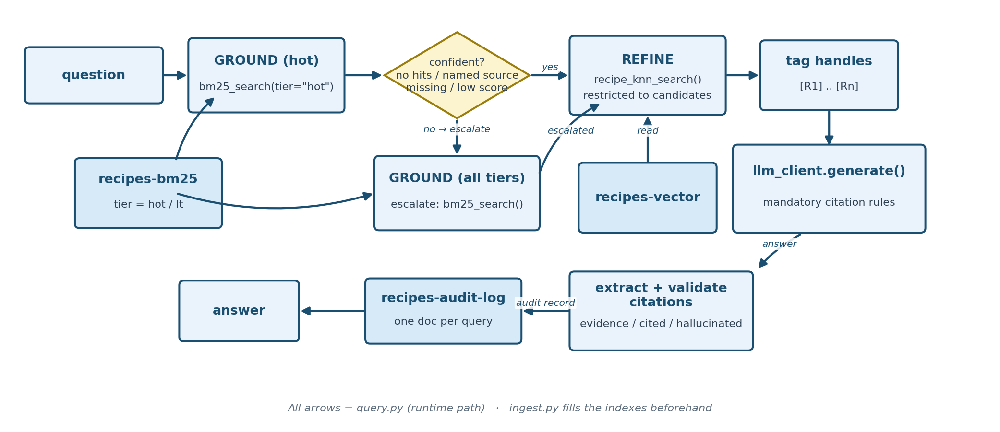

# Task 6: Governance Tiering

Recipe-dataset task building on [Hybrid RAG (NER + Rerank)](hybrid-rag-ner-rerank.md).
Reuses Hybrid RAG (NER + Rerank)'s exact same `recipes-bm25` / `recipes-vector` indexes (see the
comment in `support/common/config.py`), but this time every recipe gets a real `tier`
value instead of Hybrid RAG (NER + Rerank)'s placeholder `"hot"` default, and every query is
recorded in a governance audit trail. Governance, not relevance alone, decides which recipes live in the hot tier and which in the long-term (LT) tier.

**Not all data is equally safe to demote.** This is the mistake of tiering
data by cost alone without checking whether some of it is safety-critical
— plus the "why did it say that?" problem: this task adds the record
you'd need to answer that question after the fact.


**Teaching goal:** "Tiering" (splitting data into a fast/default tier and a
slower/archival tier) is usually framed as a pure cost/performance
optimization. This task frames it as a **governance decision instead**:
which data is *not allowed* to be relegated to the slow/optional path, and
how do you prove — after the fact — that a query correctly reached the data
it needed to?

## What you will learn

By the end, you will have re-indexed the sample with a safety-driven tier, seen a hot-tier question resolve without escalation and an LT-tier question escalate, read the citation handles in each answer, and learned what audit record each query leaves behind. The policy is [`assign_tier()`](../scripts/governance-tiering/src/ingest.py); the escalation, citation checks, and audit write are in [`ask()`](../scripts/governance-tiering/src/query.py).

The practical sequence is:

| Step | Activity | Checkpoint |
| --- | --- | --- |
| [1](#step-1-enter-the-existing-workspace) | Re-enter the workspace and open the task directory. | `Makefile` and `src/` are listed. |
| [2](#step-2-start-the-ner-service) | Start Baseline BM25 RAG's NER service in Terminal 1. | Flask reports it is serving on `127.0.0.1:8000`. |
| [3](#step-3-ingest-with-governance-tiers) | Re-index with `assign_tier()` and create the audit index. | The log reports `tier distribution: hot=209, lt=51`. |
| [4](#step-4-ask-hot-tier-lt-tier-and-filtered-questions) | Ask a hot-tier, an LT-tier, and a filtered question. | `escalated=False` for the first, `escalated=True` for the other two, and `valid=True` citations. |
| [5](#step-5-validate) | Run the smoke test with NER still running. | It prints four `[PASS] Governance Tiering ...` lines. |

## Understand governance-driven tiering

### The tiering policy

The policy is one function, [`assign_tier()` in `ingest.py`](../scripts/governance-tiering/src/ingest.py): a recipe with any allergen caution is `hot`, and a recipe with none is `lt`. This probe applies it to the sample and to the two Fish and Chips recipes. It needs no cluster, no NER service and no LLM, and writes nothing. Run it from `scripts/governance-tiering/` with the `.venv` active.

```bash
python - <<'PY'
import json
from collections import Counter
from src.common.config import RECIPES_SAMPLE_PATH
from src.ingest import assign_tier

recipes = json.loads(RECIPES_SAMPLE_PATH.read_text(encoding="utf-8"))
print("tier counts:", dict(Counter(assign_tier(r) for r in recipes)))
for r in recipes:
    if r["recipe_name"].lower() == "fish and chips":
        print(f"{r['recipe_name']:15s} {r['source']:26s} cautions={r['cautions']}  ->  {assign_tier(r)}")
print("empty cautions list ->", assign_tier({"cautions": []}), "| cautions key missing ->", assign_tier({}))
PY
```

**Expected:** the tier counts, the two Fish and Chips recipes, and the two edge cases.

```text
tier counts: {'hot': 209, 'lt': 51}
Fish and Chips  thegratefulgirlcooks.com   cautions=[]  ->  lt
Fish and chips  womensweeklyfood.com.au    cautions=['Sulfites']  ->  hot
empty cautions list -> lt | cautions key missing -> lt
```

The two edge cases matter: a recipe whose caution data is missing is treated exactly like one with no cautions, so it lands in `lt`. The policy is only as good as the field it reads.

A tier here is a label stored on each recipe, not a move to different storage. Both tiers sit in the same index, and the `tier` field decides which search path reaches a recipe first. Nothing is archived, compressed or made cheaper by being `lt`.

Any recipe with an allergen caution (Sulfites, Wheat, Soy, ...) is `tier=hot`
— safety-relevant data must always be in the default, low-latency search
path. Recipes with **no** cautions are `tier=lt` — lower priority, since
getting one of those slightly slower or via a fallback path has no safety
consequence. Of the 260-recipe sample: **209 are `hot`, 51 are `lt`.**

This is the opposite of the usual "hot = recent/popular" heuristic — the
policy is driven by a compliance requirement, not by traffic patterns. That
inversion is the point: the *governance* rule decides the *tiering* rule,
not the other way around.

### Query flow: hot-first, escalate on low confidence

`query.py` builds directly on Hybrid RAG (NER + Rerank)'s ground (BM25) → refine (vector)
pipeline, adding a tiering decision before the grounding step:

1. Run the BM25 grounding query **restricted to `tier=hot`** (same
   `bm25_search()` helper as Hybrid RAG (NER + Rerank), now passing `tier="hot"`).
2. **Escalate** to a second grounding query across **all tiers** (no tier
   filter) if the hot-tier search wasn't confident. Three independent
   triggers, in order of how they're checked:
   - **No hot candidates at all.**
   - **A specific source is named in the question but isn't present among
     the hot-tier results** (`named_source_not_in_hot_tier`). This one
     matters in practice: a generic BM25 score can be high just from
     matching the recipe *name* (e.g. "Fish and Chips" appears in both the
     hot and lt copies), even when the *specific* source the user asked
     about was never actually found. Checking the aggregate top score alone
     isn't enough — the question is parsed for anything that looks like a
     domain (`thegratefulgirlcooks.com`) and that's checked directly
     against the hot-tier hits' `source` field.
   - **Low confidence otherwise**: fewer than `TIER_MIN_HOT_CANDIDATES`
     (default 3) hits, or a top BM25 score below `TIER_MIN_HOT_SCORE`
     (default 15.0) — tuned against this corpus's real scores, where an
     exact name/source match scores ~22–28 and a loose incidental
     word-overlap match scores ~3–9.
3. Vector-refine (same as Hybrid RAG (NER + Rerank)) over whichever candidate set resulted,
   restricted to those recipe IDs. One subtlety fixed during testing: kNN's
   `include_recipe_ids` filter is a *post*-filter over OpenSearch's top-N
   nearest neighbors, so the refine step asks for a large neighbor pool
   (`REFINE_ANN_POOL = 300`, bigger than the whole corpus) rather than a
   small one — otherwise a grounding candidate with weak *vector* similarity
   to the question (exactly the failure Baseline Vector RAG demonstrated) could be
   correctly found by BM25 grounding and then silently dropped again by an
   under-sized vector refine step. [Hybrid RAG (NER + Rerank)](hybrid-rag-ner-rerank.md#see-grounding-and-refinement-without-the-model) runs this on real data: a pool of 25 keeps 4 of the 25 grounded recipes, and 300 keeps all 25.
4. Generate the answer with the LLM.
5. **Write a governance audit record** to a new `recipes-audit-log` index
   (`ensure_audit_index()` / `log_audit_event()` in
   `support/common/opensearch_client.py`) capturing: the question, extracted
   entities, any `--exclude`/`--require` filters, which tier(s) were
   searched, whether escalation happened and why, candidate/result counts,
   the final recipe IDs/sources/cautions returned, the answer, and latency.
   This is the compliance trail: you can always answer "did this query reach
   the archive tier, and why (not)?" after the fact by querying
   `recipes-audit-log` itself.

### See the escalation decision without the model

This probe repeats the escalation decision that `ask()` makes for four questions: the hot-tier BM25 search, then the three checks (too few hits or a score below the minimum, and a named source missing from the hot hits). It stops there. It does not run the second search, the vector step or the model, and it does not write an audit record. The decision expressions are copied from `ask()` and the probe calls the same helpers, so if you change the rule in `query.py` you must change the probe too. It needs the NER service from Step 2 and the indexes from Step 3, and reads only the BM25 index.

```bash
python - <<'PY'
from src.common.config import load_settings
from src.common.ner_client import NERClient
from src.common.opensearch_client import bm25_search, create_client, normalize_hits, parse_field_value_pairs
from src.query import _extract_domain_tokens

s = load_settings()
client, ner = create_client(s), NERClient(s)
cases = [
    ("Does the womensweeklyfood.com.au Fish and Chips recipe contain sulfites?", []),
    ("Does the thegratefulgirlcooks.com Fish and Chips recipe contain sulfites?", []),
    ("Suggest a British fish and chips recipe.", ["allergen=Sulfites"]),
    ("A dish with 2.5 cups of flour.", []),
]
for question, excl in cases:
    entities = ner.extract_entities(question)
    hot = normalize_hits(bm25_search(client, s.opensearch_recipe_bm25_index, question, k=25,
                                     entities=entities, exclude=parse_field_value_pairs(excl), tier="hot"))
    top = hot[0]["score"] if hot else 0.0
    named = _extract_domain_tokens(question)
    sources = {(h.get("source") or "").lower() for h in hot}
    missing = bool(named) and not any(t in src for t in named for src in sources)
    too_few = len(hot) < s.tier_min_hot_candidates
    low_score = top < s.tier_min_hot_score
    escalate = not hot or too_few or low_score or missing
    reason = None
    if escalate:
        reason = "no_hot_candidates" if not hot else "named_source_not_in_hot_tier" if missing else "low_confidence_hot_score"
    print(question)
    print(f"  named_sources={named}  hot_hits={len(hot)}  score_below_min={low_score}  named_source_missing={missing}")
    print(f"  -> escalate={escalate}  reason={reason}")
PY
```

**Expected:** four questions, each with the three signals and the decision. The raw scores are not printed because they drift with the index; the decisions are the property to check.

```text
Does the womensweeklyfood.com.au Fish and Chips recipe contain sulfites?
  named_sources=['womensweeklyfood.com.au']  hot_hits=25  score_below_min=False  named_source_missing=False
  -> escalate=False  reason=None
Does the thegratefulgirlcooks.com Fish and Chips recipe contain sulfites?
  named_sources=['thegratefulgirlcooks.com']  hot_hits=25  score_below_min=False  named_source_missing=True
  -> escalate=True  reason=named_source_not_in_hot_tier
Suggest a British fish and chips recipe.
  named_sources=[]  hot_hits=8  score_below_min=True  named_source_missing=False
  -> escalate=True  reason=low_confidence_hot_score
A dish with 2.5 cups of flour.
  named_sources=[]  hot_hits=25  score_below_min=True  named_source_missing=False
  -> escalate=True  reason=low_confidence_hot_score
```

The first three decisions match the three Step 4 commands. For the thegratefulgirlcooks.com question, the best hot-tier score is not low, because the other Fish and Chips recipe has the same name, so only the missing source triggers the escalation. The fourth question shows the other side of the source detection: "2.5" is not taken for a source (`named_sources=[]`), but the question escalates anyway because the best hot-tier score is below the minimum. Source detection prevents a *false source* escalation; it does not prevent a low-confidence one. Thresholds like 15.0 are tuned to this corpus's scores, and [Task 7](operationalize-production.md) adds a check that they have not been changed without a record.

Two details about the inputs. The source check uses a regular expression (`_extract_domain_tokens()`), not NER. The entities from the [NER service](../concepts/NER_IN_RETRIEVAL.md) do feed the BM25 score that is compared with the minimum, so an NER outage could move a question across the threshold; that effect was not tested here.

### Output-level governance: citation-tagging

The tiering/escalation/audit-log trail above answers "did this query reach
the right *data*, and why?" It doesn't answer a related question: "which
retrieved chunk backs *this specific sentence* in the answer?" This task
adds that second, complementary governance signal on top of the first.

Every recipe handed to the LLM is tagged with a stable handle (`[R1]`,
`[R2]`, ...) in `_build_context()`, in the same order as `refined_hits` (and
therefore the same order as `refined_recipe_ids` in the audit record, so a
handle can always be mapped back to a recipe ID from the audit log alone).
`_build_system_prompt()` then makes citing those handles mandatory.

This probe prints the system prompt that [`_build_system_prompt()`](../scripts/governance-tiering/src/query.py) builds for two retrievals, one with two evidence handles and one with none, then runs the citation check on a made-up answer. It needs no cluster, no NER service and no LLM, and writes nothing. Run it from `scripts/governance-tiering/` with the `.venv` active.

```bash
python - <<'PY'
import textwrap
from src.query import _build_system_prompt, _extract_cited_handles

for handles in (["R1", "R2"], []):
    print(f"allowed_handles={handles}")
    print(textwrap.fill(_build_system_prompt(handles), width=100))
    print()

evidence = ["R1", "R2", "R3"]
answer = "No, it has no sulfites. [R2] It serves four. [R2][R7]"
cited = _extract_cited_handles(answer)
print("cited handles:", cited)
print("hallucinated :", [h for h in cited if h not in evidence])
PY
```

**Expected:** the two prompts (wrapped at 100 columns by the probe), then the citation check.

```text
allowed_handles=['R1', 'R2']
You are a fact-focused recipe assistant. If the answer is not grounded in the snippets, respond with
'I don't know.' Be precise about which recipe and source you are answering about -- do not blend
facts from different recipes together. Never recommend a recipe that the context marks as containing
an excluded allergen. CITATION RULES (mandatory): each recipe snippet in the context is wrapped in a
handle tag like [R1]. Allowed citation tags for this answer: [R1] [R2]. After every sentence
containing a factual recipe claim, append the [R#] tag(s) for the snippet(s) that support it. Use
opening tags only (e.g. [R1]) -- never closing tags like [/R1]. Never invent a tag that is not in
the allowed list above.

allowed_handles=[]
You are a fact-focused recipe assistant. If the answer is not grounded in the snippets, respond with
'I don't know.' Be precise about which recipe and source you are answering about -- do not blend
facts from different recipes together. Never recommend a recipe that the context marks as containing
an excluded allergen. No recipe evidence was retrieved for this question, so there are no citation
tags available -- say you don't know rather than guessing or inventing a citation.

cited handles: ['R2', 'R7']
hallucinated : ['R7']
```

The prompt changes with the evidence: the allowed tags are listed by name, and with no evidence the model is told there are none and to say it does not know. The prompt is an instruction, not a control. Whether a model obeys it is what the check below it measures. The answer in the probe is invented to show a hallucinated tag (`R7` was never retrieved); no model produced it.

After the LLM responds, `_extract_cited_handles()` parses every `[R#]` tag
out of the generated answer, and the handles it finds are checked against
the handles that were actually retrieved:

- `evidence_handles` — every handle that was made available to the LLM.
- `cited_handles` — every handle the LLM actually used, in first-seen order.
- `hallucinated_citations` — any cited handle **not** in `evidence_handles`
  (i.e. a citation the model invented rather than grounded).
- `citations_valid` — `True` iff `hallucinated_citations` is empty.

These checks detect and record; they do not enforce. `query.py` prints the
answer even when `citations_valid` is `False`; the only effect is the
`CITATIONS:` line and the audit record. Acting on an invalid citation is
left to [Task 7](operationalize-production.md), whose monitor alerts on it.

All four are written into `governance_meta` (printed by `query.py`) *and*
into the same `recipes-audit-log` record as the tiering fields, so a single
audit document captures both governance layers: which tier(s) were
searched and why, and whether the final answer's citations were honest.

### Architecture



### Dataset

Same curated 260-recipe sample as Baseline Vector RAG, Baseline BM25 RAG, Hybrid RAG (Native) and Hybrid RAG (NER + Rerank), in
`support/recipes/recipes_sample.json`. The running "Fish and Chips" pair splits
across tiers by design:

| | Source | Cautions | Tier |
|---|---|---|---|
| Recipe A | thegratefulgirlcooks.com | *(none listed)* | **lt** |
| Recipe B | womensweeklyfood.com.au | Sulfites | **hot** |

Asking specifically about Recipe A should therefore require escalation
(it's excluded from a hot-only search), while Recipe B should resolve
without ever touching the LT tier.

## Before you begin

Complete [Task 1: Prepare the workspace](setup-environment.md). This task reuses Baseline BM25 RAG's NER service and re-indexes Hybrid RAG (NER + Rerank)'s `recipes-bm25` / `recipes-vector` indexes, overwriting their placeholder tiers; you do not need to have run Hybrid RAG (NER + Rerank) first.

Use two terminals with the `.venv` active: Terminal 1 in `scripts/baseline-bm25-rag/` for the NER service, Terminal 2 in `scripts/governance-tiering/`. Each `python -m src.<module>` command has a matching Make target, listed in the [Governance Tiering reference](../references/governance-tiering.md#commands). Every query in this task writes one document to `recipes-audit-log`, including the question and answer text.

## Step 1: enter the existing workspace

From the lab root, in Terminal 2:

```bash
source .venv/bin/activate
cd scripts/governance-tiering
ls
```

**Expected:** `Makefile` and `src`.

## Step 2: start the NER service

Terminal 1 (a new terminal opened in the lab root; NER service, stays running):

```bash
source .venv/bin/activate
cd scripts/baseline-bm25-rag
python -m src.ner_service
```

**Expected:** Flask's startup message, including `Running on http://127.0.0.1:8000`. Reuse it if it's already running from an earlier task.

## Step 3: ingest with governance tiers

Terminal 2:

```bash
python -m src.ingest
```

**Expected:** a log line `Ingested 260 recipes into 'recipes-bm25' and 'recipes-vector' -- tier distribution: hot=209, lt=51`. Hybrid RAG (NER + Rerank)'s ingest writes the same two indexes with a placeholder tier, so if you rerun that ingest later, rerun this one before querying again.

## Step 4: ask hot-tier, LT-tier, and filtered questions

```bash
# Hot-tier recipe -- should resolve without escalating
python -m src.query --question "Does the womensweeklyfood.com.au Fish and Chips recipe contain sulfites?"

# LT-tier recipe -- should escalate to find it
python -m src.query --question "Does the thegratefulgirlcooks.com Fish and Chips recipe contain sulfites?"

# --exclude/--require from Hybrid RAG (NER + Rerank) still work, combined with tiering
python -m src.query --question "Suggest a British fish and chips recipe." --exclude allergen=Sulfites
```

**Expected:** each command prints a `GOVERNANCE:` line, a `CITATIONS:` line, the `ANSWER:`, and the `REFINED` hits. Scores, such as `hot_top_score`, and the answer wording drift between runs; the properties to check are `escalated`, `reason`, `cited`, and `valid`. Sample output for each command follows.

**Hot-tier recipe** (womensweeklyfood.com.au, has a Sulfites caution): `escalated=False` and `valid=True`. It resolves without ever touching the LT tier, and the answer cites exactly the retrieved recipe that backs it (`[R1]`), with no hallucinated tags:

```text
GOVERNANCE: tiers_searched=['hot'] escalated=False reason=None hot_hits=25 hot_top_score=22.4589
CITATIONS: evidence=['R1', 'R2', 'R3', 'R4', 'R5'] cited=['R1'] hallucinated=[] valid=True
ANSWER: Yes, the womensweeklyfood.com.au Fish and Chips recipe contains sulfites. [R1] The
recipe is marked with a sulfites caution in its allergen information. [R1]

REFINED (vector rerank, top 5):
  - [R1] Fish and chips | source=womensweeklyfood.com.au | tier=hot | cautions=['Sulfites'] | score=0.8318
  - [R2] End-of-the-Rainbow Cookies | source=Martha Stewart | tier=hot | cautions=['Soy', 'Sulfites'] | score=0.7621
  ...
```

**LT-tier recipe** (thegratefulgirlcooks.com, no cautions): `escalated=True`, `reason=named_source_not_in_hot_tier`, `cited=['R4']`, and `valid=True`. The hot-only
grounding search's top hit is the *other* Fish and Chips recipe (score
22.46, since the recipe *name* matches regardless of source). The question
names a source domain (found by `_extract_domain_tokens()`, which accepts only domain-like tokens such as `name.com` or `name.com.au`), and that source
isn't among the hot-tier results, so the system escalates and finds the
correct recipe in the LT tier at a *higher* score (28.46). That extra 6.0 is
the entity boost for `chips`, which only that recipe's indexed entities
contain; it is not a source-name match, and it is not why the system
escalated. The final answer correctly cites `[R4]` — the
handle assigned to the *escalated*, LT-tier recipe — not `[R1]`, the
hot-tier recipe that merely shares a name:

```text
GOVERNANCE: tiers_searched=['hot', 'lt'] escalated=True reason=named_source_not_in_hot_tier hot_hits=25 hot_top_score=22.4589
CITATIONS: evidence=['R1', 'R2', 'R3', 'R4', 'R5'] cited=['R4'] hallucinated=[] valid=True
ANSWER: No, the thegratefulgirlcooks.com Fish and Chips recipe does not contain sulfites. [R4]
The recipe lists "none listed" for allergen cautions, and sulfites are not mentioned among
the ingredients or health warnings.

REFINED (vector rerank, top 5):
  - [R1] Fish and chips | source=womensweeklyfood.com.au | tier=hot | cautions=['Sulfites'] | score=0.8265
  - [R2] End-of-the-Rainbow Cookies | source=Martha Stewart | tier=hot | cautions=['Soy', 'Sulfites'] | score=0.7671
  - [R3] Chorizo And Shrimp Rice Recipe | source=Food Republic | tier=hot | cautions=['Sulfites'] | score=0.7645
  - [R4] Fish and Chips | source=thegratefulgirlcooks.com | tier=lt | cautions=[] | score=0.7597
  - [R5] Harry Potter's Pumpkin Juice - the Healthy Halloween Treat | source=kidsactivitiesblog.com | tier=hot | cautions=['Sulfites'] | score=0.7565
```

**Combined with a hard filter**: `--exclude allergen=Sulfites` on a generic
"suggest a fish and chips recipe" question removes the hot-tier recipe from
the candidate pool entirely, which *also* triggers escalation (this time via
the generic low-confidence-score path, since the remaining hot-tier
candidates are all weak matches), and the answer recommends the Fish and Chips recipe from thegratefulgirlcooks.com:

```text
python -m src.query --question "Suggest a British fish and chips recipe." --exclude allergen=Sulfites
GOVERNANCE: tiers_searched=['hot', 'lt'] escalated=True reason=low_confidence_hot_score hot_hits=8 hot_top_score=6.9424
ANSWER: I can suggest the Fish and Chips recipe from thegratefulgirlcooks.com...
```

Every call also writes one document to `recipes-audit-log`. Each record captures the
question, entities, filters, `tiers_searched`, `escalated`/`escalation_reason`,
the refined recipe IDs/sources/cautions, `evidence_handles`/`cited_handles`/
`hallucinated_citations`/`citations_valid`, the answer, and latency, so you
can answer both "did this query reach the archive tier, and why (not)?" and
"did the answer's citations actually match what was retrieved?" for any past
question without re-running anything. Operationalize Production reads these records back.

## Step 5: validate

With `ner_service.py` still running:

```bash
python -m src.validate
```

`validate.py` asserts four things (the two live checks fail up front, with a message, if the NER service isn't answering, because the clients otherwise hide that):
1. **Citation mechanism itself** (no live services needed): `[R#]` tags are
   parsed correctly out of a sample answer, and a citation for a handle that
   was never retrieved is correctly flagged as hallucinated.
2. **Source detection** (no live services needed): a question that names a
   source domain such as `thegratefulgirlcooks.com` yields that domain, while
   numbers and abbreviations such as "2.5" or "e.g" yield nothing, so they
   cannot trigger an escalation.
3. **Hot-tier recipe** resolves with `escalated=False`, `tiers_searched=["hot"]`,
   womensweeklyfood.com.au's recipe is among the results, and the live LLM answer cites at least one retrieved handle with no
   hallucinated citations (`citations_valid=True`).
4. **LT-tier recipe** resolves with `escalated=True`, `"lt" in tiers_searched`,
   the correct recipe is actually present in the final results, and again
   the live answer's citations are valid.

**Expected:** four `[PASS]` lines, as in this sample (the `meta` values, including `hot_top_score`, vary between runs; `escalated`, `escalation_reason`, `cited_handles`, and `citations_valid` should match):

```text
[PASS] Governance Tiering citation extraction and hallucination detection work as expected
[PASS] Governance Tiering source detection ignores numbers and abbreviations
[PASS] Governance Tiering answered the hot-tier recipe without escalating: meta={'tiers_searched': ['hot'], 'escalated': False, 'escalation_reason': None, 'hot_hit_count': 25, 'hot_top_score': 22.458874, 'evidence_handles': ['R1', 'R2', 'R3', 'R4', 'R5'], 'cited_handles': ['R1'], 'hallucinated_citations': [], 'citations_valid': True}
[PASS] Governance Tiering escalated to the LT tier and found the correct recipe: meta={'tiers_searched': ['hot', 'lt'], 'escalated': True, 'escalation_reason': 'named_source_not_in_hot_tier', 'hot_hit_count': 25, 'hot_top_score': 22.458874, 'evidence_handles': ['R1', 'R2', 'R3', 'R4', 'R5'], 'cited_handles': ['R4'], 'hallucinated_citations': [], 'citations_valid': True}
```

## Completion checkpoint

You have completed Governance Tiering when ingest reported `hot=209, lt=51`, the hot-tier question resolved with `escalated=False`, the LT-tier question escalated with `reason=named_source_not_in_hot_tier` and cited the LT-tier recipe, every `CITATIONS:` line showed `valid=True`, and all four smoke-test checks passed. Those queries also gave `recipes-audit-log` the records Operationalize Production monitors. The lesson to carry forward: a tiering rule is a governance decision, and the audit record is what lets you prove it was followed.

For how this step fits with the other approaches, and what each one adds and cannot do, see [Choosing a retrieval approach](../concepts/CHOOSING_RETRIEVAL.md). For what the NER step contributes and where it silently does nothing, see [Named-entity recognition in retrieval](../concepts/NER_IN_RETRIEVAL.md). If you add chunking to this lab, the citation handles and the audit record would need redesigning; see [Chunking and governance](../concepts/CHUNKING.md#chunking-and-governance).

The [Governance Tiering source map](../references/governance-tiering.md#source-map) lists every file used here. Setup or runtime issue? See [Governance Tiering troubleshooting](../troubleshooting/governance-tiering.md)
for common fixes -- including what to check if `ner_service.py` isn't
running (entity matching silently degrades to plain full-text matching
rather than erroring), missing `.env` values, certificate errors, and
Bedrock model access.

Continue to [Task 7: Operationalize Production](operationalize-production.md), or return to the [task index](../README.md#tasks).
