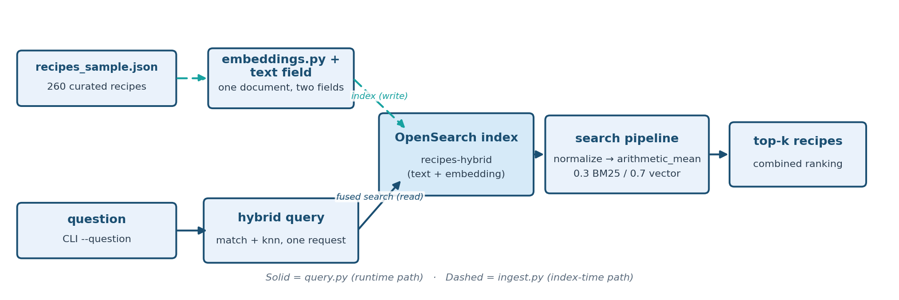

# Task 4: Hybrid RAG (Native)

Recipe-dataset task building directly on [Baseline Vector RAG](baseline-vector-rag.md)
and [Baseline BM25 RAG](baseline-bm25-rag.md), but this time BM25
keyword matching and vector semantic search are fused **server-side, in a
single OpenSearch query** (a native search pipeline), instead of running two separate retrieval systems
and reconciling them yourself.

**Drops the babysitter.** This removes the cost Baseline BM25 RAG introduced:
instead of keeping a separate service running just to catch what keyword
matching alone would, OpenSearch combines both signals in one request,
natively.

**Teaching goal:** Baseline Vector RAG showed vector search can silently drop the
correct document when two recipes share a name. Baseline BM25 RAG fixed that with
exact keyword matching plus entity tagging, which meant running an extra NER
microservice alongside it. Hybrid RAG (Native) shows you don't have to choose, and don't need
the extra service: OpenSearch's native `hybrid` query type runs a BM25
`match` and a kNN search in the same request, and a **search pipeline**
normalizes and combines their scores before the results ever leave the
cluster.

## What you will learn

By the end, you will have created one index that holds both a text field and a vector field, set up a search pipeline that normalizes and weights the two scores, and seen the 0.3 BM25 weight pull the right recipe back into the results without an NER service. Index and pipeline creation are `ensure_hybrid_index()` and `ensure_hybrid_pipeline()`, called from [`ingest.py`](../scripts/hybrid-rag-native/src/ingest.py); the query is `hybrid_search()`, called from [`ask()`](../scripts/hybrid-rag-native/src/query.py).

The practical sequence is:

| Step | Activity | Checkpoint |
| --- | --- | --- |
| [1](#step-1-enter-the-existing-workspace) | Re-enter the workspace and open the task directory. | `Makefile` and `src/` are listed. |
| [2](#step-2-ingest-and-create-the-search-pipeline) | Index the sample and create the pipeline. | The log reports `Ingested 260 recipes into hybrid index 'recipes-hybrid'`. |
| [3](#step-3-ask-both-fish-and-chips-questions) | Ask about each same-named recipe. | Each question's own recipe is in its top 2 hybrid hits. |
| [4](#step-4-validate) | Run the smoke test. | It prints `[PASS] Hybrid RAG (Native) answered both disambiguation questions with hybrid-retrieved evidence`. |

## Understand native hybrid search

### How it works

Unlike Baseline Vector RAG and Baseline BM25 RAG, there is only **one index** here (`recipes-hybrid`), and
each document has both a `text` field (for BM25) and an `embedding` field
(for kNN) — see `ensure_hybrid_index()` in `support/common/opensearch_client.py`.

Querying uses OpenSearch's `hybrid` query clause with two sub-queries.

Implementation excerpt (not a standalone exercise), the request body that `hybrid_search()` sends with its default `k` of 10 (the `[...]` stands for the question's embedding). `ask()` passes its `--top-k` instead, 5 by default, and one number sets both the result size and the kNN `k`; see [What the kNN k controls](#what-the-knn-k-controls):

```json
{
  "query": {
    "hybrid": {
      "queries": [
        { "match": { "text": "<question>" } },
        { "knn": { "embedding": { "vector": [...], "k": 10 } } }
      ]
    }
  }
}
```

A **search pipeline** (`hybrid-search-pipeline`, created once by `ingest.py`
via `ensure_hybrid_pipeline()`) post-processes the two result sets before
they're merged:

1. `normalization-processor` rescales each sub-query's raw scores onto a
  comparable `[0, 1]` range via **min-max normalization** — BM25 scores and
   cosine/L2 kNN scores otherwise live on completely different scales and
   can't be added together meaningfully.
2. `arithmetic_mean` **combination** then takes a weighted average of the two
  normalized scores: **BM25 weight 0.3, vector weight 0.7** by default. The
   query is still meaning-first (matching Baseline Vector RAG's semantic recall), but
   the 0.3 BM25 weight is enough, for this pair, to pull an exact source/name
   match back into the results — you will see this in Step 3. It is not enough
   to put that match first, and the weights themselves are a default, not a
   measured optimum (see [Why 0.3 and 0.7?](#why-03-and-07)).

This index's BM25 side searches only the indexed `text` field, and each recipe's `source` domain appears in that text. That gives BM25 a literal term to lock onto: the question's "thegratefulgirlcooks.com" matches that recipe's text and no other. There's no NER service and no separate `entities` field, since the raw text match is doing the work.

The weights are the `bm25_weight` / `vector_weight` parameters of
`ensure_hybrid_pipeline()`. `ingest.py` accepts `--bm25-weight` / `--vector-weight`
and passes them through, but `query.py` calls `ensure_hybrid_pipeline()` with the
0.3 / 0.7 defaults on every run, so a different weight set at ingest is replaced as
soon as you ask a question (read from the code; not run). To see how leaning further
toward BM25 or vector shifts the ranking without touching the cluster-wide pipeline, run the
sweep in [Why 0.3 and 0.7?](#why-03-and-07), which sends the weights inside each request.

### Architecture



### Dataset

Same curated 260-recipe sample as Baseline Vector RAG and Baseline BM25 RAG, in
`support/recipes/recipes_sample.json` — including the same real, verified ambiguous
pair: two "Fish and Chips" recipes (`thegratefulgirlcooks.com`, no cautions
vs. `womensweeklyfood.com.au`, Sulfites) where Baseline Vector RAG's vector search
demonstrably drops the first recipe from its top-5 results entirely.

## Before you begin

Complete [Task 1: Prepare the workspace](setup-environment.md). Your cluster must support the `hybrid` query and search pipelines (OpenSearch's neural-search plugin); without it, ingest and query stop with an OpenSearch error (see [troubleshooting](../troubleshooting/hybrid-rag-native.md#hybrid-query-or-search-pipeline-rejected-by-the-cluster)). Baseline Vector RAG and Baseline BM25 RAG are not prerequisites, but their results are what this task is compared against.

Every command below runs from `scripts/hybrid-rag-native/`. Each `python -m src.<module>` command has a matching Make target, listed in the [Hybrid RAG (Native) reference](../references/hybrid-rag-native.md#commands). Ingesting writes the `recipes-hybrid` index and the cluster-wide `hybrid-search-pipeline`.

## Step 1: enter the existing workspace

From the lab root:

```bash
source .venv/bin/activate
cd scripts/hybrid-rag-native
ls
```

**Expected:** `Makefile` and `src`.

## Step 2: ingest and create the search pipeline

```bash
python -m src.ingest
```

**Expected:** a log line `Ensured hybrid search pipeline 'hybrid-search-pipeline'`, then `Ingested 260 recipes into hybrid index 'recipes-hybrid'`. The search pipeline is cluster-wide, so on a shared cluster re-creating it changes it for everyone, and the sample scores in Step 3 assume the defaults (0.3 and 0.7). `ingest.py` accepts `--bm25-weight` and `--vector-weight`, but `query.py` re-creates the pipeline with the defaults on every run, so those flags do not carry over to a query (see the weights note in the overview above).

## Step 3: ask both Fish and Chips questions

```bash
python -m src.query --question "Does the thegratefulgirlcooks.com Fish and Chips recipe contain sulfites?"
python -m src.query --question "Does the womensweeklyfood.com.au Fish and Chips recipe contain sulfites?"
```

No NER service needs to be running for this task — that's the point.

**Expected:** each question's own named recipe is among the top 2 hybrid hits, and the answers are "no sulfites" for thegratefulgirlcooks.com and "yes, sulfites" for womensweeklyfood.com.au. The score is the normalized, weighted combination, not raw BM25 or cosine. Scores, ranks within the top 2, and wording vary slightly between runs. Sample output:

```text
QUESTION: Does the thegratefulgirlcooks.com Fish and Chips recipe contain sulfites?
  - Fish and chips | source=womensweeklyfood.com.au | score=0.7000
  - Fish and Chips | source=thegratefulgirlcooks.com | score=0.3000
  ...
ANSWER: ...does **not** contain sulfites. The allergen cautions for this recipe list "none listed."

QUESTION: Does the womensweeklyfood.com.au Fish and Chips recipe contain sulfites?
  - Fish and chips | source=womensweeklyfood.com.au | score=1.0000
  ...
ANSWER: Yes, ...**does contain sulfites**. The recipe lists "Sulfites" under its allergen cautions.
```

Compare this to Baseline Vector RAG, where vector search dropped
`thegratefulgirlcooks.com`'s recipe from the top-5 entirely — here it's
pulled back into the results (2nd place in the sample, still behind the more
semantically-central `womensweeklyfood.com.au` match, since vector is
weighted higher) purely because BM25's exact-text match on the source domain
contributes a nonzero combined score. That's the practical effect of the
0.3 BM25 weight on this pair: enough to retrieve the right document even
when it's not the vector-nearest one, without needing a separate NER service
to force it there like Baseline BM25 RAG did. "Enough" is a statement about
these two questions, not a guarantee; the probes below show what the weight
does and does not do.

### See the scores behind the fusion

The `0.7000` and `0.3000` in the sample output are not match qualities. This probe prints each sub-query's raw scores, then the fused scores, for both questions. It calls the same `hybrid_search()` as `ask()`, so no LLM is called and nothing is written.

```bash
python - <<'PY'
from src.common.config import load_settings
from src.common.embeddings import EmbeddingModel, to_list
from src.common.opensearch_client import VECTOR_FIELD, create_client, hybrid_search

s = load_settings()
client = create_client(s)
index = s.opensearch_hybrid_index
embedder = EmbeddingModel(s)


def show(label, resp):
    print(f"  {label}")
    for hit in resp["hits"]["hits"][:3]:
        src = hit["_source"]
        print(f"    {hit['_score']:7.4f}  {src['recipe_name']} | {src['source']}")


for source in ("thegratefulgirlcooks.com", "womensweeklyfood.com.au"):
    question = f"Does the {source} Fish and Chips recipe contain sulfites?"
    vec = to_list(embedder.encode([question])[0])
    print(f"\nQUESTION: {question}")
    show("BM25 only (raw score)",
         client.search(index=index, body={"size": 5, "query": {"match": {"text": question}}}))
    show("kNN only (raw score)",
         client.search(index=index, body={"size": 5, "query": {"knn": {VECTOR_FIELD: {"vector": vec, "k": 5}}}}))
    show("hybrid (normalized, weighted 0.3 / 0.7)", hybrid_search(client, index, question, vec, k=5))
PY
```

**Expected:** a model-loading log line and progress bar on stderr, then two blocks of three lists. The hybrid lists assume the pipeline still has the default weights, as Step 2 leaves it.

```text
QUESTION: Does the thegratefulgirlcooks.com Fish and Chips recipe contain sulfites?
  BM25 only (raw score)
     4.2986  Fish and Chips | thegratefulgirlcooks.com
     3.2271  Apricot and White Chip Cookies with Almonds Recipe | recipeofhealth.com
     2.8081  Chocolate Cups Recipe | thespruceeats.com
  kNN only (raw score)
     0.5903  Fish and chips | womensweeklyfood.com.au
     0.5611  Trout Amandine, Steamed Asparagus, and New Potatoes | Food Network
     0.5540  New Orleans BBQ Shrimp | Epicurious
  hybrid (normalized, weighted 0.3 / 0.7)
     0.7000  Fish and chips | womensweeklyfood.com.au
     0.3000  Fish and Chips | thegratefulgirlcooks.com
     0.2132  Trout Amandine, Steamed Asparagus, and New Potatoes | Food Network

QUESTION: Does the womensweeklyfood.com.au Fish and Chips recipe contain sulfites?
  BM25 only (raw score)
     4.6261  Fish and chips | womensweeklyfood.com.au
     3.2271  Apricot and White Chip Cookies with Almonds Recipe | recipeofhealth.com
     2.8081  Chocolate Cups Recipe | thespruceeats.com
  kNN only (raw score)
     0.5977  Fish and chips | womensweeklyfood.com.au
     0.5585  Trout Amandine, Steamed Asparagus, and New Potatoes | Food Network
     0.5463  Chocolate Stout Whoopie Pies | The Daily Meal
  hybrid (normalized, weighted 0.3 / 0.7)
     1.0000  Fish and chips | womensweeklyfood.com.au
     0.2928  Trout Amandine, Steamed Asparagus, and New Potatoes | Food Network
     0.1656  Chocolate Stout Whoopie Pies | The Daily Meal
```

Read the first block as a calculation. BM25's best hit is thegratefulgirlcooks.com's recipe (raw 4.2986) and the kNN best hit is womensweeklyfood.com.au's (raw 0.5903). Min-max normalization rescales each list so that its best hit becomes 1.0, then the weights apply: womensweeklyfood.com.au is `1.0 x 0.7 = 0.7000` and thegratefulgirlcooks.com is `1.0 x 0.3 = 0.3000`. Each recipe is missing from the other list, or at its bottom (where min-max gives 0.0), so neither adds anything from it. In the second block both signals pick the same recipe, so it scores `1.0 x 0.3 + 1.0 x 0.7 = 1.0000`. Two things follow: a hybrid score ranks results within one query and says nothing about how good a match is, and the raw BM25 and kNN scores are on different scales, which is why they need normalizing before they can be added.

### Why 0.3 and 0.7?

The defaults are not derived from this data. They are a meaning-first convention: most of the vote to the vector, enough to BM25 to pull in exact word matches. To see what the weight actually does, this probe sweeps it for both questions. It puts the weights in the request itself (an inline search pipeline), so it does not change the cluster-wide `hybrid-search-pipeline`.

```bash
python - <<'PY'
from src.common.config import load_settings
from src.common.embeddings import EmbeddingModel, to_list
from src.common.opensearch_client import VECTOR_FIELD, create_client

s = load_settings()
client = create_client(s)
embedder = EmbeddingModel(s)


def fused_hits(question, vec, bm25_weight, size=5):
    """Run the same hybrid query with an inline pipeline, so the cluster-wide pipeline is untouched."""
    body = {
        "size": size, "_source": ["recipe_name", "source"],
        "query": {"hybrid": {"queries": [
            {"match": {"text": question}},
            {"knn": {VECTOR_FIELD: {"vector": vec, "k": size}}},
        ]}},
        "search_pipeline": {"phase_results_processors": [{"normalization-processor": {
            "normalization": {"technique": "min_max"},
            "combination": {"technique": "arithmetic_mean",
                            "parameters": {"weights": [bm25_weight, round(1 - bm25_weight, 1)]}}}}]},
    }
    return client.search(index=s.opensearch_hybrid_index, body=body)["hits"]["hits"]


LABEL = {"thegratefulgirlcooks.com": "A", "womensweeklyfood.com.au": "B"}
for source in LABEL:
    question = f"Does the {source} Fish and Chips recipe contain sulfites?"
    vec = to_list(embedder.encode([question])[0])
    print(f"\nQuestion names recipe {LABEL[source]} ({source})")
    for bm25_weight in (0.0, 0.1, 0.2, 0.3, 0.5, 0.7, 0.9, 1.0):
        place = {}
        for rank, hit in enumerate(fused_hits(question, vec, bm25_weight), start=1):
            if hit["_source"]["source"] in LABEL:
                place[LABEL[hit["_source"]["source"]]] = f"#{rank} ({hit['_score']:.3f})"
        print(f"  bm25={bm25_weight:.1f} vector={1 - bm25_weight:.1f}   "
              f"A: {place.get('A', 'absent'):12s} B: {place.get('B', 'absent')}")
PY
```

**Expected:** two tables of eight rows each, showing where each Fish and Chips recipe lands as the BM25 weight rises.

```text
Question names recipe A (thegratefulgirlcooks.com)
  bm25=0.0 vector=1.0   A: absent       B: #1 (1.000)
  bm25=0.1 vector=0.9   A: #4 (0.100)   B: #1 (0.900)
  bm25=0.2 vector=0.8   A: #3 (0.200)   B: #1 (0.800)
  bm25=0.3 vector=0.7   A: #2 (0.300)   B: #1 (0.700)
  bm25=0.5 vector=0.5   A: #2 (0.500)   B: #1 (0.500)
  bm25=0.7 vector=0.3   A: #1 (0.700)   B: #2 (0.300)
  bm25=0.9 vector=0.1   A: #1 (0.900)   B: #3 (0.100)
  bm25=1.0 vector=0.0   A: #1 (1.000)   B: absent

Question names recipe B (womensweeklyfood.com.au)
  bm25=0.0 vector=1.0   A: absent       B: #1 (1.000)
  bm25=0.1 vector=0.9   A: absent       B: #1 (1.000)
  bm25=0.2 vector=0.8   A: absent       B: #1 (1.000)
  bm25=0.3 vector=0.7   A: absent       B: #1 (1.000)
  bm25=0.5 vector=0.5   A: absent       B: #1 (1.000)
  bm25=0.7 vector=0.3   A: absent       B: #1 (1.000)
  bm25=0.9 vector=0.1   A: absent       B: #1 (1.000)
  bm25=1.0 vector=0.0   A: absent       B: #1 (1.000)
```

The 0.3 row is the sample output above. For this pair:

- **Any BM25 weight above 0 brings recipe A back into the results.** The weight changes where it lands (fourth at 0.1, second from 0.3 to 0.5), not whether it appears. So "0.3 is enough" is true, but 0.1 or 0.5 would have worked here too. Nothing in this table singles out 0.3.
- **A does not rank first until BM25 outweighs vector.** At 0.5 the two scores tie, and A is first only from 0.7. The ranking alone cannot name the recipe the question asks for, which is why the model still relies on the `source:` label in its context.
- **The second question does not depend on the weight**, because BM25 and vector already agree on recipe B.

Two questions cannot pick a weight. Raising BM25 to 0.7 puts A first here, but it hurts questions that describe a dish without using its words; [BM25 versus kNN](../concepts/BM25_VS_KNN.md#probe-6-the-cost-of-a-high-bm25-weight) runs that comparison and describes how to choose weights for a real question set.

### What the kNN k controls

In `ask()`, one number does two jobs. `hybrid_search(k=top_k)` uses it as the number of hits returned (`size`) and as the `k` of the kNN sub-query, the number of nearest neighbours that side contributes. The sweep above never changed it. Because the fusion rescales scores within the results it is given, changing `k` can change a recipe's fused score and rank. This probe repeats the Step 3 query with the same 0.3 / 0.7 weights (sent inline, so the cluster-wide pipeline is untouched) and varies only `k`. It matches the Fish and Chips recipes by name and source, because other recipes share those sources. No LLM is called and nothing is written.

```bash
python - <<'PY'
from src.common.config import load_settings
from src.common.embeddings import EmbeddingModel, to_list
from src.common.opensearch_client import VECTOR_FIELD, create_client

s = load_settings()
client = create_client(s)
embedder = EmbeddingModel(s)
LABEL = {"thegratefulgirlcooks.com": "A", "womensweeklyfood.com.au": "B"}
PIPELINE = {"phase_results_processors": [{"normalization-processor": {
    "normalization": {"technique": "min_max"},
    "combination": {"technique": "arithmetic_mean", "parameters": {"weights": [0.3, 0.7]}}}}]}


def run(question, vec, k):
    body = {"size": k, "_source": ["recipe_name", "source"],
            "query": {"hybrid": {"queries": [{"match": {"text": question}},
                                              {"knn": {VECTOR_FIELD: {"vector": vec, "k": k}}}]}},
            "search_pipeline": PIPELINE}
    return client.search(index=s.opensearch_hybrid_index, body=body)["hits"]["hits"]


for source in LABEL:
    question = f"Does the {source} Fish and Chips recipe contain sulfites?"
    vec = to_list(embedder.encode([question])[0])
    print(f"\nQuestion names recipe {LABEL[source]} ({source})")
    for k in (2, 5, 10, 25, 50, 260):
        place = {}
        for rank, hit in enumerate(run(question, vec, k), start=1):
            src = hit["_source"]
            if src["source"] in LABEL and src["recipe_name"].lower() == "fish and chips":
                place[LABEL[src["source"]]] = f"#{rank} ({hit['_score']:.3f})"
        print(f"  k={k:3d}   A: {place.get('A', 'absent'):12s} B: {place.get('B', 'absent')}")
PY
```

**Expected:** two tables of six rows, showing where each Fish and Chips recipe lands as `k` grows.

```text
Question names recipe A (thegratefulgirlcooks.com)
  k=  2   A: #2 (0.300)   B: #1 (0.700)
  k=  5   A: #2 (0.300)   B: #1 (0.700)
  k= 10   A: #3 (0.300)   B: #1 (0.700)
  k= 25   A: #5 (0.300)   B: #1 (0.779)
  k= 50   A: #7 (0.344)   B: #1 (0.825)
  k=260   A: #2 (0.690)   B: #1 (0.856)

Question names recipe B (womensweeklyfood.com.au)
  k=  2   A: absent       B: #1 (1.000)
  k=  5   A: absent       B: #1 (1.000)
  k= 10   A: absent       B: #1 (1.000)
  k= 25   A: absent       B: #1 (1.000)
  k= 50   A: #18 (0.184)  B: #1 (1.000)
  k=260   A: #7 (0.497)   B: #1 (1.000)
```

For the first question, recipe B stays first at every `k`, but recipe A moves: second at `k` 2 to 5, then third, fifth and seventh as `k` grows to 50, then back to second at 260. Its score also changes, from 0.300 to 0.344 and then 0.690. Nothing about the recipe or the question changed. At small `k` the kNN side returns only a few neighbours, and A, which is not among them, gets nothing from the vector half. As `k` grows, more recipes enter through the vector side and some score above A. When `k` reaches the size of the whole index, the vector side scores every recipe, A included, and it moves up again. For the second question the right recipe is first at every `k`, and A appears only once `k` reaches 50.

Two consequences. The fused score is relative to the results of one query, as in the first probe above, so it cannot be compared across different values of `k`. And `top_k` is not only "how many recipes the model sees": raising it to rescue a missed recipe also changes how the others rank. Unlike [Hybrid RAG (NER + Rerank)](hybrid-rag-ner-rerank.md#see-grounding-and-refinement-without-the-model), there are no filters here, so this is not the post-filter effect; it comes from normalising over a different set of results. [BM25 versus kNN, Probe 4](../concepts/BM25_VS_KNN.md#probe-4-how-deep-the-missed-recipe-sits) shows how deep the missed recipe sits in a pure vector search.

## Step 4: validate

```bash
python -m src.validate
```

**Expected:** `[PASS] Hybrid RAG (Native) answered both disambiguation questions with hybrid-retrieved evidence`. The smoke test checks that each question returns an answer and that its own recipe is in the top 2 hybrid hits; Step 3 is where you see the scores and the answers.

## Completion checkpoint

You have completed Hybrid RAG (Native) when ingest created the pipeline and indexed 260 recipes, each question's own recipe appeared in its top 2 hits with no NER service running, and the smoke test passed. The lesson to carry forward: a weighted fusion improves what gets *retrieved*, but it is still a score.

For the reasoning behind the fusion and its weights, read [BM25 versus kNN](../concepts/BM25_VS_KNN.md#hybrid-fusion-and-the-weights-03-and-07). The [Hybrid RAG (Native) source map](../references/hybrid-rag-native.md#source-map) lists every file used here. Setup or runtime issue? See [Hybrid RAG (Native) troubleshooting](../troubleshooting/hybrid-rag-native.md)
for common fixes (missing `.env` values, certificate errors, Bedrock
model access, etc.).

Continue to [Task 5: Hybrid RAG (NER + Rerank)](hybrid-rag-ner-rerank.md), or return to the [task index](../README.md#tasks).
