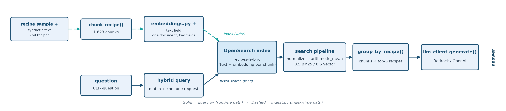

# Task 4: Hybrid RAG (Native)

Recipe-dataset task building directly on [Baseline Vector RAG](baseline-vector-rag.md)
and [Baseline BM25 RAG](baseline-bm25-rag.md), but this time BM25
keyword matching and vector semantic search are fused **server-side, in a
single OpenSearch query** (a native search pipeline), instead of running two separate retrieval systems
and reconciling them yourself.

**Drops the babysitter.** This removes the cost Baseline BM25 RAG introduced:
instead of keeping a separate service running just to catch what keyword
matching alone would, OpenSearch combines both signals in one request,
natively.

How the fusion works and what the two weights do is explained in [BM25 versus kNN](../concepts/BM25_VS_KNN.md#hybrid-fusion-and-the-weights). The vectors use the same embedding model as Baseline Vector RAG; [Embedding models](../concepts/EMBEDDING_MODELS.md) explains why this lab uses MiniLM.

**Teaching goal:** Baseline Vector RAG showed vector search can silently drop the
correct document when two recipes share a name. Baseline BM25 RAG fixed that with
exact keyword matching plus entity tagging, which meant running an extra NER
microservice alongside it. Hybrid RAG (Native) shows you don't have to choose, and don't need
the extra service: OpenSearch's native `hybrid` query type runs a BM25
`match` and a kNN search in the same request, and a **search pipeline**
normalizes and combines their scores before the results ever leave the
cluster.

## What you will learn

By the end, you will have created one index that holds both a text field and a vector field, set up a search pipeline that normalizes and weights the two scores, and seen equal BM25 and vector weights pull the right recipe back into the results without an NER service. Index and pipeline creation are `ensure_hybrid_index()` and `ensure_hybrid_pipeline()`, called from [`ingest.py`](../scripts/hybrid-rag-native/src/ingest.py); the query is `hybrid_search()`, called from [`ask()`](../scripts/hybrid-rag-native/src/query.py).

The practical sequence is:

| Step | Activity | Checkpoint |
| --- | --- | --- |
| [1](#step-1-enter-the-existing-workspace) | Re-enter the workspace and open the task directory. | `Makefile` and `src/` are listed. |
| [2](#step-2-ingest-and-create-the-search-pipeline) | Chunk and index the sample, and create the pipeline. | The log reports `Ingested 260 recipes as 1823 chunks into hybrid index 'recipes-hybrid'`. |
| [3](#step-3-ask-both-fish-and-chips-questions) | Ask about each same-named recipe. | Each question's own recipe is in its top 2 hybrid hits. |
| [4](#step-4-validate) | Run the smoke test. | It prints `[PASS] Hybrid RAG (Native) answered both disambiguation questions with hybrid-retrieved evidence`. |

## Understand native hybrid search

### How it works

Unlike Baseline Vector RAG and Baseline BM25 RAG, there is only **one index** here (`recipes-hybrid`), and
each document is a recipe chunk (the same 1,823 chunks as the earlier tasks) with both a `text` field (for BM25) and an `embedding` field
(for kNN) — see `ensure_hybrid_index()` in `support/common/opensearch_client.py`.

Querying uses OpenSearch's `hybrid` query clause with two sub-queries.

Implementation excerpt (not a standalone exercise), the request body that `hybrid_search()` sends with its default `k` of 10 (the `[...]` stands for the question's embedding). `ask()` passes `chunk_fetch(top_k)` instead, 30 chunks for the default `--top-k` of 5, and one number sets both the result size and the kNN `k`; see [What the kNN k controls](#what-the-knn-k-controls):

```json
{
  "query": {
    "hybrid": {
      "queries": [
        { "match": { "text": "<question>" } },
        { "knn": { "embedding": { "vector": [...], "k": 10 } } }
      ]
    }
  }
}
```

A **search pipeline** (`hybrid-search-pipeline`, created by `ingest.py` and
re-applied by `query.py`, both via `ensure_hybrid_pipeline()`) post-processes the two result sets before
they're merged:

1. `normalization-processor` rescales each sub-query's raw scores onto a
  comparable `[0, 1]` range via **min-max normalization** — BM25 scores and
   cosine/L2 kNN scores otherwise live on completely different scales and
   can't be added together meaningfully.
2. `arithmetic_mean` **combination** then takes a weighted average of the two
  normalized scores: **BM25 weight 0.5, vector weight 0.5** by default. The two
   signals get an equal vote, which is enough, for this pair, to bring the recipe
   an exact source/name match points to back into the top 2 -- you will see this in
   Step 3. It is not enough to make that match first, and the weights are a choice
   made from a few questions, not a measured optimum (see
   [Why equal weights?](#why-equal-weights)).

Because the index holds chunks, the hybrid query returns chunks, and `ask()` folds them back into recipes with `group_by_recipe()` (see [Why this lab chunks](baseline-vector-rag.md#why-this-lab-chunks)). A recipe's score is the fused score of its best chunk.

This index's BM25 side searches only the indexed `text` field, and each recipe's `source` domain appears in that text. That gives BM25 a literal term to lock onto: the question's "thegratefulgirlcooks.com" matches that recipe's text and no other. There's no NER service and no separate `entities` field, since the raw text match is doing the work.

The weights are the `bm25_weight` / `vector_weight` parameters of
`ensure_hybrid_pipeline()`. `ingest.py` accepts `--bm25-weight` / `--vector-weight`
and passes them through, but `query.py` calls `ensure_hybrid_pipeline()` with the
0.5 / 0.5 defaults on every run, so a different weight set at ingest is replaced as
soon as you ask a question (read from the code; not run). To see how leaning further
toward BM25 or vector shifts the ranking without touching the cluster-wide pipeline, run the
sweep in [Why equal weights?](#why-equal-weights), which sends the weights inside each request.

### Architecture



### Dataset

Same curated 260-recipe sample as Baseline Vector RAG and Baseline BM25 RAG, in
`support/recipes/recipes_sample.json`, with the same synthetic page text and chunks — including the same real, verified ambiguous
pair: two "Fish and Chips" recipes (`thegratefulgirlcooks.com`, no cautions
vs. `womensweeklyfood.com.au`, Sulfites) where Baseline Vector RAG's vector search
demonstrably drops the first recipe from its top-5 results entirely.

## Before you begin

Complete [Task 1: Prepare the workspace](setup-environment.md). Your cluster must support the `hybrid` query and search pipelines (OpenSearch's neural-search plugin, called AI Search in the Instaclustr console); without it, ingest and query stop with an OpenSearch error (see [troubleshooting](../troubleshooting/hybrid-rag-native.md#hybrid-query-or-search-pipeline-rejected-by-the-cluster)). Baseline Vector RAG and Baseline BM25 RAG are not prerequisites, but their results are what this task is compared against.

Every command below runs from `scripts/hybrid-rag-native/`. Each `python -m src.<module>` command has a matching Make target, listed in the [Hybrid RAG (Native) reference](../references/hybrid-rag-native.md#commands). Ingesting writes the `recipes-hybrid` index and the cluster-wide `hybrid-search-pipeline`.

## Step 1: enter the existing workspace

From the lab root:

```bash
source .venv/bin/activate
cd scripts/hybrid-rag-native
ls
```

**Expected:** `Makefile` and `src`.

## Step 2: ingest and create the search pipeline

```bash
python -m src.ingest
```

**Expected:** a log line `Ensured hybrid search pipeline 'hybrid-search-pipeline'`, then `Ingested 260 recipes as 1823 chunks into hybrid index 'recipes-hybrid'`. If `recipes-hybrid` has the older one-document-per-recipe layout, ingest logs a `WARNING`, deletes it and creates it again for chunks. `query.py` never deletes an index: against an old-layout index it stops with an `OldLayoutIndexError` that tells you to run ingest. Add `--recreate` to rebuild an index that already holds chunks. The search pipeline is cluster-wide, so on a shared cluster re-creating it changes it for everyone, and the sample scores in Step 3 assume the defaults (0.5 and 0.5). `ingest.py` accepts `--bm25-weight` and `--vector-weight`, but `query.py` re-creates the pipeline with the defaults on every run, so those flags do not carry over to a query (see the weights note in the overview above).

## Step 3: ask both Fish and Chips questions

```bash
python -m src.query --question "Does the thegratefulgirlcooks.com Fish and Chips recipe contain sulfites?"
python -m src.query --question "Does the womensweeklyfood.com.au Fish and Chips recipe contain sulfites?"
```

No NER service needs to be running for this task — that's the point.

**Expected:** each question's own named recipe is among the top 2 hybrid hits, and the answers are "no sulfites" for thegratefulgirlcooks.com and "yes, sulfites" for womensweeklyfood.com.au. Each hit is a recipe, with its best chunk's fused score and, in brackets, the sections of its chunks that matched. The score is the normalized, weighted combination, not raw BM25 or cosine. Scores, ranks within the top 2, and wording vary slightly between runs. Sample output:

```text
QUESTION: Does the thegratefulgirlcooks.com Fish and Chips recipe contain sulfites?
  - Fish and chips | source=womensweeklyfood.com.au | score=0.7113 | [Allergen cautions and labels, Introduction, Method steps 7-8]
  - Fish and Chips | source=thegratefulgirlcooks.com | score=0.5000 | [Allergen cautions and labels, Introduction, Method step 7]
  - Breakfast Skillet recipes | source=momspantrykitchen.com | score=0.3965 | [Allergen cautions and labels]
  ...
ANSWER: ...does **not** contain sulfites. The allergen cautions for this recipe list "none listed."

QUESTION: Does the womensweeklyfood.com.au Fish and Chips recipe contain sulfites?
  - Fish and chips | source=womensweeklyfood.com.au | score=1.0000 | [Allergen cautions and labels, Introduction, Method steps 7-8]
  - Breakfast Skillet recipes | source=momspantrykitchen.com | score=0.3008 | [Allergen cautions and labels]
  ...
ANSWER: Yes, ...**does contain sulfites**. The recipe lists "Sulfites" under its allergen cautions.
```

Compare this to Baseline Vector RAG, where vector search ranked `thegratefulgirlcooks.com`'s recipe 97th of 260. Here it is pulled back to 2nd place in the sample, still behind the more
semantically-central `womensweeklyfood.com.au` match, because BM25's exact-text match on the source domain
and recipe name contributes half of its combined score. That is the practical effect of the
equal BM25 weight on this pair: enough to retrieve the right document even
when it's not the vector-nearest one, without needing a separate NER service
to force it there like Baseline BM25 RAG did. "Enough" is a statement about
these two questions, not a guarantee; the probes below show what the weight
does and does not do.

### See the scores behind the fusion

The `0.7113` and `0.5000` in the sample output are not match qualities. This probe prints each sub-query's raw scores, then the fused scores, for both questions, with chunks folded into recipes as `ask()` does (the bracket is the recipe's best chunk). It calls the same `hybrid_search()` as `ask()`, so no LLM is called and nothing is written.

```bash
python - <<'PY'
from src.common.chunking import chunk_fetch, group_by_recipe
from src.common.config import load_settings
from src.common.embeddings import EmbeddingModel, to_list
from src.common.opensearch_client import VECTOR_FIELD, create_client, hybrid_search, normalize_hits

s = load_settings()
client = create_client(s)
index = s.opensearch_hybrid_index
embedder = EmbeddingModel(s)
n = chunk_fetch(5)  # 30 chunks, as ask() requests for the top 5 recipes


def show(label, resp):
    print(f"  {label}")
    for h in group_by_recipe(normalize_hits(resp), top_k=3):
        print(f"    {h['score']:7.4f}  {h['recipe_name']} | {h['source']}  [{h['section']}]")


for source in ("thegratefulgirlcooks.com", "womensweeklyfood.com.au"):
    question = f"Does the {source} Fish and Chips recipe contain sulfites?"
    vec = to_list(embedder.encode([question])[0])
    print(f"\nQUESTION: {question}")
    show("BM25 only (raw score)",
         client.search(index=index, body={"size": n, "query": {"match": {"text": question}}}))
    show("kNN only (raw score)",
         client.search(index=index, body={"size": n, "query": {"knn": {VECTOR_FIELD: {"vector": vec, "k": n}}}}))
    show("hybrid (normalized, weighted by the pipeline)", hybrid_search(client, index, question, vec, k=n))
PY
```

**Expected:** a model-loading log line and progress bar on stderr, then two blocks of three lists. The hybrid lists assume the pipeline still has the default weights, as Step 2 leaves it.

```text
QUESTION: Does the thegratefulgirlcooks.com Fish and Chips recipe contain sulfites?
  BM25 only (raw score)
     7.0304  Fish and Chips | thegratefulgirlcooks.com  [Method step 7]
     4.9478  Fish and chips | womensweeklyfood.com.au  [Introduction]
     3.8850  Lemon-Garlic Goat Cheese Dip Recipe | The Daily Meal  [Allergen cautions and labels]
  kNN only (raw score)
     0.5726  Fish and chips | womensweeklyfood.com.au  [Allergen cautions and labels]
     0.5613  Breakfast Skillet recipes | momspantrykitchen.com  [Allergen cautions and labels]
     0.5516  Trout Amandine, Steamed Asparagus, and New Potatoes | Food Network  [Allergen cautions and labels]
  hybrid (normalized, weighted by the pipeline)
     0.7113  Fish and chips | womensweeklyfood.com.au  [Allergen cautions and labels]
     0.5000  Fish and Chips | thegratefulgirlcooks.com  [Method step 7]
     0.3965  Breakfast Skillet recipes | momspantrykitchen.com  [Allergen cautions and labels]

QUESTION: Does the womensweeklyfood.com.au Fish and Chips recipe contain sulfites?
  BM25 only (raw score)
     7.5714  Fish and chips | womensweeklyfood.com.au  [Allergen cautions and labels]
     4.4614  Fish and Chips | thegratefulgirlcooks.com  [Introduction]
     3.8850  Lemon-Garlic Goat Cheese Dip Recipe | The Daily Meal  [Allergen cautions and labels]
  kNN only (raw score)
     0.5851  Fish and chips | womensweeklyfood.com.au  [Allergen cautions and labels]
     0.5554  Breakfast Skillet recipes | momspantrykitchen.com  [Allergen cautions and labels]
     0.5521  Trout Amandine, Steamed Asparagus, and New Potatoes | Food Network  [Allergen cautions and labels]
  hybrid (normalized, weighted by the pipeline)
     1.0000  Fish and chips | womensweeklyfood.com.au  [Allergen cautions and labels]
     0.3008  Breakfast Skillet recipes | momspantrykitchen.com  [Allergen cautions and labels]
     0.2785  Trout Amandine, Steamed Asparagus, and New Potatoes | Food Network  [Allergen cautions and labels]
```

Read the first block as a calculation. BM25's best chunk is thegratefulgirlcooks.com's Method step 7 (raw 7.0304), and the kNN best chunk is womensweeklyfood.com.au's allergen chunk (raw 0.5726). Min-max normalization rescales each list so that its best chunk becomes 1.0, then the 0.5 weights apply. thegratefulgirlcooks.com's chunk is `1.0 x 0.5 = 0.5000`, and it is in no vector result, so that is all it gets. womensweeklyfood.com.au's allergen chunk gets `1.0 x 0.5 = 0.5` from the vector side, plus about `0.42 x 0.5 = 0.21` because that chunk also matched the question's words, so `0.7113`. In the second block both signals pick the same chunk, so it scores `1.0 x 0.5 + 1.0 x 0.5 = 1.0000`. Two things follow: a hybrid score ranks results within one query and says nothing about how good a match is, and the raw BM25 and kNN scores are on different scales, which is why they need normalizing before they can be added. Note also that the vector side fills its list with the allergen chunks of unrelated recipes (Breakfast Skillet, Trout Amandine): the question is mostly "contain sulfites?", and that is what an allergen chunk looks like.

### Why equal weights?

The pipeline defaults to 0.5 BM25 and 0.5 vector. That is a choice made from a few questions, not a value derived from this data, and it was not always the default. This lab first used 0.3 BM25 and 0.7 vector, a meaning-first convention that worked while each recipe was one document. With chunks it did not: recipe A fell to about fifth place. A chunk that only BM25 finds can score at most the BM25 weight, because it earns nothing from the vector side. At 0.3 that is 0.3, and the allergen chunks of unrelated recipes that the vector side likes (see above) scored higher than that. At 0.5 the same chunk scores 0.5 and is second.

To see what the weight does, this probe sweeps it for both questions. It puts the weights in the request itself (an inline search pipeline), so it does not change the cluster-wide `hybrid-search-pipeline`.

```bash
python - <<'PY'
from src.common.chunking import chunk_fetch, group_by_recipe
from src.common.config import load_settings
from src.common.embeddings import EmbeddingModel, to_list
from src.common.opensearch_client import VECTOR_FIELD, create_client, normalize_hits

s = load_settings()
client = create_client(s)
embedder = EmbeddingModel(s)
n = chunk_fetch(5)  # 30 chunks, as ask() requests for the top 5 recipes


def fused_recipes(question, vec, bm25_weight):
    """Run the same hybrid query with an inline pipeline, so the cluster-wide pipeline is untouched."""
    body = {
        "size": n,
        "query": {"hybrid": {"queries": [
            {"match": {"text": question}},
            {"knn": {VECTOR_FIELD: {"vector": vec, "k": n}}},
        ]}},
        "search_pipeline": {"phase_results_processors": [{"normalization-processor": {
            "normalization": {"technique": "min_max"},
            "combination": {"technique": "arithmetic_mean",
                            "parameters": {"weights": [bm25_weight, round(1 - bm25_weight, 1)]}}}}]},
    }
    return group_by_recipe(normalize_hits(client.search(index=s.opensearch_hybrid_index, body=body)))


LABEL = {"thegratefulgirlcooks.com": "A", "womensweeklyfood.com.au": "B"}
for source in LABEL:
    question = f"Does the {source} Fish and Chips recipe contain sulfites?"
    vec = to_list(embedder.encode([question])[0])
    print(f"\nQuestion names recipe {LABEL[source]} ({source})")
    for bm25_weight in (0.0, 0.1, 0.2, 0.3, 0.5, 0.7, 0.9, 1.0):
        place = {}
        for rank, hit in enumerate(fused_recipes(question, vec, bm25_weight), start=1):
            if hit["source"] in LABEL and hit["recipe_name"].lower() == "fish and chips":
                place[LABEL[hit["source"]]] = f"#{rank} ({hit['score']:.3f})"
        print(f"  bm25={bm25_weight:.1f} vector={1 - bm25_weight:.1f}   "
              f"A: {place.get('A', 'absent'):12s} B: {place.get('B', 'absent')}")
PY
```

**Expected:** two tables of eight rows each, showing where each Fish and Chips recipe lands, among recipes, as the BM25 weight rises.

```text
Question names recipe A (thegratefulgirlcooks.com)
  bm25=0.0 vector=1.0   A: absent       B: #1 (1.000)
  bm25=0.1 vector=0.9   A: #17 (0.100)  B: #1 (0.942)
  bm25=0.2 vector=0.8   A: #9 (0.200)   B: #1 (0.885)
  bm25=0.3 vector=0.7   A: #5 (0.300)   B: #1 (0.827)
  bm25=0.5 vector=0.5   A: #2 (0.500)   B: #1 (0.711)
  bm25=0.7 vector=0.3   A: #1 (0.700)   B: #2 (0.596)
  bm25=0.9 vector=0.1   A: #1 (0.900)   B: #2 (0.480)
  bm25=1.0 vector=0.0   A: #1 (1.000)   B: #2 (0.484)

Question names recipe B (womensweeklyfood.com.au)
  bm25=0.0 vector=1.0   A: absent       B: #1 (1.000)
  bm25=0.1 vector=0.9   A: #24 (0.032)  B: #1 (1.000)
  bm25=0.2 vector=0.8   A: #18 (0.064)  B: #1 (1.000)
  bm25=0.3 vector=0.7   A: #13 (0.096)  B: #1 (1.000)
  bm25=0.5 vector=0.5   A: #4 (0.160)   B: #1 (1.000)
  bm25=0.7 vector=0.3   A: #2 (0.225)   B: #1 (1.000)
  bm25=0.9 vector=0.1   A: #2 (0.289)   B: #1 (1.000)
  bm25=1.0 vector=0.0   A: #2 (0.321)   B: #1 (1.000)
```

The 0.5 row of the first table is the sample output above. For this pair:

- **Recipe A needs a real BM25 vote to be retrieved.** It is absent at 0, 17th at 0.1, 9th at 0.2 and 5th at 0.3, the last place that a top-5 would still include it. It reaches 2nd at 0.5. So the weight decides whether the right recipe reaches the model at all, and 0.3 is a borderline value for this index.
- **A does not rank first until BM25 outweighs vector.** At 0.5 it is second, and first only from 0.7. The ranking alone cannot name the recipe the question asks for, which is why the model still relies on the `source:` label in its context.
- **Recipe B is first at every weight in the second question**, because BM25 and vector already agree. The cost of a high BM25 weight shows on the other recipe: A, which only shares B's name, climbs from 24th to 2nd as the weight rises.

Two questions cannot pick a weight. Raising BM25 to 0.7 puts A first here, but it hurts questions that describe a dish without using its words; [BM25 versus kNN](../concepts/BM25_VS_KNN.md#probe-6-the-cost-of-a-high-bm25-weight) runs that comparison and describes how to choose weights for a real question set.

### What the kNN k controls

In `ask()`, one number does two jobs. `hybrid_search(k=chunk_fetch(top_k))` uses it as the number of chunks returned (`size`) and as the `k` of the kNN sub-query, the number of nearest chunks that side contributes. The sweep above never changed it. Because the fusion rescales scores within the results it is given, changing `k` can change a recipe's fused score and rank. This probe repeats the Step 3 query with the same 0.5 / 0.5 weights (sent inline, so the cluster-wide pipeline is untouched) and varies only `k`, from 6 chunks (what `--top-k 1` would send) to all 1,823 chunks in the index. It matches the Fish and Chips recipes by name and source, because other recipes share those sources. No LLM is called and nothing is written.

```bash
python - <<'PY'
from src.common.chunking import group_by_recipe
from src.common.config import load_settings
from src.common.embeddings import EmbeddingModel, to_list
from src.common.opensearch_client import VECTOR_FIELD, create_client, normalize_hits

s = load_settings()
client = create_client(s)
embedder = EmbeddingModel(s)
LABEL = {"thegratefulgirlcooks.com": "A", "womensweeklyfood.com.au": "B"}
PIPELINE = {"phase_results_processors": [{"normalization-processor": {
    "normalization": {"technique": "min_max"},
    "combination": {"technique": "arithmetic_mean", "parameters": {"weights": [0.5, 0.5]}}}}]}


def run(question, vec, k):
    body = {"size": k,
            "query": {"hybrid": {"queries": [{"match": {"text": question}},
                                              {"knn": {VECTOR_FIELD: {"vector": vec, "k": k}}}]}},
            "search_pipeline": PIPELINE}
    return group_by_recipe(normalize_hits(client.search(index=s.opensearch_hybrid_index, body=body)))


for source in LABEL:
    question = f"Does the {source} Fish and Chips recipe contain sulfites?"
    vec = to_list(embedder.encode([question])[0])
    print(f"\nQuestion names recipe {LABEL[source]} ({source})")
    for k in (6, 30, 60, 150, 300, 1823):
        place = {}
        for rank, hit in enumerate(run(question, vec, k), start=1):
            if hit["source"] in LABEL and hit["recipe_name"].lower() == "fish and chips":
                place[LABEL[hit["source"]]] = f"#{rank} ({hit['score']:.3f})"
        print(f"  k={k:4d}   A: {place.get('A', 'absent'):12s} B: {place.get('B', 'absent')}")
PY
```

**Expected:** two tables of six rows, showing where each Fish and Chips recipe lands as `k` grows.

```text
Question names recipe A (thegratefulgirlcooks.com)
  k=   6   A: #1 (0.500)   B: #2 (0.500)
  k=  30   A: #2 (0.500)   B: #1 (0.711)
  k=  60   A: #2 (0.500)   B: #1 (0.740)
  k= 150   A: #2 (0.500)   B: #1 (0.748)
  k= 300   A: #2 (0.630)   B: #1 (0.794)
  k=1823   A: #2 (0.799)   B: #1 (0.833)

Question names recipe B (womensweeklyfood.com.au)
  k=   6   A: absent       B: #1 (1.000)
  k=  30   A: #4 (0.160)   B: #1 (1.000)
  k=  60   A: #4 (0.191)   B: #1 (1.000)
  k= 150   A: #20 (0.199)  B: #1 (1.000)
  k= 300   A: #58 (0.314)  B: #1 (1.000)
  k=1823   A: #18 (0.539)  B: #1 (1.000)
```

For the first question, recipe A is second at every `k` from 30 up, so the default is stable here, but its score is not: it stays at 0.500 while the BM25 side alone supports it, then rises to 0.630 and 0.799 as the vector side's list grows to include more of A's chunks. At `k=6` the two recipes tie at 0.500, so their order is arbitrary. For the second question the right recipe is first at every `k`, and the *other* recipe's rank moves a lot (4th, 20th, 58th, 18th), purely because the fusion normalizes over a different set of results. Nothing about the recipes or the question changed.

Two consequences. The fused score is relative to the results of one query, as in the first probe above, so it cannot be compared across different values of `k`. And `top_k` is not only "how many recipes the model sees": it sets how many chunks are fetched, and that changes how the others rank. Unlike [Hybrid RAG (NER + Rerank)](hybrid-rag-ner-rerank.md#see-grounding-and-refinement-without-the-model), there are no filters here, so this is not the post-filter effect; it comes from normalising over a different set of results. [BM25 versus kNN, Probe 4](../concepts/BM25_VS_KNN.md#probe-4-how-deep-the-missed-recipe-sits) shows how deep the missed recipe sits in a pure vector search.

## Step 4: validate

```bash
python -m src.validate
```

**Expected:** `[PASS] Hybrid RAG (Native) answered both disambiguation questions with hybrid-retrieved evidence`. The smoke test checks that each question returns an answer and that its own recipe is in the top 2 hybrid hits; Step 3 is where you see the scores and the answers.

## Completion checkpoint

You have completed Hybrid RAG (Native) when ingest created the pipeline and indexed 260 recipes as 1823 chunks, each question's own recipe appeared in its top 2 hits with no NER service running, and the smoke test passed. The lesson to carry forward: a weighted fusion improves what gets *retrieved*, but it is still a score.

For the reasoning behind the fusion and its weights, read [BM25 versus kNN](../concepts/BM25_VS_KNN.md#hybrid-fusion-and-the-weights). The [Hybrid RAG (Native) source map](../references/hybrid-rag-native.md#source-map) lists every file used here. Setup or runtime issue? See [Hybrid RAG (Native) troubleshooting](../troubleshooting/hybrid-rag-native.md)
for common fixes (missing `.env` values, certificate errors, Bedrock
model access, etc.).

Continue to [Task 5: Hybrid RAG (NER + Rerank)](hybrid-rag-ner-rerank.md), or return to the [task index](../README.md#tasks).
