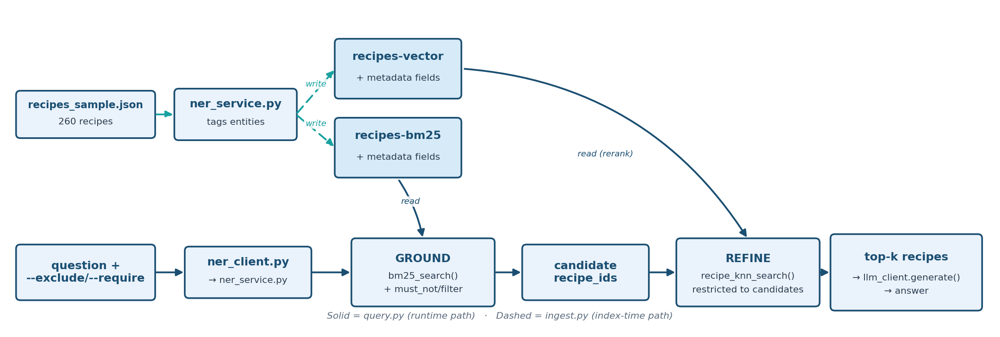

# Task 5: Hybrid RAG (NER + Rerank)

Recipe-dataset task building on [Hybrid RAG (Native)](hybrid-rag-native.md), but
solving a gap that Hybrid RAG (Native)'s native hybrid pipeline can't: **guaranteed hard
exclusions**, e.g. "never recommend a recipe with sulfites." It does this with an external NER service, BM25 grounding with hard filters, and a vector rerank of the grounded set.

**Combining two guesses still isn't a guarantee.** Hybrid RAG (Native)'s hybrid score
blends two signals into one number — but a recipe that says "contains
peanuts" can still outscore one that doesn't, and slip through. This task
makes exclusions absolute instead of just likely.


**Teaching goal:** Vector similarity and even Hybrid RAG (Native)'s weighted
BM25+vector hybrid are still *scoring* mechanisms — they can rank a
sulfite-containing recipe lower, but nothing in a similarity score can
*guarantee* a negation like "no sulfites" is honored, because "no sulfites"
and "contains sulfites" can still embed close together, and BM25 keyword
matching has no built-in concept of exclusion either. Hybrid RAG (NER + Rerank) fixes this
with explicit, generalized `--exclude`/`--require` structured filters
applied as real OpenSearch `must_not`/`filter` clauses — which are boolean,
not scored, so they can't be outvoted by relevance.

## What you will learn

By the end, you will have run a two-phase retrieval pipeline, seen a sulfite-containing recipe legitimately win without a filter, and seen `--exclude allergen=Sulfites` remove it from both phases. Grounding is `bm25_search()` and refinement is `recipe_knn_search()`, both called from [`ask()`](../scripts/hybrid-rag-ner-rerank/src/query.py); the filters are built by `build_recipe_bm25_query()` and `build_recipe_vector_query()` in [`opensearch_client.py`](../support/common/opensearch_client.py).

The practical sequence is:

| Step | Activity | Checkpoint |
| --- | --- | --- |
| [1](#step-1-enter-the-existing-workspace) | Re-enter the workspace and open the task directory. | `Makefile` and `src/` are listed. |
| [2](#step-2-start-the-ner-service) | Start Baseline BM25 RAG's NER service in Terminal 1. | Flask reports it is serving on `127.0.0.1:8000`. |
| [3](#step-3-ingest-into-both-indexes) | Index the sample into the BM25 and vector indexes. | The log reports `Ingested 260 recipes into 'recipes-bm25' and 'recipes-vector'`. |
| [4](#step-4-query-with-and-without-a-hard-filter) | Ask the same question with and without `--exclude`. | The sulfite recipe appears without the filter and is absent from both phases with it. |
| [5](#step-5-validate) | Run the smoke test with NER still running. | It prints two `[PASS] Hybrid RAG (NER + Rerank) ...` lines. |

## Understand hard constraints in two-phase retrieval

### How it works — externally orchestrated two-phase retrieval

Unlike Hybrid RAG (Native)'s single native `hybrid` query + search pipeline, Hybrid RAG (NER + Rerank)
runs two separate queries across two separate indexes, glued together by
client-side (Python) logic:

1. **GROUND** — `bm25_search()` against `recipes-bm25`: a keyword + NER-entity
   query (same style as Baseline BM25 RAG) that also applies any `--exclude`/`--require`
   filters as hard `must_not`/`filter` clauses. This produces a candidate set
   that is *provably* free of anything excluded — not just down-ranked.
2. **REFINE** — `recipe_knn_search()` against `recipes-vector`, restricted via
   `include_recipe_ids` to exactly the grounding set's candidate IDs (plus the
   same filters again, for defense-in-depth). This re-ranks the
   already-safe candidates by semantic similarity to the question, so the
   final top-k is both constraint-compliant *and* relevant.

Both indexes are populated by `ingest.py` from the same 260-recipe sample
used by Baseline Vector RAG, Baseline BM25 RAG and Hybrid RAG (Native), tagged with the same structured metadata
(`cautions`, `diet_labels`, `cuisine_type`, `meal_type`, `dish_type`) so
filters behave identically against either index. The generalized field
aliases (`allergen`→`cautions`, `diet`→`diet_labels`, `cuisine`→`cuisine_type`,
etc., see `FILTERABLE_FIELDS` in `support/common/opensearch_client.py`) mean any of
these can be excluded or required from the CLI — not just one hardcoded flag.

### Architecture



### Dataset

Same curated 260-recipe sample as Baseline Vector RAG, Baseline BM25 RAG and Hybrid RAG (Native), in
`support/recipes/recipes_sample.json`. Of the 260 recipes, **201 carry a "Sulfites"
caution** — a large enough majority that a plain, unfiltered "fish and
chips" query legitimately surfaces a sulfite-containing recipe as the
top result, making it a genuine (not contrived) test of the exclusion
guarantee below.

## Before you begin

Complete [Task 1: Prepare the workspace](setup-environment.md). This task reuses Baseline BM25 RAG's NER service, so you need the `en_core_web_sm` model installed; you do not need to have run Baseline BM25 RAG's ingest.

Use two terminals with the `.venv` active: Terminal 1 in `scripts/baseline-bm25-rag/` for the NER service, Terminal 2 in `scripts/hybrid-rag-ner-rerank/`. Each `python -m src.<module>` command has a matching Make target, listed in the [Hybrid RAG (NER + Rerank) reference](../references/hybrid-rag-ner-rerank.md#commands). Ingesting writes `recipes-bm25` and `recipes-vector`, which Governance Tiering later re-indexes with real tiers.

## Step 1: enter the existing workspace

From the lab root, in Terminal 2:

```bash
source .venv/bin/activate
cd scripts/hybrid-rag-ner-rerank
ls
```

**Expected:** `Makefile` and `src`.

## Step 2: start the NER service

Terminal 1 (a new terminal opened in the lab root; NER service, stays running — the same one Baseline BM25 RAG uses):

```bash
source .venv/bin/activate
cd scripts/baseline-bm25-rag
python -m src.ner_service
```

**Expected:** Flask's startup message, including `Running on http://127.0.0.1:8000`. If it's already running from Baseline BM25 RAG, reuse it instead of starting a second copy.

## Step 3: ingest into both indexes

Terminal 2:

```bash
python -m src.ingest
```

**Expected:** a log line `Ingested 260 recipes into 'recipes-bm25' and 'recipes-vector'`. Governance Tiering later re-indexes these same two indexes with real tiers. If you rerun this ingest after Task 6, every recipe goes back to the placeholder tier, so rerun Governance Tiering's ingest before querying it again.

## Step 4: query with and without a hard filter

```bash
# No hard filter -- both "Fish and Chips" recipes are eligible
python -m src.query --question "Suggest a British fish and chips recipe."

# Hard-exclude anything with sulfites
python -m src.query --question "Suggest a British fish and chips recipe." --exclude allergen=Sulfites

# --require works the same way, e.g.:
python -m src.query --question "Suggest an Italian dinner idea." --require cuisine=italian --require diet=Low-Carb
```

**Expected:** each command prints a `GROUNDING` list (phase 1), a `REFINED` list (phase 2), and the model's `ANSWER`. Scores and wording vary between runs (the BM25 scores especially, which drift as the index changes); check these properties. The sample outputs below are abridged: the real output also prints the model's full answer and lists up to 10 grounding hits.

**Without a filter**, the sulfite-containing recipe legitimately appears in both phases and the answer presents both recipes. This is the *correct*, unforced behavior when nothing says to avoid it. Sample output:

```text
GROUNDING (BM25, 25 candidates, filters applied):
  - Fish and Chips | source=thegratefulgirlcooks.com | cautions=[] | score=22.1129
  - Fish and chips | source=womensweeklyfood.com.au | cautions=['Sulfites'] | score=22.1129
  ...
REFINED (vector rerank of grounding set, top 5):
  - Fish and chips | source=womensweeklyfood.com.au | cautions=['Sulfites'] | score=0.7941
  - Fish and Chips | source=thegratefulgirlcooks.com | cautions=[] | score=0.7691
  ...
ANSWER: presents BOTH recipes, sulfites and all, as valid options.
```

**With `--exclude allergen=Sulfites`**, the sulfite-containing recipe is gone from *both* the 25-candidate grounding set and the final refined results, not just pushed down. No hit lists `Sulfites` under `cautions`. Sample output:

```text
GROUNDING (BM25, 25 candidates, filters applied):
  - Fish and Chips | source=thegratefulgirlcooks.com | cautions=[] | score=22.1129
  ...
REFINED (vector rerank of grounding set, top 4):
  - Fish and Chips | source=thegratefulgirlcooks.com | cautions=[] | score=0.7691
  ...
ANSWER: recommends ONLY thegratefulgirlcooks.com's recipe, correctly noting it has no allergen cautions.
```

The refined list can be shorter than the grounding list (here "top 4" from 25 candidates). The vector step restricts results to the grounding IDs, but OpenSearch applies that restriction after it has taken the `--candidate-k` (25) nearest neighbors across the *whole* index, so a grounding candidate that is not among those neighbors is dropped. In a check run for this lab, the same `--exclude` query kept 4 of 25 candidates at `candidate-k` 25 and all 25 at 300. The exclusion guarantee still holds either way; only recall is affected. [Governance Tiering](governance-tiering.md) raises the neighbor pool for this reason.

**With `--require cuisine=italian --require diet=Low-Carb`**, every hit in both phases is an Italian recipe labelled Low-Carb. Only 3 recipes in the sample carry both labels, and the filter applies on top of the BM25 text match, so you only see those whose words match your question. "Suggest an Italian dinner idea." grounds exactly one, *Classic Spaghetti* (a one-line `GROUNDING (BM25, 1 candidates, filters applied)` list, one `REFINED` hit, and an answer that suggests it). A question that matches none of the three, such as "Suggest a dinner idea.", grounds zero recipes and the model answers "I don't know": a hard filter never pads the results with recipes that fail it.

This is the practical difference between "hybrid scoring" (Hybrid RAG (Native), where
sulfite-free wasn't even an option the system could be told to enforce) and
"hybrid scoring + hard constraints" (Hybrid RAG (NER + Rerank)): the exclusion isn't a
preference the ranking might honor, it's a guarantee.

### See grounding and refinement without the model

This probe runs both phases of `ask()` for the `--exclude allergen=Sulfites` question, and runs the refine step twice, with the neighbour pool (`--candidate-k`) at 25 and at 300. It asks for as many refined hits as there are grounding candidates, so the first line of each refine result shows how many survived. It needs the NER service from Step 2 and the indexes from Step 3. No LLM is called and nothing is written.

```bash
python - <<'PY'
from src.common.config import load_settings
from src.common.embeddings import EmbeddingModel, to_list
from src.common.ner_client import NERClient
from src.common.opensearch_client import (
    bm25_search, create_client, normalize_hits, parse_field_value_pairs, recipe_knn_search,
)

s = load_settings()
client, ner, model = create_client(s), NERClient(s), EmbeddingModel(s)
question = "Suggest a British fish and chips recipe."
exclude = parse_field_value_pairs(["allergen=Sulfites"])

entities = ner.extract_entities(question)
grounding = normalize_hits(bm25_search(client, s.opensearch_recipe_bm25_index, question, k=25, entities=entities, exclude=exclude))
ids = [h["recipe_id"] for h in grounding]
print(f"entities={entities}  grounding candidates={len(ids)}  any Sulfites in grounding: {any('Sulfites' in (h.get('cautions_display') or []) for h in grounding)}")
print("grounding (BM25) top 3:")
for h in grounding[:3]:
    print(f"  {h['score']:7.4f}  {h['recipe_name'][:40]} | {h['source']}")

vec = to_list(model.encode([question])[0])
for pool in (25, 300):
    refined = normalize_hits(recipe_knn_search(client, s.opensearch_recipe_vector_index, vec, k=len(ids), candidate_k=pool, include_recipe_ids=ids, exclude=exclude))
    print(f"refine with candidate-k={pool}: kept {len(refined)} of {len(ids)} grounding candidates")
    for h in refined[:3]:
        print(f"  {h['score']:7.4f}  {h['recipe_name'][:40]} | {h['source']}")
PY
```

**Expected:** the grounding list, then the refine result for each pool size. The BM25 scores drift with the index; the counts and the order of the first hits are the properties to check.

```text
entities=['british']  grounding candidates=25  any Sulfites in grounding: False
grounding (BM25) top 3:
  22.1129  Fish and Chips | thegratefulgirlcooks.com
   8.6906  Microwave Potato Chips | Food Network
   7.8901  Weight Watchers Potato Chips | food.com
refine with candidate-k=25: kept 4 of 25 grounding candidates
   0.7691  Fish and Chips | thegratefulgirlcooks.com
   0.7334  Recipe: Freezer-to-Grill Steak and Veget | The Kitchn
   0.7301  Steak and Egg Breakfast Sandwich | Delish
refine with candidate-k=300: kept 25 of 25 grounding candidates
   0.7691  Fish and Chips | thegratefulgirlcooks.com
   0.7334  Recipe: Freezer-to-Grill Steak and Veget | The Kitchn
   0.7301  Steak and Egg Breakfast Sandwich | Delish
```

Three things to read from this. First, grounding never contains a Sulfites recipe: the filter is part of the BM25 query, so the exclusion holds before any scoring happens. Second, refinement reorders the survivors by meaning: the second and third grounding hits are potato-chip recipes that share a word with the question, and the vector step puts two steak and sandwich recipes in their place because it compares the whole question to each recipe. That shows what the vector step does to a candidate set; it is not evidence that the new order is better. Third, the neighbour pool decides recall: the same three top hits come back at both pool sizes, but only 4 of the 25 candidates survive at 25 and all 25 at 300. The exclusion guarantee holds either way. For why the pool behaves this way, see [BM25 versus kNN, Probe 3](../concepts/BM25_VS_KNN.md#probe-3-a-post-filter-over-a-small-pool); for what the `british` entity is, and what NER can and cannot extract, see [Named-entity recognition in retrieval](../concepts/NER_IN_RETRIEVAL.md).

## Step 5: validate

With `ner_service.py` still running:

```bash
python -m src.validate
```

`validate.py` asserts the exclusion guarantee directly: with
`--exclude allergen=Sulfites`, no recipe in either the grounding set or the
refined set may carry the Sulfites caution.

**Expected:** two lines, `[PASS] Hybrid RAG (NER + Rerank) grounded ... candidates and refined to ... hits` and `[PASS] Hybrid RAG (NER + Rerank) enforced the sulfite exclusion filter across ... grounding hits and ... refined hits`. Both checks fail up front, with a message, if the NER service isn't answering (the clients otherwise hide that). The first also checks that both Fish and Chips recipes are in the grounding set and that the sulfite recipe appears in the unfiltered results; the second also checks that the sulfite-free recipe is still returned.

## Completion checkpoint

You have completed Hybrid RAG (NER + Rerank) when ingest wrote 260 recipes to both indexes, the unfiltered query surfaced the womensweeklyfood.com.au recipe, the `--exclude allergen=Sulfites` query showed no sulfite recipe in either phase, and both smoke-test checks passed. The lesson to carry forward: a boolean filter is a guarantee in a way that a score can never be.

For why a filter is applied after the nearest neighbours are chosen, see [BM25 versus kNN](../concepts/BM25_VS_KNN.md#probe-3-a-post-filter-over-a-small-pool); for the optional entity boost, see [Named-entity recognition in retrieval](../concepts/NER_IN_RETRIEVAL.md); and to see where filters sit among the other approaches, see [Choosing a retrieval approach](../concepts/CHOOSING_RETRIEVAL.md).

The [Hybrid RAG (NER + Rerank) source map](../references/hybrid-rag-ner-rerank.md#source-map) lists every file used here. Setup or runtime issue? See [Hybrid RAG (NER + Rerank) troubleshooting](../troubleshooting/hybrid-rag-ner-rerank.md)
for common fixes -- including what to check if `ner_service.py` isn't
running (entity matching silently degrades to plain full-text matching
rather than erroring), missing `.env` values, certificate errors, and
Bedrock model access.

Continue to [Task 6: Governance Tiering](governance-tiering.md), or return to the [task index](../README.md#tasks).
