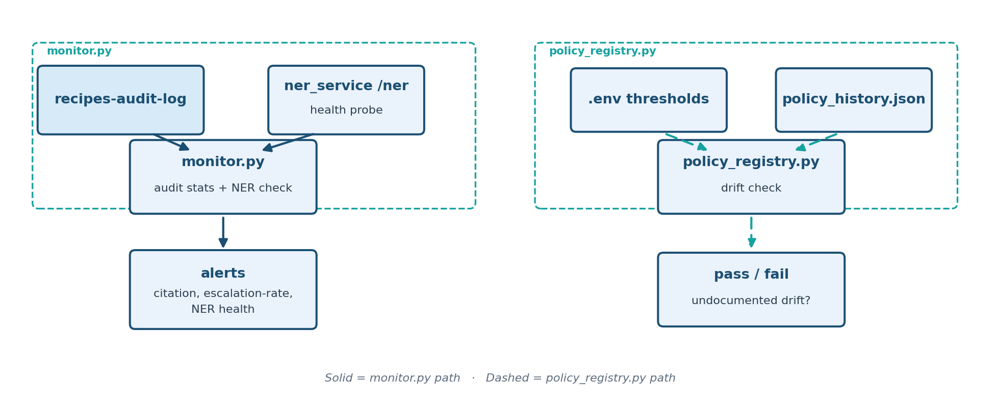

# Task 7: Operationalize Production

Unlike Baseline Vector RAG through Governance Tiering, this task is **not new RAG retrieval code**. The
underlying infrastructure (Instaclustr OpenSearch + AWS Bedrock) was adopted
all the way back in Baseline Vector RAG; this task is an **operational hardening
pass** over everything already built, expanded to cover the governance
artifacts [Governance Tiering](governance-tiering.md) introduced
(the `recipes-audit-log` audit trail, citation-validity checking, and the
hot/LT tiering policy) that didn't exist when this task was originally
scoped.

**A governance signal nobody watches is worthless.** Governance Tiering built the
record you'd need to answer "why did it say that?" — this task makes sure
someone (and something automated) is actually watching it, and that the
infrastructure underneath isn't handing out more access than it needs.


**Teaching goal:** retrieval quality (Baseline Vector RAG through Hybrid RAG (NER + Rerank)) and governance signals
(Governance Tiering) are worthless in production if nobody is watching them, nobody
controls who can write/delete them, and the infrastructure underneath is
over-privileged. This task draws an explicit line between:

- **What this task automates** — code you can actually run, with a
  `validate.py` smoke test, like every other task.
- **What stays a manual/infra checklist** — things that require
  cluster-admin or AWS-console access this codebase's app credentials
  intentionally don't hold, and so can only ever be a documented,
  reviewable checklist item, not a script.

## What you will learn

By the end, you will have run the governance monitor against the audit trail Governance Tiering wrote, checked the tiering thresholds against the approved policy history, and separated what the code automates from what stays a manual checklist item. The alert logic is [`evaluate_alerts()`](../scripts/operationalize-production/src/monitor.py) and the drift check is [`check_drift()`](../scripts/operationalize-production/src/policy_registry.py).

The practical sequence is:

| Step | Activity | Checkpoint |
| --- | --- | --- |
| [1](#step-1-enter-the-existing-workspace) | Re-enter the workspace and open the task directory. | `Makefile` and `src/` are listed. |
| [2](#step-2-start-the-ner-service-and-write-audit-data) | Start NER and run one Governance Tiering query. | NER is serving and `recipes-audit-log` has at least one record. |
| [3](#step-3-run-the-monitor-and-the-policy-check) | Run `monitor` and `policy`. | `monitor` exits `0` with no alerts, and `policy` prints `[OK]`. |
| [4](#step-4-validate) | Run the smoke test. | It prints `[PASS]` for the offline checks and a `[PASS]` or `[SKIP]` for the retention policy. |

## Understand production hardening

### Architecture



### A. Infrastructure & access control *(checklist — manual/infra action)*

These are manual items; nothing here is automated by
this task's code because they require access beyond the app's own
OPENSEARCH_USER/PASSWORD and AWS credentials in `.env`.

- **Scope IAM to the specific Bedrock model ARN(s) actually in use**, not a
  broad `bedrock:InvokeModel` grant over `*`. See
  [`src/hardening/bedrock_invoke_policy.json`](../scripts/operationalize-production/src/hardening/bedrock_invoke_policy.json)
  for the exact policy shape to attach (fill in your `.env`'s `AWS_REGION`
  / `BEDROCK_MODEL_ID`).
- **Role-based OpenSearch security** instead of one shared cluster
  credential. See [`src/hardening/opensearch_roles.json`](../scripts/operationalize-production/src/hardening/opensearch_roles.json)
  for four illustrative roles (`recipe_writer`, `recipe_reader`,
  `audit_writer`, `audit_admin`) that separate ingest/query/audit-review
  access, each documented with *why* it's scoped that way.
- **Backup / point-in-time-recovery (PITR) verification** on the
  Instaclustr cluster — confirm snapshots are configured *and* actually
  restorable (via the Instaclustr console; not something this repo's app
  credentials can check).
- **Per-tenant index isolation** — not yet applicable; this project is
  single-tenant today. Revisit if/when that changes.
- **Secrets handling** — move `.env`'s plaintext Instaclustr/AWS
  credentials to a real secrets manager (e.g. AWS Secrets Manager or SSM
  Parameter Store), loaded at process start instead of kept in a local
  file. Not wired up here since it requires provisioning AWS resources this
  repo doesn't own; the change is a few lines in `support/common/config.py`'s
  `_load_env_once()` once you have a secret to point it at.

### B. Governance-signal monitoring *(automated — [`monitor.py`](../scripts/operationalize-production/src/monitor.py))*

Governance Tiering made sure every query *writes* a governance audit record. Nothing
before this task ever *read* them back proactively. `monitor.py` queries
`recipes-audit-log` and alerts (non-zero exit code + printed detail) on:

- **Citation-validity**: any `citations_valid=False` record in the lookback
  window, with sample question/answer pairs printed for review. The
  *response policy* (block the answer? auto-retry? human review queue?) is
  a decision this surfaces but deliberately doesn't make for you — right
  now a hallucinated citation is only ever recorded, never acted on; this
  is the first step toward acting on it.
- **Escalation-rate drift**: `escalated`/`escalation_reason` rate over the
  window, alerting if it exceeds `GOVERNANCE_MAX_ESCALATION_RATE` — a
  leading indicator that newly-ingested "hot" data is missing a caution it
  should have, or that the hot/LT split has shifted unexpectedly.
- **NER service availability**: `ner_service.py` has no restart policy and
  no dedicated health route; this probes the real `/ner` endpoint and
  alerts if it isn't answering (Baseline BM25 RAG, Hybrid RAG (NER + Rerank) and Governance Tiering silently lose their entity boost
  when NER is down, rather than failing loudly; hard filters still apply).

### C. Audit-log hardening *(automated — [`validate.py`](../scripts/operationalize-production/src/validate.py) + `support/common/opensearch_client.py`)*

- **Retention / ILM policy**: `common.opensearch_client.ensure_audit_retention_policy()`
  attaches an OpenSearch Index State Management (ISM) policy to
  `recipes-audit-log` that deletes the whole index once the index is
  `AUDIT_RETENTION_DAYS` old (default 180, counted from index creation).
  It removes the index, not individual old records, so recent records go
  with it — currently the index grows unbounded with no lifecycle policy
  at all.
- **Write/delete access separation**: see the `audit_writer` /
  `audit_admin` roles in `src/hardening/opensearch_roles.json` (A, above) — an
  audit trail that the same credential can write *and* delete/edit isn't
  trustworthy for compliance.

### D. Governance-policy change control *(automated — [`policy_registry.py`](../scripts/operationalize-production/src/policy_registry.py))*

`assign_tier()`'s rule and the `TIER_MIN_HOT_SCORE` /
`TIER_MIN_HOT_CANDIDATES` thresholds it depends on (Governance Tiering) define what
counts as "safety-critical" data, yet lived only in code and `.env` with no
change history. [`src/policy_history.json`](../scripts/operationalize-production/src/policy_history.json) is the
checked-in record of every approved version; `policy_registry.py` checks
the currently configured thresholds against the latest approved entry and
fails loudly on undocumented drift. It deliberately does **not** catch
changes to `assign_tier()`'s qualitative rule itself (only the two numeric
thresholds are machine-checkable from `.env`) — a code-review requirement
on `scripts/governance-tiering/src/ingest.py`'s `assign_tier()` is the other
half of this control.

### E. General operational readiness *(checklist — manual/infra action)*

- **Latency**: already captured per-query as `latency_ms` in
  `recipes-audit-log` (Governance Tiering) — build any latency alarm from that raw
  signal rather than re-instrumenting.
- **Error rates / cost**: Bedrock invoke errors and spend are visible in
  AWS CloudWatch's `bedrock-runtime` metrics; wire a CloudWatch alarm
  against your account, not something this repo's app credentials can set
  up on their own.

## Before you begin

Complete [Task 1: Prepare the workspace](setup-environment.md). The monitor reads `recipes-audit-log`, so complete [Governance Tiering](governance-tiering.md) first. Its ingest step creates the indexes that Step 2 below queries, and Step 2 only adds one more audit record to the ones its queries already wrote. With no recent records the monitor reports an empty window instead of statistics.

Use two terminals with the `.venv` active: Terminal 1 in `scripts/baseline-bm25-rag/` for the NER service, Terminal 2 for the remaining commands. Each `python -m src.<module>` command has a matching Make target, listed in the [Operationalize Production reference](../references/operationalize-production.md#commands). `validate` calls `ensure_audit_retention_policy()`, which attaches a retention policy to `recipes-audit-log` on your cluster and needs ISM permissions; see the [operational checklist](../references/OPERATIONAL_CHECKLIST.md) for the manual items this task cannot automate.

## Step 1: enter the existing workspace

From the lab root, in Terminal 2:

```bash
source .venv/bin/activate
cd scripts/operationalize-production
ls
```

**Expected:** `Makefile` and `src`.

## Step 2: start the NER service and write audit data

Terminal 1 (a new terminal opened in the lab root; NER service, stays running — reused as `monitor.py`'s health
probe target):

```bash
source .venv/bin/activate
cd scripts/baseline-bm25-rag
python -m src.ner_service
```

**Expected:** Flask's startup message, including `Running on http://127.0.0.1:8000`.

Terminal 2 (still in `scripts/operationalize-production`; the `.venv` is already active) — run Governance Tiering first so `recipes-audit-log` has real data to
monitor (skip if you've already run Governance Tiering's `query.py` a few times; this needs Governance Tiering's ingest to have run):

```bash
cd ../governance-tiering
python -m src.query --question "Does the womensweeklyfood.com.au Fish and Chips recipe contain sulfites?"
cd ../operationalize-production
```

**Expected:** the Governance Tiering `GOVERNANCE:` and `CITATIONS:` lines, then you're back in `scripts/operationalize-production`.

This query calls your LLM provider, so it needs the same LLM settings as Governance Tiering and your provider bills the call. If it fails with an LLM error, see [Governance Tiering troubleshooting](../troubleshooting/governance-tiering.md). The commands in Steps 3 and 4 (`monitor`, `policy_registry`, `validate`) make no LLM calls.

## Step 3: run the monitor and the policy check

From `scripts/operationalize-production/`:

```bash
# B: check for governance alerts. (The audit-log retention policy from C is
# applied by `validate` in Step 4, not by `monitor`.)
python -m src.monitor

# D: check .env's tiering thresholds against the approved policy history.
python -m src.policy_registry
```

`monitor.py` exits `1` if it finds any alert (hallucinated citation,
escalation-rate drift, or an unhealthy NER service) — safe to wire into a
cron job or CI check. `policy_registry.py` exits `1` on undocumented
threshold drift.

**Expected:** `monitor` prints a `GOVERNANCE MONITOR:` summary line and `No governance alerts.`, and exits `0`. `policy_registry` prints `POLICY REGISTRY: latest approved version=1 ...` followed by `[OK] Configured TIER_MIN_HOT_SCORE / TIER_MIN_HOT_CANDIDATES match the latest approved version.`, and exits `0`. The `approved_by` value in that first line reads `'TBD -- record the actual approver here'`: the checked-in `policy_history.json` ships a placeholder, and a team using this check would replace it with a real name when approving a version. If you have only run a single Governance Tiering query on an LT-tier question, the escalation rate can exceed `GOVERNANCE_MAX_ESCALATION_RATE` (0.5) and `monitor` will correctly report an alert; that is the monitor working, not a failure of the lab.

### See the alert logic without the cluster

`monitor` needs real audit data to say anything. The decision it makes is one pure function, [`evaluate_alerts()`](../scripts/operationalize-production/src/monitor.py), so you can feed it sample numbers and watch each alert fire. The same probe then runs the policy drift check twice: against the checked-in history, and against a temporary history that approves a different score threshold. It needs no cluster, no NER service and no LLM, and writes nothing (the temporary file is deleted). Run it from `scripts/operationalize-production/`.

```bash
python - <<'PY'
import json
import tempfile
from pathlib import Path

from src.monitor import evaluate_alerts
from src.policy_registry import check_drift

clean = {"total": 10, "escalation_rate": 0.2, "citations_invalid": 0}
healthy = {"healthy": True, "status_code": 200}
cases = [
    ("clean window, NER up", clean, healthy),
    ("one hallucinated citation", {**clean, "citations_invalid": 1}, healthy),
    ("escalation rate 0.8", {**clean, "escalation_rate": 0.8}, healthy),
    ("NER down", clean, {"healthy": False, "error": "Connection refused"}),
    ("no audit records", {"total": 0}, healthy),
]
for label, stats, ner in cases:
    alerts = evaluate_alerts(stats, ner, max_escalation_rate=0.5)
    print(f"{label:28s} alerts={len(alerts)}")
    for a in alerts:
        print("   ", a)

print()
real = check_drift()
print("checked-in history: in_sync =", real["in_sync"], "| approved version", real["approved_version"])
with tempfile.TemporaryDirectory() as d:
    path = Path(d) / "history.json"
    entry = {"version": 2, "tier_min_hot_score": 20.0, "tier_min_hot_candidates": 3}
    path.write_text(json.dumps({"history": [entry]}))
    drift = check_drift(path)
    print("history approving score 20.0: in_sync =", drift["in_sync"], "| drifted =", drift["drifted"])
PY
```

**Expected:** one line per case, with the alert text under any case that fires, then the two drift results. This assumes the default `TIER_MIN_HOT_SCORE` of 15.0 and `TIER_MIN_HOT_CANDIDATES` of 3 in your `.env`; if you changed either, the checked-in history reports drift, which is the check working.

```text
clean window, NER up         alerts=0
one hallucinated citation    alerts=1
    1 of 10 answer(s) contained a hallucinated citation (citations_valid=False) -- see samples above
escalation rate 0.8          alerts=1
    escalation rate 80.0% exceeds threshold 50.0% -- possible hot/LT tiering drift (check for newly-ingested hot-tier data missing a required caution)
NER down                     alerts=1
    NER service is not responding (Connection refused) -- entity boosting is silently disabled, so ranking quality degrades (hard filters still apply)
no audit records             alerts=0

checked-in history: in_sync = True | approved version 1
history approving score 20.0: in_sync = False | drifted = {'tier_min_hot_score': {'configured': 15.0, 'approved': 20.0}}
```

Each alert is independent: a clean window with the NER service down still raises one alert, and an empty window raises none from the audit data (the NER check still applies). The NER alert exists because a missing service does not produce an error anywhere else; see [Named-entity recognition in retrieval](../concepts/NER_IN_RETRIEVAL.md#failure-and-monitoring). The drift check compares only the two numeric thresholds. It cannot see a change to the tiering rule itself, which is why the page above asks for a code review of `assign_tier()`.

## Step 4: validate

```bash
python -m src.validate
```

`validate.py` asserts:
1. **Alert decision logic** (no live services needed): a synthetic
   hallucination and a synthetic escalation-rate spike are each correctly
   flagged by `monitor.evaluate_alerts()`, and a clean/healthy input
   produces no alerts.
2. **Policy drift detection** (no live services needed): a temporary
   history file with thresholds matching `.env` is reported in-sync; one
   with different thresholds is correctly flagged as drifted.
3. **Audit retention policy** (live cluster): `ensure_audit_retention_policy()`
   runs idempotently against the real `recipes-audit-log` index. If the
   cluster's ISM plugin is unavailable, this is reported rather than
   treated as a hard failure (see A, above).
4. **Live governance stats** (live cluster): `audit_log_governance_stats()`
   returns well-formed rates (each in `[0, 1]`) against whatever real audit
   data Governance Tiering has already written.

**Expected:** `[PASS]` lines for the alert logic and the policy drift check, then either `[PASS] Operationalize Production ISM retention policy ensured on 'recipes-audit-log' (180d)` or a `[SKIP]` line if the cluster's ISM plugin is unavailable, then `[PASS] Operationalize Production audit_log_governance_stats() returned well-formed stats`.

## Completion checkpoint

You have completed Operationalize Production when `monitor` and `policy_registry` ran against real data and exited as expected, the smoke test passed (a `[SKIP]` for retention counts as a manual-review item, not a failure), and you can name which hardening items are automated (B, C, D) and which are manual (A, E). The lesson to carry forward: a governance signal only counts once something reads it on a schedule.

For why the NER health check exists and what a silent NER failure changes, see [Named-entity recognition in retrieval](../concepts/NER_IN_RETRIEVAL.md#failure-and-monitoring). For where this layer sits among the retrieval approaches, see [Choosing a retrieval approach](../concepts/CHOOSING_RETRIEVAL.md).

The [Operationalize Production source map](../references/operationalize-production.md#source-map) lists every file used here. Setup or runtime issue? See [Operationalize Production troubleshooting](../troubleshooting/operationalize-production.md)
for common fixes -- including the spaCy model error, what to check when
the monitor reports that the NER service is not responding (entity matching
silently degrades to plain full-text matching rather than erroring), missing
`.env` values, certificate errors, ISM plugin warnings, and empty audit-log
queries.

This is the last task. Return to the [task index](../README.md#tasks), or read the [operational checklist](../references/OPERATIONAL_CHECKLIST.md) for the full automated-versus-manual breakdown.
